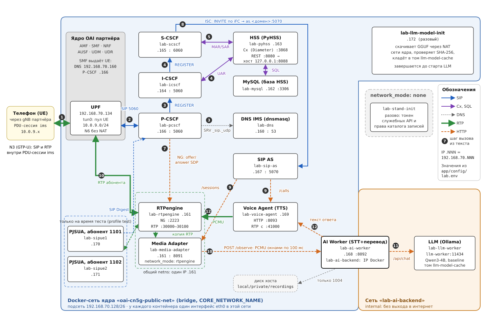

# 2. Как устроено

## Термины

| Термин | Что это |
|---|---|
| Ядро 5G (OAI CN5G) | серверы оператора: AMF (подключение телефона), SMF (выдаёт телефону адрес), UPF (пересылает пакеты телефона в сеть) |
| IMS | подсистема телефонной связи поверх IP-сети: регистрирует телефоны и соединяет звонки |
| SIP | протокол управления звонком: `REGISTER` — регистрация, `INVITE` — начать звонок, `BYE` — закончить |
| RTP | протокол передачи самого звука; идёт отдельно от SIP |
| SDP | часть SIP-сообщения, где записано, на какой адрес и порт присылать звук |
| P-CSCF | входной SIP-сервер: через него телефон общается с IMS |
| I-CSCF | при регистрации узнаёт у HSS, какой S-CSCF обслуживает абонента |
| S-CSCF | главный SIP-сервер: проверяет ключи, хранит регистрацию, решает, куда отправить звонок |
| HSS | база абонентов IMS: ключи и список услуг каждого абонента |
| AS (сервер услуг) | сервер, через который S-CSCF пропускает звонок, чтобы выполнить услугу |
| iFC | правило в профиле абонента: «звонки этого абонента отправлять на такой-то AS» |
| B2BUA | режим AS: он сам отвечает звонящему и сам делает отдельный звонок вызываемому, а между этими двумя звонками обрабатывает звук |
| STT, TTS | распознавание речи в текст и синтез речи из текста |
| PCMU | формат звука в телефонии: 8000 отсчётов в секунду. Все сервисы AI обмениваются звуком только в этом формате |

## Сервисы

Все контейнеры описаны в [docker-compose.yml](../docker-compose.yml) и подключены к
Docker-сети ядра. Адреса — из `lab.env`.

| Контейнер | Адрес | Что делает |
|---|---|---|
| `lab-dns` | .160 | DNS для имён IMS; остальные имена пересылает дальше |
| `lab-rtpengine` | .161 | через него идёт весь звук; переводит кодеки телефона (AMR) в PCMU |
| `lab-mysql`, `lab-pyhss` | .162, .163 | HSS: база абонентов и их услуг |
| `lab-icscf`, `lab-scscf`, `lab-pcscf` | .164, .165, .166 | SIP-серверы IMS (Kamailio) |
| `lab-sip-as` | .167 | сервер услуг: перевод, запись, номера услуг |
| `lab-media-adapter` | .161 (общий с RTPengine) | копирует звук звонка и передаёт его в AI Worker |
| `lab-ai-worker` | .168 | делит звук на фразы, распознаёт (Whisper), переводит (OPUS-MT или Qwen), сохраняет запись |
| `lab-voice-agent` | .169 | озвучивает текст (Piper) и отправляет звук в звонок |
| `lab-llm-worker` | только внутренняя сеть | языковая модель Qwen, только в режиме `baseline` |
| `lab-sipue1`, `lab-sipue2` | .170, .171 | тестовые SIP-телефоны (PJSUA, номера 1101, 1102); существуют только во время проверок |



## Путь одного звонка

Пример: телефон звонит на 1003 (перевод русской речи на английский).

1. Телефон подключается к 5G и открывает мобильную сессию в сети `ims`. SMF выдаёт ему
   адрес из `IMS_UE_CIDR`, адрес DNS и адрес P-CSCF.
2. Телефон регистрируется: `REGISTER` идёт через UPF на P-CSCF, оттуда на I-CSCF и
   S-CSCF. S-CSCF берёт ключи у HSS, проверяет ответ SIM и загружает список услуг
   абонента (iFC).
3. Телефон отправляет `INVITE` на 1003. P-CSCF заменяет в SDP адрес телефона на адрес
   RTPengine, поэтому весь звук звонка пойдёт через RTPengine.
4. S-CSCF по правилам iFC отправляет звонок на сервер услуг `lab-sip-as`.
5. Сервер услуг видит номер 1003 и отвечает сам. По HTTP он открывает сессию в Media
   Adapter и Voice Agent.
6. Media Adapter отправляет звук звонящего в AI Worker кусками по 100 мс.
7. AI Worker ждёт паузу 700 мс (конец фразы), распознаёт фразу и переводит её.
8. Voice Agent синтезирует перевод и отправляет звук через RTPengine обратно телефону.
9. `BYE` закрывает сессии во всех сервисах.

Обратный путь к телефону: у каждого контейнера IMS есть маршрут
`IMS_UE_CIDR via UPF_IP`, поэтому пакеты к телефону идут через UPF.

## Номера и услуги

| Номер или услуга | Что происходит |
|---|---|
| 1001, 1002 | телефоны `UE1`, `UE2` |
| 1101, 1102 | тестовые телефоны `SIPUE1`, `SIPUE2` |
| 1003 | переводчик: ваша русская речь возвращается вам по-английски |
| 1004 | запись: после звукового уведомления речь записывается и расшифровывается |
| 1005 / 1006 | двусторонний перевод: русский участник звонит на 1005, английский на 1006, каждый слышит перевод речи другого |
| услуга `translate` | звонок абоненту с другим языком автоматически идёт через переводчик; каждый слышит собеседника на своём языке |
| услуга `record` | после уведомления записываются обе стороны разговора |
| `*номер`, например `*1101` | разовый звонок через переводчик с любого телефона |

Услуги и язык абонента задаются в `lab.env`: `UE1_SERVICES=translate,record`,
`UE1_LANGUAGE=ru`. У `UE1` и `SIPUE1` — `translate,record` и русский, у `UE2` и
`SIPUE2` — без услуг и английский. Если у собеседников один язык или звонят на номер
услуги, `translate` не включается.

## Как звонок попадает в услуги

`scripts/provision.py` строит для каждого абонента правила iFC из его услуг и
записывает их в HSS. S-CSCF проходит правила по порядку приоритета:

| Приоритет | Услуга | Адрес сервера услуг |
|---|---|---|
| 10 | `translate` | `sip:translate.as.<домен>` |
| 15 | `*номер` (у всех абонентов) | `sip:translate.as.<домен>` |
| 20 | `record` | `sip:record.as.<домен>` |
| 30 | номера 1003–1006 и наблюдение за обычным звонком (у всех) | `sip:as.<домен>` |
| 40 | SMS (у всех) | `sip:smsc.<домен>` |

Правила 10–40 — для исходящих звонков абонента. Входящие правила (для вызываемого)
строятся так же; пример — `app/tests/integration/term_ifc.py`.

Все эти адреса указывают на один контейнер `lab-sip-as`. По адресу в заголовке
`Route` он выбирает модуль услуги в `app/services/sip-as/ims_sip/services/`.

Услуга `translate` работает как B2BUA. Сервер услуг отвечает звонящему сам и создаёт
отдельный звонок к вызываемому. Этот второй звонок снова проходит через S-CSCF и
остальные правила iFC. Звук обеих сторон идёт через Voice Agent, поэтому каждый
слышит только перевод.

**Если сервер услуг не отвечает.** У всех правил `DefaultHandling 0`: звонок должен
пройти без услуги. S-CSCF ждёт сервер услуг 5 с, один раз пробует следующий сервер
из списка, затем соединяет звонок напрямую. Это работает и для звонящего, и для
вызываемого. Звонок, продолжающийся после отказа, S-CSCF помечает служебным заголовком
`X-Lab-ISC-Continued` (это расширение стенда, не стандарт 3GPP).

## Запись

Звонок на 1004 и звонки абонента с услугой `record` записываются только после
звукового уведомления. Обе стороны звонка попадают в один каталог:

```text
local/private/recordings/<id звонка>/
  README.txt       уведомление о записи
  transcript.txt   текст; строки начинаются с [caller/<язык>] или [callee/<язык>]
  turn-0001.wav    звук каждой фразы
  manifest.jsonl   язык и длительность каждой фразы
  completed.json   появляется после окончания звонка
```

## Безопасность и приватность

- В журналы сервисов не пишутся номера SIM (IMSI) и текст фраз — только служебные
  идентификаторы и длительности.
- Сервисы AI общаются между собой по HTTP с внутренним токеном. Языковая модель
  доступна только во внутренней сети без выхода наружу.
- Наши сервисы (SIP AS, Media Adapter, AI Worker, Voice Agent) работают без прав
  root, с файловой системой только для чтения. Проверка — `verify-security.sh`.
