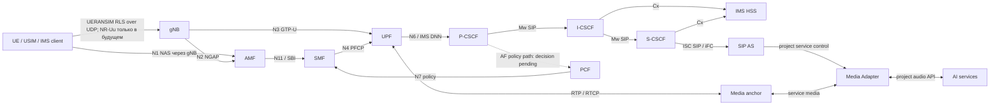

# Проверяемый профиль 5GS/IMS

Состояние: **DESIGN CANDIDATE, 2026-09-21**. Это детализация требований и порядка реализации. Ни соответствие 3GPP, ни готовность физического VoNR этим документом не объявляются.

Читайте вместе с [матрицей требований](3gpp-requirements.md), [приёмочными сценариями](3gpp-acceptance.md) и [текущим статусом](status.md).

Детализация по компонентам и порядок изменения кода: [план виртуального стенда](virtual-stand-plan.md), [core/access](virtual-core-design.md), [IMS](virtual-ims-design.md), [media/policy](virtual-media-policy-design.md), [runner/evidence](virtual-evidence-design.md).

Пользовательская граница от 2026-09-21: **сейчас только виртуальный стенд, до оборудования далеко**. Активная цель — LAB-VOICE-1 и затем SERVICE-VOICE-1 на эмуляторах. DEVICE-VOICE-1 ниже — будущая граница, не зависимость текущей работы. Покупка/подбор оборудования не входят в этот этап.

## Цель и границы

Цель — прослеживаемая реализация выбранного подмножества процедур 5GS/IMS: для каждого требования известны источник, компонент, положительная и отрицательная проверка, состояние и артефакт результата. Формулировка результата: «проверен профиль X, ревизия Y, сценарии Z», а не «весь 3GPP реализован».

Предлагаемый ориентир — Release 18. Это база проектирования, не утверждение о поддержке Release 18 всеми текущими компонентами. Набор точных версий документов ниже — рабочая библиография, ещё не согласованный нормативный baseline. До замораживания профиля сверить междокументные ссылки, применимость требований и возможности UE/сети; обновления спецификаций не применять молча.

| Профиль | Состав | Что позволяет утверждать |
|---|---|---|
| LAB-VOICE-1 | Один PLMN, один slice, один gNB, два UE, IPv4, internet/ims DNN, AKA-клиенты и отдельные аудиоклиенты, обычный вызов | Проверены выбранные сетевые и SIP-процедуры в эмуляции; не RF и не полный NG.114 |
| DEVICE-VOICE-1 | Два физических UE с собственным IMS-клиентом, выбранные USIM/ISIM, реальный NR SA gNB, согласованные адресация/защита/кодеки, QoS | Проверена совместимость конкретного оборудования в выбранном профиле |
| SERVICE-VOICE-1 | Принятый голосовой профиль + iFC/ISC, AS, OBSERVE, затем агент и переводчик | Проверены прикладные услуги поверх принятого телефонного тракта |

Идентичности и ключи у двух абонентов разные. Обычный разговор не зависит от доступности AI. Digest/PJSUA/PCMU остаются совместимым регрессионным профилем, но не засчитываются вместо AKA и native-UE сценариев.

Ограничения первого этапа: один PLMN без roaming, без EPS fallback/SRVCC, один gNB без handover, без видео/SMS/RTT, без операторского charging и emergency routing. Это отложенные области, а не автоматическое N/A: если выбранный NG.114/device-профиль требует функцию, её отсутствие блокирует утверждение о соответствии ему. В production и emergency-сети этот лабораторный профиль не позиционируется.

## Архитектура и ответственность

Диаграмма объединяет логические и транспортные связи и не является порядком пакетов. N1 — логический интерфейс UE–AMF; пользовательские Gm SIP и RTP проходят через gNB/UPF. RTPengine — выбранная реализация media anchor, его NG control API не интерфейс 3GPP. AS→Media Adapter→AI — собственные контракты проекта. UDM/UDR/AUSF обеспечивают 5GS subscriber/authentication domain; IMS HSS — отдельную IMS-роль. Наличие HSS не заменяет 5G-AKA.

| Зона | Владелец поведения | Что нельзя считать доказательством |
|---|---|---|
| 5GS access | UERANSIM либо physical gNB/UE, AMF/AUSF/UDM/SMF/UPF | Успешный ping не доказывает NAS security и QoS |
| IMS registration | UE, P/I/S-CSCF, HSS | Запись старого REGISTER 200 не доказывает живой контакт |
| IMS call | UE, CSCF, media anchor | INVITE 200 без ACK/SDP/media не доказывает разговор |
| Policy | AF/PCF/SMF/UPF/gNB/UE | Включённый модуль QoS не доказывает QFI/DRB enforcement |
| Services | AS/Media Adapter/AI | HTTP health AI не доказывает готовность IMS |
| Evidence | Test runner/SigDiag/capture | Нарисованная стрелка без источника не наблюдение |

## Решения, которые уже можно принять

1. Сохранить Docker и текущую декомпозицию; жизненный цикл маршрутов сделать управляемым независимо от запуска PJSUA.
2. Не фиксировать номер uesimtun: сопоставлять UE + PDU session + DNN + текущий адрес + интерфейс. Проверять фактический исходящий пакет.
3. Сохранить PyHSS до проверки AKA/Cx capabilities. Переход на другой HSS решать по воспроизводимому ограничению, а не названию продукта.
4. Добавить отдельный AKA test client. Тест регистрации SIPp и аудиопрогон PJSUA не выдавать за один непрерывный AKA voice-сеанс; для такого утверждения нужен клиент, выполняющий оба шага под одной принятой регистрацией.
5. Выделить инфраструктурный запуск и ready без обязательной загрузки AI-моделей. Для услуг будет отдельная готовность.
6. Закрепить upstream source/version/image/module inventory, включая локальные patches. Digest контейнера обеспечивает неизменность образа, но не заменяет документирование dev-версии Kamailio.
7. Не отключать неуспешные проверки ради общего PASS. Пропущенные стадии сохранять как NOT_TESTED.

## Что проверяется полностью виртуально

Основной состав: UERANSIM 5GS UE/gNB, Open5GS core, отдельный IMS client в namespace каждого UE, Kamailio/HSS, RTPengine, capture и AS. У UERANSIM нет встроенного полного IMS-телефона: IMS client — отдельный компонент стенда.

Кандидат основного детерминированного IMS-клиента — SIPp с проверенной AKA-поддержкой и media scenario. Сначала capability spike: REGISTER→INVITE/SDP→двусторонний PCMU→BYE с сохранением зарегистрированного endpoint и захватом RX. [SIPp media documentation](https://sipp.readthedocs.io/en/latest/media.html) описывает RTP playback, но способность конкретной сборки пройти весь наш сценарий ещё нужно проверить. PJSUA остаётся отдельным регрессионным/AI-клиентом. Если SIPp недостаточен для stateful security/media, решение о другом клиенте принимается по результату spike, а не путём подмены AKA на Digest.

Виртуально доступны: NAS/NGAP, PDU sessions, Cx, IMS AKA, SIP lifecycle, IPsec в Linux namespaces при наличии соответствующего клиента, RTP/RTCP, core-side policy/PFCP и отказоустойчивость. IPsec не требует физического телефона, поэтому T04 входит в виртуальную дорожную карту; выбор клиента остаётся открытым.

[UERANSIM Feature Set](https://github.com/aligungr/UERANSIM/wiki/Feature-Set) описывает отсутствие PHY/MAC/RLC/PDCP и ограничения session modification. Страница историческая: каждую capability сверить с закреплённой версией 3.2.6 и воспроизводимым probe. Нельзя выдавать Linux netem/traffic shaping за scheduler/DRB физического NR. Core QoS verdict и ограничения UERANSIM фиксировать раздельно; radio enforcement исключён из LAB-VOICE-1, но остаётся обязательной будущей проверкой для соответствующего physical claim.

Paging/service request сначала проверить в эмуляции, если поддерживает наша версия. Отсутствие этой возможности обозначить capability gap выбранного эмулятора; physical result из этого не выводится. Ограничения эмулятора не исправлять ослаблением обязательного теста: изменить профиль или реализацию с явной записью решения.

## Кодеки и физические устройства

Существующий внутренний контракт AI — PCMU/8000. Он остаётся неизменным в этом изменении. Для DEVICE-VOICE-1 определить обязательные codecs/SDP parameters по выбранной версии NG.114 и TS 26.114 и проверить их на устройствах; PCMU-only не объявлять достаточным.

Кандидатная граница: native UE media ↔ отдельная согласованная функция media interworking ↔ PCMU/8000 service leg. Для обычного UE↔UE разговора не навязывать AI-кодек и лишнее перекодирование. До реализации определить поддерживаемые AMR/AMR-WB/EVS modes, packetization, DTX, telephone-event/DTMF, RTCP, лицензирование/сборку выбранного кодека и стоимость задержки. RTPengine без transcoding не объявлять готовым interworking.

Если расширение внутреннего контракта даст преимущества, оформить отдельное решение и регрессию; не менять sample rate/codec незаметно для AI и тестов.

## Policy и QoS

В текущем профиле P-CSCF authorization через Rx/N5 отключена. План — сначала проверить capabilities точных версий, затем выбрать поддерживаемый путь AF↔PCF. Кандидат для 5GS — Npcf_PolicyAuthorization; Rx или interworking допускаются только при явно подтверждённой поддержке выбранного deployment. Наличие SBI listener PCF недостаточно, чтобы считать policy authorization реализованной.

Приёмка должна связать SIP dialog и SDP flows с policy association, PCC rules, SM policy, PFCP PDR/FAR/QER, QFI и настройкой radio bearer. 5QI — характеристика QoS, QFI — идентификатор потока; они не взаимозаменяемы. Проверять оба направления и удаление правил после звонка.

IMS signalling и conversational voice имеют разные стандартные QoS-характеристики; задание числа 5QI в базе не доказывает их применение. Congestion-test, параметры нагрузки, GBR/MBR, метрики и допустимые пределы нужно зафиксировать до запуска. Если UERANSIM не предоставляет нужную радиопроверку, результат обозначить CONTROL_PLANE_ONLY; физический enforcement останется отдельным условием.

## Открытые решения перед замораживанием

| ID | Требуется | До какого этапа |
|---|---|---|
| D01 | Модели/firmware gNB, UE/modem, USIM/ISIM; native IMS и доступ к диагностике | DEVICE-VOICE-1 |
| D02 | Точные версии спецификаций, NG.114 и таблица mandatory/conditional/not applicable с основаниями | Любое утверждение о standards-profile acceptance |
| D03 | IPv4/IPv6/IPv4v6 для выбранного UE; DNS и P-CSCF discovery | DEVICE-VOICE-1; IPv4-only LAB не переносить автоматически |
| D04 | Поддерживаемый эмулированным IMS client Gm security profile; отдельный выбор для будущего телефона | Виртуальная защищённая IMS-регистрация |
| D05 | Codec/SDP/interworking contract | DEVICE media |
| D06 | PCF/SMF/AF capabilities и конкретный policy path | QoS |
| D07 | Локальные timeout/quality/repetition budgets и точность часов | До соответствующего прогона |
| D08 | Роль emergency, SMS/RTT, supplementary services, mobility в итоговом профиле | До утверждения о NG.114 compatibility |

Открытое решение не препятствует исправлению recovery/gates, разделению секретов и созданию traceability. Зависимые физические проверки остаются BLOCKED с причиной, а не выбирают оборудование молча.

## Источники и точность привязки

Ссылки ниже задают области требований, а не полный постатейный compliance checklist. Детальные normative clauses/условия обязаны появиться в карточке теста до нормативного verdict. Инженерные требования recovery/run-id/AI latency обозначаются PROJECT и не приписываются 3GPP.

| Код | Рабочий источник | Область |
|---|---|---|
| S501 | [TS 23.501 V18.7.0](https://www.etsi.org/deliver/etsi_TS/123500_123599/123501/18.07.00_60/ts_123501v180700p.pdf) | 5GS architecture/QoS, таблица 5.7.4-1 |
| S502 | [TS 23.502 V18.5.0](https://www.etsi.org/deliver/etsi_ts/123500_123599/123502/18.05.00_60/ts_123502v180500p.pdf) | 4.2 registration/service request; 4.3 session management |
| S503 | [TS 23.503 V18.8.0](https://www.etsi.org/deliver/etsi_ts/123500_123599/123503/18.08.00_60/ts_123503v180800p.pdf) | Policy/charging framework; точные применимые подпункты определить для D06 |
| SIP | [TS 24.229 V18.8.0](https://www.etsi.org/deliver/etsi_ts/124200_124299/124229/18.08.00_60/ts_124229v180800p.pdf) | IMS SIP/SDP; публикация найдена, полный PDF не разобран из-за лимита инструмента |
| CX | [TS 29.228 V18.0.0](https://www.etsi.org/deliver/etsi_ts/129200_129299/129228/18.00.00_60/ts_129228v180000p.pdf) | Cx/Dx flows; AVP-level проверки дополнить TS 29.229 при D02 |
| SEC5 | [TS 33.501 V18.5.0](https://www.etsi.org/deliver/etsi_ts/133500_133599/133501/18.05.00_60/ts_133501v180500p.pdf) | 5GS security; выбранные algorithms/procedures уточнить для UE |
| SECI | [TS 33.203 V18.0.0](https://www.etsi.org/deliver/etsi_ts/133200_133299/133203/18.00.00_60/ts_133203v180000p.pdf) | Разделы 6–7: AKA, resync, security associations |
| MEDIA | [TS 26.114 V18.6.0](https://www.etsi.org/deliver/etsi_ts/126100_126199/126114/18.06.00_60/ts_126114v180600p.pdf) | Multimedia telephony media/SDP |
| POLICY | [TS 29.514 V18.6.0](https://www.etsi.org/deliver/etsi_ts/129500_129599/129514/18.06.00_60/ts_129514v180600p.pdf) | Npcf Policy Authorization API |
| NG114 | [GSMA NG.114 V10.0 publication](https://www.gsma.com/newsroom/gsma_resources/ng-114-ims-profile-for-voice-video-and-messaging-over-5gs-v-8-1/) | Interoperability profile; полный applicability review ещё не выполнен |

Дополнить при D02 stage-3 references: TS 24.501 (NAS), 38.413 (NGAP), 29.244 (PFCP), 29.281 (GTP-U), 29.229 (Cx protocol), 23.228 (IMS architecture). Их версии и конкретные clauses пока не заморожены. Само перечисление номера не считается выполненной нормативной проверкой.
