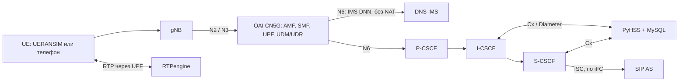

# Туториал 1. Настройка IMS и её связь с ядром 5G

Этот документ объясняет, как поднять IMS и подключить её к ядру 5G: сначала
к нашему локальному OAI CN5G, затем к уже работающему OAI другого проекта.
Работа AI поверх IMS описана во [втором туториале](guide-2-ims-ai.md),
установка и настройка SIP-серверов и клиентов — в [третьем](guide-3-sip.md).

Документ состоит из двух частей:

- **Часть 1 — только команды.** Выполните их по порядку и получите результат.
- **Часть 2 — разъяснения.** Что запущено, как это устроено, как настроить,
  проверить и починить.

Все команды выполняются из корня репозитория (папка с `README.md`,
`docker-compose.yml`, `app/` и `scripts/`). Команды Bash даны для Linux; на
Windows используйте PowerShell для Python и `.ps1`, Git Bash — для `bash ...`.

# Часть 1. Команды

## А. Локальный стенд: наше ядро OAI + IMS

Нужны Git, Python 3.12+, Docker 28+ с Compose 2.33.1+ (Linux или Windows с
Docker Desktop/WSL2).

**1. Исходники и окружение**

```bash
git clone --branch master https://git.miem.hse.ru/2508/5g-lab.git
cd 5g-lab
docker info --format '{{.OSType}}'
python3 -m venv .venv
source .venv/bin/activate
python -m pip install -r requirements-dev.txt
python scripts/quality/check.py
```

Ожидается `linux` и `TEAM OFFLINE CHECKS: PASS`.
Windows: `python -m venv .venv`, затем `.\.venv\Scripts\Activate.ps1`.

**2. Ключи и конфигурация**

```bash
python scripts/initialize_local.py
./scripts/compose.sh config --quiet
```

Вторая команда ничего не печатает. Windows: `./scripts/compose.ps1 config --quiet`.

**3. Запуск ядра и IMS**

```bash
python scripts/start_lab.py --base-only
```

Ожидается `LOCAL 5G IMS BASE: READY`.

**4. Проверка** (по одной)

```bash
bash app/tests/integration/verify.sh
bash app/tests/integration/verify-ims.sh
bash app/tests/integration/verify-ims-registration.sh
```

Каждая заканчивается `PASS`. Готово: две эмулированные UE подключены к ядру
и зарегистрированы в IMS. Дальше — AI ([туториал 2](guide-2-ims-ai.md)).

**5. Остановка** (базы сохраняются; `-v` не добавлять)

```bash
./scripts/compose.sh down
```

## Б. Ядро уже работает у партнёров: ставим только IMS (+ AI)

Нужна Linux-машина с rootful Docker 28+, Compose 2.33.1+, Python 3.12+ и
интерфейсом в LAN, которую видит N6 UPF партнёров.

**1. Партнёры вносят в свой OAI** (подробно — [раздел 6.4](#64-что-сделать-на-стороне-ядра-партнёров))

```yaml
dnns:
  - dnn: "ims"
    pdu_session_type: "IPV4"
    ipv4_subnet: "10.46.0.0/16"   # IMS-пул, без NAT
smf:
  ue_dns:
    primary_ipv4: "172.22.0.100"  # наш DNS_IP
  ims:
    pcscf_ipv4: "172.22.0.106"    # наш PCSCF_IP
```

Также: DNN `ims` в подписке абонентов, NAT только для internet-пула, маршрут
N6 → наша LAN, маршрут к IMS-пулу у шлюза.

**2. Исходники и окружение** — как в шаге А1.

**3. Узнать интерфейс и сеть машины**

```bash
ip -br link
ip -br addr
ip route
```

**4. Заполнить `app/config/lab.env`** (пример; подставьте свои значения)

```dotenv
MCC=001
MNC=01
IMS_DOMAIN=ims.mnc001.mcc001.3gppnetwork.org
IMS_DNN=ims
IMS_UE_CIDR=10.46.0.0/16
INTERNET_UE_CIDR=10.45.0.0/16
LAB_NETWORK_CIDR=172.22.0.0/24
LAB_DYNAMIC_IP_RANGE=172.22.0.128/25
IMS_PARENT_INTERFACE=ens192
IMS_ROUTE_GATEWAY=172.22.0.1
UE1_IMSI=001010000000001
UE2_IMSI=001010000000002
```

`IMS_ROUTE_GATEWAY` — адрес в этой LAN, через который достижим IMS-пул (UPF
или маршрутизатор). Адреса сервисов (`DNS_IP`, `PCSCF_IP`, `RTPENGINE_IP` и др.)
должны лежать в `LAB_NETWORK_CIDR` и совпадать с тем, что указано в SMF.

**5. IMS-ключи и проверка конфигурации**

```bash
python scripts/initialize_local.py --ims-only
python scripts/start_partner.py --check
```

Ожидается `PARTNER CONFIG: VALID`. IMS-ключи абонентов из
`local/secrets/ims.env` передайте в их IMS-клиенты/ISIM защищённым способом.

**6. Запуск IMS без AI**

```bash
python scripts/start_partner.py --ims-only
docker compose --env-file app/config/lab.env --env-file local/secrets/ims.env -f compose.partner.yml ps
```

Ожидается `PARTNER SERVICES: STARTED`, все сервисы `Up`/`healthy`.

**7. Проверка с телефона/UE партнёров**

Зарегистрируйте UE в 5G, затем смотрите:

```bash
docker logs --tail 200 lab-pcscf
docker logs --tail 200 lab-scscf
```

Должны быть `REGISTER`, `401`, затем `200`. Позвоните UE1 → UE2 и проверьте
звук; затем:

```bash
docker logs --tail 50 lab-rtpengine
```

Если что-то не прошло — [проверка по шагам вызова](#67-проверка-по-шагам-вызова).

**8. Включить AI** — [туториал 2, часть 1, вариант В](guide-2-ims-ai.md#в-ядро-партнёров).

**9. Остановка**

```bash
docker compose --env-file app/config/lab.env --env-file local/secrets/ims.env -f compose.partner.yml down
```

# Часть 2. Разъяснения

## 1. Что именно мы связываем



| Часть | Что делает | Адрес по умолчанию (`lab.env`) |
| --- | --- | --- |
| OAI CN5G v2.2.1 | NRF, AMF, SMF, UPF, AUSF, UDM, UDR и своя MySQL `oai-db`; выдаёт абонентам PDU-сессии `internet` и `ims` | UPF `172.22.0.3` |
| UERANSIM | Эмулятор gNB и двух UE (только для локального стенда) | — |
| DNS (dnsmasq) | Зона IMS-домена: `pcscf.`, `icscf.`, `scscf.`, `hss.`, `as.`, SRV-записи `_sip._udp` | `DNS_IP=172.22.0.100` |
| P-CSCF | Точка входа UE в IMS, привязка медиа к RTPengine | `PCSCF_IP=172.22.0.106`, порт 5060 |
| I-CSCF | Выбор S-CSCF при регистрации, запросы к HSS | `ICSCF_IP=172.22.0.104`, порт 5060 |
| S-CSCF | Регистратор, аутентификация, маршрутизация и вызов AS по iFC | `SCSCF_IP=172.22.0.105`, порт 6060 |
| PyHSS + MySQL | IMS HSS: идентификаторы, ключи IMS AKA, iFC; интерфейс Cx | `PYHSS_IP=172.22.0.103` |
| RTPengine | Медиа-якорь, передаёт RTP, транскодирует AMR/AMR-WB ↔ PCMU | `RTPENGINE_IP=172.22.0.101`, RTP 30000–30100 |

Ключевое правило: **OAI UDM/UDR и IMS HSS — разные базы**. Ядро отвечает за
доступ в сеть 5G (5GS-ключи, PDU-сессии), IMS HSS — за телефонную регистрацию
(IMS-ключи, IMPI/IMPU, iFC). IMS не нужен доступ к SQL-базе OAI, NRF, N2/N3/N4.
Связь между ними сводится к четырём вещам:

1. **IMS DNN.** Абонент получает в ядре отдельную PDU-сессию `ims` с адресом
   из пула `IMS_UE_CIDR` (`10.46.0.0/16`).
2. **Обнаружение.** SMF сообщает UE адреса DNS и P-CSCF (PCO/EPCO).
3. **Маршрутизация N6.** Пакеты из IMS-пула идут от UPF к сервисам IMS и обратно
   **без NAT** и без SIP ALG: SIP и SDP должны содержать реальный адрес UE.
4. **Медиа.** RTP идёт через UPF к RTPengine и обратно.

В этот лабораторный профиль не входят N5/Rx (политики PCF), выделенные QoS-потоки,
полная защита Gm (IPsec) и гарантии VoNR на физической радиосети.

## 2. Подготовка машины

Нужны Git, Python 3.12+, Docker Engine 28+ и Compose 2.33.1+ с Linux-контейнерами
(конфигурация использует `include`, `!override` и `gw_priority`).

- **Windows:** Python, Git for Windows с Git Bash, Docker Desktop с WSL2.
- **Linux:** Git, Python с модулем venv, Docker Engine с Compose plugin, ядро с SCTP.
  `docker info` должен работать без `sudo` из того же терминала.
- macOS текущим launcher не поддерживается. Проверенный хост — x86-64, i5-12400F;
  ARM не проверен. Минимальный объём RAM всего стенда пока не измерен.

```bash
git clone --branch master https://git.miem.hse.ru/2508/5g-lab.git
cd 5g-lab
docker info --format '{{.OSType}}'
docker compose version
```

Ожидается `linux`. Затем окружение Python и offline-проверка исходников.

Linux:

```bash
python3 -m venv .venv
source .venv/bin/activate
python -m pip install -r requirements-dev.txt
python scripts/quality/check.py
```

Windows PowerShell:

```powershell
python -m venv .venv
.\.venv\Scripts\Activate.ps1
python -m pip install -r requirements-dev.txt
python scripts/quality/check.py
```

Если PowerShell блокирует `Activate.ps1`, не меняйте политику системы: вызывайте
`.\.venv\Scripts\python.exe` напрямую. Ожидается `TEAM OFFLINE CHECKS: PASS`.

## 3. Конфигурация и секреты

| Файл | Что в нём | В Git |
| --- | --- | --- |
| `app/config/lab.env` | Все публичные параметры: сети, адреса, IMS-домен, порты, номера, образы, модели | Да |
| `local/secrets/ims.env` | Ключи 5GS и IMS абонентов, пароли БД, машинные overrides | Нет |
| `local/oai/*.yaml` | Конфигурации OAI, генерируются из двух файлов выше | Нет |
| `app/config/ims.env.example` | Шаблон секретов (значения `replace-*` не использовать) | Да |

Основные параметры связи IMS с ядром:

| Параметр | Значение по умолчанию | Смысл |
| --- | --- | --- |
| `MCC`, `MNC` | `001`, `01` | PLMN |
| `IMS_DOMAIN` | `ims.mnc001.mcc001.3gppnetwork.org` | Домашний IMS-домен, realm |
| `INTERNET_DNN`, `IMS_DNN` | `internet`, `ims` | Имена DNN |
| `UE_PDU_SST` | `1` | S-NSSAI SST |
| `INTERNET_UE_CIDR` | `10.45.0.0/16` | Пул internet; NAT включён только для него |
| `IMS_UE_CIDR`, `IMS_UE_GATEWAY` | `10.46.0.0/16`, `10.46.0.1` | Пул IMS без NAT |
| `LAB_NETWORK_CIDR` | `172.22.0.0/24` | LAN сервисов; статические адреса `.100`–`.110` |
| `LAB_DYNAMIC_IP_RANGE` | `172.22.0.128/25` | Динамический диапазон Docker |
| `IMS_PARENT_INTERFACE`, `IMS_ROUTE_GATEWAY` | пусто | Только для внешнего ядра (раздел 6) |
| `UE1_IMSI`, `UE2_IMSI`, `UE1_MSISDN`, `UE2_MSISDN` | `…0001`, `…0002`, `1001`, `1002` | Тестовые абоненты |

Подсети Docker, IMS и internet не должны пересекаться с LAN/VPN машины. При смене
LAN меняйте **все** статические адреса согласованно. Полный перечень всех 246
параметров — [lab-env-reference.md](lab-env-reference.md).

Создать недостающие ключи и конфигурации OAI (существующие ключи сохраняются):

```bash
python scripts/initialize_local.py
```

Проверить итоговую конфигурацию Compose (Windows — `./scripts/compose.ps1`):

```bash
./scripts/compose.sh config --quiet
```

Успешная команда ничего не печатает. Полный вывод `compose config` не публикуйте:
в нём есть секреты.

### Как применяются настройки

- Compose читает `lab.env`, затем `local/secrets/ims.env`; переменные shell
  имеют более высокий приоритет. Обёртки `scripts/compose.ps1` / `compose.sh`
  подключают оба файла, «голый» `docker compose` — нет.
- После изменения env нужен `up -d` с пересозданием сервиса, для build args — ещё
  `build`. `restart` оставляет старое окружение.
- После изменения публичных параметров ядра повторите
  `python scripts/initialize_local.py` и перезапустите соответствующие NF.

## 4. Вариант А: локальное ядро OAI + IMS

Запуск только сети и телефонии, без AI:

```bash
python scripts/start_lab.py --base-only
```

Launcher выполняет по порядку:

1. Подготавливает SCTP (в Docker Desktop — через `scripts/prepare-host.ps1`).
2. Собирает образы и поднимает OAI CN5G, UERANSIM gNB и две UE.
3. Создаёт абонентов в OAI UDR (`scripts/oai_subscribers.py`): новые записи
   добавляются, ключи и SQN существующих не перезаписываются.
4. Создаёт абонентов, APN и iFC в PyHSS (`scripts/provision-ims-subscribers.sh`).
5. Поднимает DNS, PyHSS, P/I/S-CSCF и RTPengine, ждёт установления Cx.
6. Выполняет три базовые проверки: сеть и UE, IMS-маршруты и DNS, регистрацию.

Ожидаемый итог — `LOCAL 5G IMS BASE: READY`. Он означает: у обеих UE есть
PDU-сессии internet и ims, DNS и маршруты к IMS работают, оба SIP-клиента
зарегистрированы.

### Как в локальном стенде устроена связь ядра и IMS

- **UPF.** Режим simple-switch, один `tun0` для обоих DNN. Общий SNAT OAI
  отключён; wrapper UPF при каждом старте (и при `docker restart`) включает NAT
  только для internet-пула и ставит маршрут к IMS-шлюзу. Healthcheck UPF
  проверяет TUN и UDP-слушатели N3/N4, но не прохождение RTP.
- **SMF.** Выдаёт DNS и P-CSCF из `DNS_IP` и `PCSCF_IP`. Шаблон закреплён в
  [oai_config.py](../scripts/oai_config.py); SBI работает по HTTP/1.1
  (обход ошибки обработчика HTTP/2 в OAI 2.2.1), таймаут — `OAI_HTTP_TIMEOUT_MS`.
  Отсутствующий SD хранится в подписке как `FFFFFF`.
- **UE.** UERANSIM создаёт отдельный TUN (`uesimtun*`) на каждую PDU-сессию.
  SIP-клиент находит IMS-TUN по адресу из `IMS_UE_CIDR` и ставит маршруты /32
  к P-CSCF и RTPengine через этот TUN. Так SIP и RTP действительно проходят
  через PDU-сессию, а не через общий Docker bridge.
- **CSCF, DNS, RTPengine** получают обратные маршруты к пулам UE.

Уровень логов OAI — warning: info/debug могут содержать ключи и векторы
аутентификации. Не включайте такие логи в передачу.

## 5. Абоненты и ключи

| Ключи | Где | Назначение |
| --- | --- | --- |
| `UE*_5GS_K`, `UE*_5GS_OPC`, `UE*_5GS_AMF` | secrets → OAI UDR | Доступ в сеть 5GS; только для нашего локального OAI |
| `UE*_IMS_K`, `UE*_IMS_OPC`, `UE*_IMS_AMF` | secrets → PyHSS AuC | IMS AKA |
| `IMS_DIGEST_PASSWORD` | secrets | Лабораторный fallback Digest |
| `OAI_DB_PASSWORD`, `OAI_DB_ROOT_PASSWORD` | secrets | Создаются автоматически |

K и OPc — 32 hex-символа, поле AMF — 4 hex-символа (это поле Milenage, не функция
AMF). Новые профили имеют независимые 5GS- и IMS-ключи.

Идентификаторы IMS формирует provisioning:

- IMPI: `<IMSI>@ims.mnc<MNC>.mcc<MCC>.3gppnetwork.org`;
- IMPU: `sip:<MSISDN>@<домен>`, `tel:<MSISDN>`, `sip:<IMSI>@<домен>`.

Правила:

- Существующие базы при provisioning не перезаписываются; несовпадение ключей
  требует явной миграции с backup.
- **SQN не сбрасывать** для обхода ошибки аутентификации.
- `scripts/migrate_subscriber_keys.py` относится только к прежнему Open5GS,
  к OAI UDR его не применять.
- Ключи настоящих SIM передаются по защищённому каналу, не через документацию.

## 6. Вариант Б: подключение IMS + AI + SIP к уже работающему ядру

Этот раздел — пошаговая инструкция для случая, когда у партнёров уже есть
работающее ядро OAI, радиосеть и абоненты, а мы ставим рядом только свою часть:
DNS, PyHSS/MySQL, P/I/S-CSCF, RTPengine, SIP AS и AI. Наше ядро, gNB и UE
в этом варианте **не запускаются**. Состав задаёт
[compose.partner.yml](../compose.partner.yml).

### 6.1. Как это понимать: три слоя

Самая частая ошибка — ожидать, что IMS «подключается к ядру» каким-то
специальным интерфейсом. Это не так. Связь устроена слоями:

| Слой | Что передаёт | Кто отвечает | Что видит соседний слой |
| --- | --- | --- | --- |
| **1. Ядро 5G (IP-транспорт)** | Только IP-пакеты UE. Выдаёт UE адрес из IMS-пула, сообщает адреса DNS и P-CSCF, отправляет пакеты через UPF (N6) в нашу LAN | Партнёры (их OAI) | Ядро не разбирает SIP и не знает про AI |
| **2. IMS (SIP-сигнализация)** | REGISTER, INVITE, BYE между UE и нашими CSCF; аутентификация через наш HSS; вызов SIP AS по iFC | Мы (Kamailio, PyHSS) | Для ядра SIP — просто UDP/TCP на порт 5060 нашего P-CSCF |
| **3. Медиа и AI (RTP и речь)** | Звук UE ↔ RTPengine; копия звука в AI; синтезированный ответ обратно | Мы (RTPengine, SIP AS, Media Adapter, AI Worker, Voice Agent) | Для ядра RTP — просто UDP на порты 30000–30100 RTPengine |

Отсюда правило: **со стороны ядра нужны только IP-сессия, адреса DNS/P-CSCF и
маршруты в обе стороны без NAT**. Нашему IMS не нужен доступ к SQL ядра, NRF,
N2/N3/N4; ядру не нужен доступ к нашим Cx, SQL, RTPengine NG и AI HTTP.
5GS-ключи абонентов остаются у партнёров (UDR и SIM); IMS-ключи — у нас (PyHSS)
и в IMS-клиенте/ISIM.

### 6.2. Один вызов с начала до конца

Так выглядит вызов абонента на номер перевода 1003 через ядро партнёров.
Каждая строка — место, где можно проверить работу (раздел 6.7).

| Шаг | Что происходит | Слой | Где это задано |
| --- | --- | --- | --- |
| 1 | UE регистрируется в 5G и открывает PDU-сессию DNN `ims`, получает адрес, например `10.46.0.5` | 1 | OAI партнёров: DNN и пул в SMF, подписка в UDR |
| 2 | SMF сообщает UE DNS `172.22.0.100` и P-CSCF `172.22.0.106` | 1 | SMF партнёров: `ue_dns`, `ims.pcscf_ipv4` |
| 3 | UE отправляет SIP REGISTER на P-CSCF; пакет идёт gNB → UPF → N6 → наша LAN | 1 → 2 | Маршрут N6 → `LAB_NETWORK_CIDR` у партнёров |
| 4 | P-CSCF → I-CSCF (по DNS-домену) → запрос в HSS (Cx) → S-CSCF | 2 | Наш DNS, PyHSS |
| 5 | S-CSCF отвечает `401` с challenge, UE повторяет REGISTER с ответом, получает `200 OK` | 2 | Ключи абонента в PyHSS и в клиенте/ISIM |
| 6 | Ответы идут обратно к `10.46.0.5`: наши контейнеры отправляют их на `IMS_ROUTE_GATEWAY`, дальше в UPF | 2 → 1 | Маршрут `IMS_UE_CIDR via IMS_ROUTE_GATEWAY` у нас и маршрут к пулу у шлюза |
| 7 | UE звонит на 1003: INVITE → P-CSCF. P-CSCF через RTPengine подменяет адрес медиа в SDP на `172.22.0.101:<порт>` | 2 → 3 | P-CSCF `rtpengine_manage()` |
| 8 | S-CSCF по iFC отправляет исходящий INVITE на `as.<домен>:5070` (SIP AS) | 2 | `default_ifc.xml` в PyHSS |
| 9 | SIP AS видит номер услуги, отвечает от имени Voice Agent, сообщает Media Adapter и Voice Agent Call-ID | 2 → 3 | `VOICE_*_MSISDN` в `lab.env` |
| 10 | Звук UE: UE → UPF → RTPengine. Media Adapter берёт копию, отправляет в AI Worker окнами по 100 мс | 3 | Порты `RTPENGINE_PORT_MIN`–`MAX` |
| 11 | AI Worker: реплика по паузе → STT → перевод; Voice Agent синтезирует голос | 3 | Режим AI ([туториал 2](guide-2-ims-ai.md)) |
| 12 | Voice Agent отправляет PCMU на RTPengine, тот — на `10.46.0.5` через шлюз и UPF; UE слышит перевод | 3 → 1 | Тот же обратный маршрут, что в шаге 6 |

Для обычного вызова 1001 → 1002 шаги 8–9 другие: SIP AS лишь наблюдает и
пересылает INVITE обратно в S-CSCF, звук идёт UE ↔ RTPengine ↔ UE. Если AS или AI
недоступны, обычный вызов продолжается (`DefaultHandling 0` в iFC).

Важное следствие шага 7: SIP AS **отклоняет вызов на номер услуги**, если адрес
медиа в SDP — не RTPengine. Поэтому UE должен попадать в IMS только через наш
P-CSCF; обход P-CSCF не работает.

### 6.3. Выбрать сетевую схему

Наши контейнеры подключаются к LAN партнёров через **macvlan**: у каждого свой
адрес в этой LAN, как у отдельной машины.

| Схема | Условие |
| --- | --- |
| OAI партнёров и наш IMS на разных Linux-машинах/ВМ | Общая LAN/VLAN; на vSwitch разрешены дополнительные MAC; маршруты в обе стороны |
| OAI партнёров и наш IMS на одной Linux ВМ | N6 их UPF должен достигать LAN macvlan. Хост сам не видит свои macvlan-контейнеры: нужен общий L2-сегмент или маршрутизатор |

Ограничения: только Linux и rootful Docker (Docker Desktop под Windows этот вариант
не покрывает); нельзя запускать локальный стенд и партнёрский состав на одном
Docker daemon — имена контейнеров и томов общие.

### 6.4. Что сделать на стороне ядра партнёров

Это изменения в **их** OAI. Наши скрипты ядро партнёров не меняют.

**1. DNN `ims` с отдельным пулом.** В конфигурации OAI (формат v2.x):

```yaml
dnns:
  - dnn: "internet"
    pdu_session_type: "IPV4"
    ipv4_subnet: "10.45.0.0/16"
  - dnn: "ims"
    pdu_session_type: "IPV4"
    ipv4_subnet: "10.46.0.0/16"
```

DNN `ims` также должен быть в `smf_info` и `upf_info` для нужного S-NSSAI.

**2. Адреса DNS и P-CSCF в SMF** — наши:

```yaml
smf:
  ue_dns:
    primary_ipv4: "172.22.0.100"
    secondary_ipv4: "172.22.0.100"
  ims:
    pcscf_ipv4: "172.22.0.106"
```

Если тот же DNS нужен и для internet, следите, чтобы он был доступен из обоих пулов.

**3. Подписка абонента.** В UDR у абонента разрешены DNN `ims` и S-NSSAI.
Без этого UE получит только internet и в IMS не попадёт.

**4. Без NAT для IMS-пула.** Если UPF делает SNAT (`enable_snat: yes`), IMS-трафик
придёт к нам с адреса UPF, а SIP/SDP будут содержать адрес UE — звонок сломается.
NAT допускается только для internet-пула. Так сделано в нашем локальном стенде:
общий SNAT выключен, а [oai-upf-network.sh](../scripts/oai-upf-network.sh)
добавляет `MASQUERADE` только для `INTERNET_UE_CIDR`.

**5. Маршрут N6 → наша LAN.** UPF (или маршрутизатор за его N6) должен знать, что
`LAB_NETWORK_CIDR` (например `172.22.0.0/24`) достижима через интерфейс N6.

**6. Маршрут к IMS-пулу у шлюза.** Адрес, который мы укажем как
`IMS_ROUTE_GATEWAY`, должен пересылать пакеты для `IMS_UE_CIDR` в UPF. Если это
сам UPF в нашей LAN — достаточно пункта 5. Если маршрутизатор — на нём:

```bash
ip route add 10.46.0.0/16 via <адрес N6 UPF>
```

**7. Без SIP ALG и фильтров** на пути UE ↔ наша LAN для UDP/TCP 53, 5060 и
UDP 30000–30100.

После изменений партнёры перезапускают SMF/UPF по своей процедуре.

### 6.5. Что заполнить у нас

Все значения — в `app/config/lab.env`; ключи — в `local/secrets/ims.env`.

| Параметр | Что вписать | Должно совпасть с |
| --- | --- | --- |
| `MCC`, `MNC` | PLMN партнёров | Их AMF/SMF и SIM |
| `IMS_DOMAIN` | Согласованный домен, обычно `ims.mnc<MNC>.mcc<MCC>.3gppnetwork.org` | Настройки IMS-клиента/ISIM |
| `IMS_DNN` | `ims` (или их имя) | DNN в SMF партнёров |
| `IMS_UE_CIDR` | Их IMS-пул | `ipv4_subnet` DNN `ims` |
| `INTERNET_UE_CIDR` | Их internet-пул | `ipv4_subnet` DNN `internet` |
| `LAB_NETWORK_CIDR` | LAN/VLAN для наших контейнеров | Маршрут N6 у партнёров; не пересекается с пулами UE |
| `LAB_DYNAMIC_IP_RANGE` | Свободный диапазон этой LAN, исключённый из DHCP | — |
| `DNS_IP`, `PCSCF_IP`, `RTPENGINE_IP`, `*_IP` | Свободные статические адреса в этой LAN | `ue_dns` и `pcscf_ipv4` в SMF |
| `IMS_PARENT_INTERFACE` | Имя интерфейса Linux в этой LAN (`ip -br link`) | — |
| `IMS_ROUTE_GATEWAY` | Адрес в этой LAN, через который достижим IMS-пул (UPF или маршрутизатор) | Пункт 6 раздела 6.4 |
| `UE1_IMSI`, `UE2_IMSI`, `UE1_MSISDN`, `UE2_MSISDN` | IMSI и номера двух тестовых абонентов | SIM/клиенты партнёров |
| `UE*_IMS_K`, `UE*_IMS_OPC`, `UE*_IMS_AMF` (secrets) | IMS-ключи | IMS-клиент/ISIM; передаются защищённо |

Что делают эти значения автоматически:

- `IMS_ROUTE_GATEWAY` становится шлюзом macvlan-сети; init-скрипты DNS, P-CSCF,
  S-CSCF и RTPengine ставят `ip route replace <IMS_UE_CIDR> via <IMS_ROUTE_GATEWAY>`,
  P-CSCF и RTPengine — также маршрут к `INTERNET_UE_CIDR`. Указание шлюза **не
  настраивает сам шлюз**: пункт 6 раздела 6.4 остаётся за партнёрами.
- `start_partner.py --check` проверяет, что все адреса уникальны и лежат в
  `LAB_NETWORK_CIDR`, шлюз в той же сети, а пул UE с ней не пересекается.
- Provisioning создаёт абонентов в PyHSS с iFC на SIP AS.

Пример адресного плана (не готовые адреса другого проекта):

```dotenv
LAB_NETWORK_CIDR=172.22.0.0/24
LAB_DYNAMIC_IP_RANGE=172.22.0.128/25
IMS_PARENT_INTERFACE=ens192
IMS_ROUTE_GATEWAY=172.22.0.1
DNS_IP=172.22.0.100
RTPENGINE_IP=172.22.0.101
PCSCF_IP=172.22.0.106
IMS_UE_CIDR=10.46.0.0/16
INTERNET_UE_CIDR=10.45.0.0/16
```

Здесь `172.22.0.1` — N6-сторона UPF или маршрутизатор к нему. При другой LAN
меняйте **все** статические адреса сервисов.

### 6.6. Запуск по шагам

На Linux-машине с Docker 28+, Compose 2.33.1+, Python 3.12+:

```bash
python scripts/initialize_local.py --ims-only
python scripts/start_partner.py --check
```

Ожидается `PARTNER CONFIG: VALID`. Затем только IMS (без AI), чтобы сначала
проверить сигнализацию:

```bash
python scripts/start_partner.py --ims-only
```

Скрипт поднимает DNS, MySQL, PyHSS, I/S/P-CSCF и RTPengine, создаёт абонентов и
iFC, ждёт Cx. Выполните проверки 6.7, шаги 1–5. Затем включите AI:

```bash
python scripts/start_partner.py
```

или CPU-режим без Qwen (после [подготовки OPUS](guide-2-ims-ai.md#42-compact-без-qwen-локальный-стенд)):

```bash
python scripts/compose_ai.py --mode compact --partner up -d --build
python scripts/compose_ai.py --mode compact --partner ps
```

Обслуживание — только с явным файлом партнёрского состава:

```bash
docker compose --env-file app/config/lab.env --env-file local/secrets/ims.env -f compose.partner.yml ps
```

Обычные `compose.ps1` / `compose.sh` относятся к локальному составу с OAI.
Надпись `PARTNER SERVICES: STARTED` означает только запуск процессов.

### 6.7. Проверка по шагам вызова

Проверяйте по порядку; не переходите дальше, пока шаг не прошёл. Номера — шаги
из таблицы 6.2. Команды `docker exec` выполняются на нашей машине.

| Шаг | Что проверить | Как |
| --- | --- | --- |
| 1–2 | У UE есть IMS PDU-адрес из `IMS_UE_CIDR`, DNS и P-CSCF — наши | Журналы SMF партнёров; на UE — сведения о сессии `ims` |
| 3 | Пакеты UE доходят до нас | `docker exec lab-pcscf ip route` (маршрут к пулу через шлюз); захват на P-CSCF: `docker exec lab-pcscf tcpdump -ni any port 5060` (если в образе есть tcpdump) или захват на `IMS_PARENT_INTERFACE` хоста |
| 3 | DNS отвечает с адреса UE | С UE: запрос `pcscf.<IMS_DOMAIN>` к `DNS_IP` |
| 4–5 | REGISTER завершается `200 OK` | `docker logs --tail 200 lab-pcscf` (затем `lab-icscf`, `lab-scscf`, `lab-pyhss`): видны REGISTER, `401` и `200` |
| 6 | Ответы уходят к UE, а не теряются | Если UE видит повторы REGISTER без ответа — проверьте пункт 6 раздела 6.4 (маршрут к пулу у шлюза) |
| 7 | Обычный вызов UE1 → UE2: INVITE/200/ACK/BYE, звук в обе стороны | `docker logs lab-rtpengine` — сессия с адресами обоих UE |
| 8 | S-CSCF вызвал AS | `docker logs lab-sip-as`: `AS observed INVITE call_id=...` |
| 9 | Вызов на 1003 попал в услугу | `docker logs lab-sip-as`: `AS terminated INVITE for voice agent ...`; при `AS rejected unanchored media` — медиа не через RTPengine (шаг 7) |
| 10 | Звук дошёл до AI | `docker logs --since 2m lab-media-adapter lab-ai-worker` |
| 11–12 | Ответ синтезирован и отправлен | `docker logs --since 2m lab-voice-agent`: `reason=greeting state=sent`, затем ответы; UE слышит приветствие и перевод |

Затем: вызов на 1004 (запись появляется в `local/private/recordings/`), пара
1005/1006, остановка AI при обычном вызове (звук не пропадает), повтор после
перезапуска IMS и перерегистрации. SQN не сбрасывать.

Если шаг не прошёл — ищите причину в слое этого шага (таблица 6.1): нет IP-сессии
или маршрута — ядро и сеть; есть пакеты, но нет `200 OK` — IMS и ключи; есть
вызов, нет звука или перевода — медиа и AI. Смена модели AI не исправит проблему
ядра или SIP.

Порты на границе (всё остальное — внутреннее и наружу не открывается):

| Поток | Порты |
| --- | --- |
| UE → DNS | UDP/TCP 53 |
| UE ↔ P-CSCF | `PCSCF_SIP_PORT` (5060), UDP/TCP |
| UE ↔ RTPengine | UDP `RTPENGINE_PORT_MIN`–`RTPENGINE_PORT_MAX` (30000–30100) |

## 7. Проверка связи IMS с ядром

### Локальный стенд

Запускать по одной, на свободном стенде (Windows — через Git Bash):

```bash
bash app/tests/integration/verify.sh
bash app/tests/integration/verify-ims.sh
bash app/tests/integration/verify-ims-registration.sh
```

| Скрипт | Что проверяет |
| --- | --- |
| `verify.sh` | Базовая сеть и подключение UE |
| `verify-ims.sh` | IMS-маршруты, DNS, необходимые компоненты |
| `verify-ims-registration.sh` | Регистрация двух SIP-абонентов через IMS |

Проверка восстановления IMS PDU-сессии (на свободном стенде с остановленными AS/AI):

```bash
python app/tests/integration/verify_pdu_recovery.py --ue 1
```

Она освобождает IMS PDU-сессию UE, ждёт восстановления с новым адресом и новым
TUN, проверяет маршруты SIP/RTP и новый `REGISTER 200`. Internet-сессия и
второе UE не должны пострадать.

### Внешнее ядро

Проверка по шагам вызова — [раздел 6.7](#67-проверка-по-шагам-вызова).
Локальные скрипты используют контейнеры `lab-ue*`/`lab-sipue*` и не проверяют
телефоны партнёров. Для партнёрской приёмки нужны их UE, трассы на границах и
протокол результатов: дата, версии, топология, команды, результат. `FAIL`
остаётся `FAIL` даже после успешного повтора.

## 8. Диагностика

Проверяйте по цепочке: Docker → ядро/PDU → DNS/маршруты → REGISTER → звонок.

| Симптом | Что проверить |
| --- | --- |
| Compose не понимает `include`, `!override`, `gw_priority` | Версии Docker/Compose |
| UE не подключается, нет SCTP | Журналы AMF/gNB/UE, поддержка SCTP ядром Linux/WSL2 |
| У UE нет IMS PDU | IMS DNN/S-NSSAI в подписке, SMF и UE; не путать internet и ims |
| REGISTER без ответа | Адреса DNS/P-CSCF, обратный маршрут к IMS-пулу, порт SIP, firewall |
| REGISTER отклоняется | IMPI/IMPU, realm, способ аутентификации, ключи, журналы Cx |
| `signal lost`, тайм-ауты `Service Request`, `UE context already exists` | Журналы UE/gNB, `verify-ims.sh`; перезапустить `gnb ue1 ue2`, затем пересоздать `sipue1 sipue2` |
| Контейнер перезапускается | `docker stats --no-stream`, `docker inspect --format '{{.State.OOMKilled}}' <контейнер>`, лимит ВМ/WSL2 |

Работающий контейнер не гарантирует живую сессию. После перезапуска радиочасти
SIP-клиенты нужно пересоздать, чтобы сокеты привязались к новым IMS-адресам.

## 9. Остановка, обновление, откат

Остановка с сохранением баз и кэшей (Windows — `./scripts/compose.ps1 down`):

```bash
./scripts/compose.sh down
```

**`down -v` не использовать:** он удаляет тома с базами OAI и IMS.

Обновление:

1. Зафиксировать commit, версии образов, конфигурацию и результаты проверок;
   завершить вызовы.
2. Приватно сохранить `local/secrets/ims.env`.
3. Согласованно сохранить тома IMS MySQL и OAI DB. Копия файлов работающей MySQL
   не является резервной копией: сначала остановить потребителей и БД.
4. Обновить исходники, пересобрать образы, повторить запуск.
5. Повторить проверки раздела 7. При откате учитывать схемы БД, а не только образы.

Прежнее ядро Open5GS сохранено в `app/infrastructure/compose/core-open5gs.yml`
для отката. Переключать только образ UPF нельзя: маршруты и хранилище абонентов
отличаются.

## 10. Что проверено и что нет

Проверено на локальном OAI: две UE с сессиями internet/ims, DNS и маршруты,
Cx, Digest- и AKA-регистрация, двусторонний PCMU-вызов, восстановление после
`docker restart lab-upf`, повторный provisioning без изменения ключей и SQN.
Партнёрский Compose прошёл проверку конфигурации.

Не проверено: внешний OAI партнёров, развёртывание macvlan на Linux, настоящие
телефоны, Gm IPsec, QoS/N5/Rx, полная матрица отказов. `PASS` относится к
конкретной проверке и не означает полного соответствия 3GPP.
