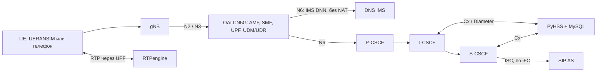

# Туториал 1. Настройка IMS и её связь с ядром 5G

Этот документ объясняет, как поднять IMS и подключить её к ядру 5G: сначала
к нашему локальному OAI CN5G, затем к уже работающему OAI другого проекта.
Работа AI поверх IMS описана во [втором туториале](guide-2-ims-ai.md),
установка и настройка SIP-серверов и клиентов — в [третьем](guide-3-sip.md).

Все команды выполняются из корня репозитория (папка с `README.md`,
`docker-compose.yml`, `app/` и `scripts/`).

## 1. Что именно мы связываем



| Часть | Что делает | Адрес по умолчанию (`lab.env`) |
| --- | --- | --- |
| OAI CN5G v2.2.1 | NRF, AMF, SMF, UPF, AUSF, UDM, UDR и своя MySQL `oai-db`; выдаёт абонентам PDU-сессии `internet` и `ims` | UPF `172.22.0.3` |
| UERANSIM | Эмулятор gNB и двух UE (только для локального стенда) | — |
| DNS (dnsmasq) | Зона IMS-домена: `pcscf.`, `icscf.`, `scscf.`, `hss.`, `as.`, SRV-записи `_sip._udp` | `DNS_IP=172.22.0.100` |
| P-CSCF | Точка входа UE в IMS, привязка медиа к RTPengine | `PCSCF_IP=172.22.0.106`, порт 5060 |
| I-CSCF | Выбор S-CSCF при регистрации, запросы к HSS | `ICSCF_IP=172.22.0.104`, порт 5060 |
| S-CSCF | Регистратор, аутентификация, маршрутизация и вызов AS по iFC | `SCSCF_IP=172.22.0.105`, порт 6060 |
| PyHSS + MySQL | IMS HSS: идентификаторы, ключи IMS AKA, iFC; интерфейс Cx | `PYHSS_IP=172.22.0.103` |
| RTPengine | Медиа-якорь, передаёт RTP, транскодирует AMR/AMR-WB ↔ PCMU | `RTPENGINE_IP=172.22.0.101`, RTP 30000–30100 |

Ключевое правило: **OAI UDM/UDR и IMS HSS — разные базы**. Ядро отвечает за
доступ в сеть 5G (5GS-ключи, PDU-сессии), IMS HSS — за телефонную регистрацию
(IMS-ключи, IMPI/IMPU, iFC). IMS не нужен доступ к SQL-базе OAI, NRF, N2/N3/N4.
Связь между ними сводится к четырём вещам:

1. **IMS DNN.** Абонент получает в ядре отдельную PDU-сессию `ims` с адресом
   из пула `IMS_UE_CIDR` (`10.46.0.0/16`).
2. **Обнаружение.** SMF сообщает UE адреса DNS и P-CSCF (PCO/EPCO).
3. **Маршрутизация N6.** Пакеты из IMS-пула идут от UPF к сервисам IMS и обратно
   **без NAT** и без SIP ALG: SIP и SDP должны содержать реальный адрес UE.
4. **Медиа.** RTP идёт через UPF к RTPengine и обратно.

В этот лабораторный профиль не входят N5/Rx (политики PCF), выделенные QoS-потоки,
полная защита Gm (IPsec) и гарантии VoNR на физической радиосети.

## 2. Подготовка машины

Нужны Git, Python 3.12+, Docker Engine 28+ и Compose 2.33.1+ с Linux-контейнерами
(конфигурация использует `include`, `!override` и `gw_priority`).

- **Windows:** Python, Git for Windows с Git Bash, Docker Desktop с WSL2.
- **Linux:** Git, Python с модулем venv, Docker Engine с Compose plugin, ядро с SCTP.
  `docker info` должен работать без `sudo` из того же терминала.
- macOS текущим launcher не поддерживается. Проверенный хост — x86-64, i5-12400F;
  ARM не проверен. Минимальный объём RAM всего стенда пока не измерен.

```bash
git clone --branch master https://git.miem.hse.ru/2508/5g-lab.git
cd 5g-lab
docker info --format '{{.OSType}}'
docker compose version
```

Ожидается `linux`. Затем окружение Python и offline-проверка исходников.

Linux:

```bash
python3 -m venv .venv
source .venv/bin/activate
python -m pip install -r requirements-dev.txt
python scripts/quality/check.py
```

Windows PowerShell:

```powershell
python -m venv .venv
.\.venv\Scripts\Activate.ps1
python -m pip install -r requirements-dev.txt
python scripts/quality/check.py
```

Если PowerShell блокирует `Activate.ps1`, не меняйте политику системы: вызывайте
`.\.venv\Scripts\python.exe` напрямую. Ожидается `TEAM OFFLINE CHECKS: PASS`.

## 3. Конфигурация и секреты

| Файл | Что в нём | В Git |
| --- | --- | --- |
| `app/config/lab.env` | Все публичные параметры: сети, адреса, IMS-домен, порты, номера, образы, модели | Да |
| `local/secrets/ims.env` | Ключи 5GS и IMS абонентов, пароли БД, машинные overrides | Нет |
| `local/oai/*.yaml` | Конфигурации OAI, генерируются из двух файлов выше | Нет |
| `app/config/ims.env.example` | Шаблон секретов (значения `replace-*` не использовать) | Да |

Основные параметры связи IMS с ядром:

| Параметр | Значение по умолчанию | Смысл |
| --- | --- | --- |
| `MCC`, `MNC` | `001`, `01` | PLMN |
| `IMS_DOMAIN` | `ims.mnc001.mcc001.3gppnetwork.org` | Домашний IMS-домен, realm |
| `INTERNET_DNN`, `IMS_DNN` | `internet`, `ims` | Имена DNN |
| `UE_PDU_SST` | `1` | S-NSSAI SST |
| `INTERNET_UE_CIDR` | `10.45.0.0/16` | Пул internet; NAT включён только для него |
| `IMS_UE_CIDR`, `IMS_UE_GATEWAY` | `10.46.0.0/16`, `10.46.0.1` | Пул IMS без NAT |
| `LAB_NETWORK_CIDR` | `172.22.0.0/24` | LAN сервисов; статические адреса `.100`–`.110` |
| `LAB_DYNAMIC_IP_RANGE` | `172.22.0.128/25` | Динамический диапазон Docker |
| `IMS_PARENT_INTERFACE`, `IMS_ROUTE_GATEWAY` | пусто | Только для внешнего ядра (раздел 6) |
| `UE1_IMSI`, `UE2_IMSI`, `UE1_MSISDN`, `UE2_MSISDN` | `…0001`, `…0002`, `1001`, `1002` | Тестовые абоненты |

Подсети Docker, IMS и internet не должны пересекаться с LAN/VPN машины. При смене
LAN меняйте **все** статические адреса согласованно. Полный перечень всех 246
параметров — [lab-env-reference.md](lab-env-reference.md).

Создать недостающие ключи и конфигурации OAI (существующие ключи сохраняются):

```bash
python scripts/initialize_local.py
```

Проверить итоговую конфигурацию Compose (Windows — `./scripts/compose.ps1`):

```bash
./scripts/compose.sh config --quiet
```

Успешная команда ничего не печатает. Полный вывод `compose config` не публикуйте:
в нём есть секреты.

### Как применяются настройки

- Compose читает `lab.env`, затем `local/secrets/ims.env`; переменные shell
  имеют более высокий приоритет. Обёртки `scripts/compose.ps1` / `compose.sh`
  подключают оба файла, «голый» `docker compose` — нет.
- После изменения env нужен `up -d` с пересозданием сервиса, для build args — ещё
  `build`. `restart` оставляет старое окружение.
- После изменения публичных параметров ядра повторите
  `python scripts/initialize_local.py` и перезапустите соответствующие NF.

## 4. Вариант А: локальное ядро OAI + IMS

Запуск только сети и телефонии, без AI:

```bash
python scripts/start_lab.py --base-only
```

Launcher выполняет по порядку:

1. Подготавливает SCTP (в Docker Desktop — через `scripts/prepare-host.ps1`).
2. Собирает образы и поднимает OAI CN5G, UERANSIM gNB и две UE.
3. Создаёт абонентов в OAI UDR (`scripts/oai_subscribers.py`): новые записи
   добавляются, ключи и SQN существующих не перезаписываются.
4. Создаёт абонентов, APN и iFC в PyHSS (`scripts/provision-ims-subscribers.sh`).
5. Поднимает DNS, PyHSS, P/I/S-CSCF и RTPengine, ждёт установления Cx.
6. Выполняет три базовые проверки: сеть и UE, IMS-маршруты и DNS, регистрацию.

Ожидаемый итог — `LOCAL 5G IMS BASE: READY`. Он означает: у обеих UE есть
PDU-сессии internet и ims, DNS и маршруты к IMS работают, оба SIP-клиента
зарегистрированы.

### Как в локальном стенде устроена связь ядра и IMS

- **UPF.** Режим simple-switch, один `tun0` для обоих DNN. Общий SNAT OAI
  отключён; wrapper UPF при каждом старте (и при `docker restart`) включает NAT
  только для internet-пула и ставит маршрут к IMS-шлюзу. Healthcheck UPF
  проверяет TUN и UDP-слушатели N3/N4, но не прохождение RTP.
- **SMF.** Выдаёт DNS и P-CSCF из `DNS_IP` и `PCSCF_IP`. Шаблон закреплён в
  [oai_config.py](../scripts/oai_config.py); SBI работает по HTTP/1.1
  (обход ошибки обработчика HTTP/2 в OAI 2.2.1), таймаут — `OAI_HTTP_TIMEOUT_MS`.
  Отсутствующий SD хранится в подписке как `FFFFFF`.
- **UE.** UERANSIM создаёт отдельный TUN (`uesimtun*`) на каждую PDU-сессию.
  SIP-клиент находит IMS-TUN по адресу из `IMS_UE_CIDR` и ставит маршруты /32
  к P-CSCF и RTPengine через этот TUN. Так SIP и RTP действительно проходят
  через PDU-сессию, а не через общий Docker bridge.
- **CSCF, DNS, RTPengine** получают обратные маршруты к пулам UE.

Уровень логов OAI — warning: info/debug могут содержать ключи и векторы
аутентификации. Не включайте такие логи в передачу.

## 5. Абоненты и ключи

| Ключи | Где | Назначение |
| --- | --- | --- |
| `UE*_5GS_K`, `UE*_5GS_OPC`, `UE*_5GS_AMF` | secrets → OAI UDR | Доступ в сеть 5GS; только для нашего локального OAI |
| `UE*_IMS_K`, `UE*_IMS_OPC`, `UE*_IMS_AMF` | secrets → PyHSS AuC | IMS AKA |
| `IMS_DIGEST_PASSWORD` | secrets | Лабораторный fallback Digest |
| `OAI_DB_PASSWORD`, `OAI_DB_ROOT_PASSWORD` | secrets | Создаются автоматически |

K и OPc — 32 hex-символа, поле AMF — 4 hex-символа (это поле Milenage, не функция
AMF). Новые профили имеют независимые 5GS- и IMS-ключи.

Идентификаторы IMS формирует provisioning:

- IMPI: `<IMSI>@ims.mnc<MNC>.mcc<MCC>.3gppnetwork.org`;
- IMPU: `sip:<MSISDN>@<домен>`, `tel:<MSISDN>`, `sip:<IMSI>@<домен>`.

Правила:

- Существующие базы при provisioning не перезаписываются; несовпадение ключей
  требует явной миграции с backup.
- **SQN не сбрасывать** для обхода ошибки аутентификации.
- `scripts/migrate_subscriber_keys.py` относится только к прежнему Open5GS,
  к OAI UDR его не применять.
- Ключи настоящих SIM передаются по защищённому каналу, не через документацию.

## 6. Вариант Б: IMS подключается к OAI другого проекта

Передаётся только наша часть: DNS, PyHSS/MySQL, P/I/S-CSCF, RTPengine и AI.
Ядро, RAN и UE остаются у партнёров. Состав задаёт
[compose.partner.yml](../compose.partner.yml) — те же определения IMS/AI, что
в локальном стенде, без OAI, gNB и UE.

### 6.1. Выбрать схему

| Схема | Что запускать | Условие |
| --- | --- | --- |
| OAI партнёров и наш IMS на одной Linux ВМ | `compose.partner.yml` | N6 их UPF должен достигать LAN macvlan; общий хост сам маршруты не создаёт |
| OAI и IMS на разных ВМ | `compose.partner.yml` | Общая LAN/VLAN, маршруты в обе стороны, разрешены дополнительные MAC на vSwitch |

Ограничения сети:

- Партнёрский вариант использует **macvlan**: контейнеры получают собственные
  адреса в LAN. Нужен Linux и rootful Docker; Docker Desktop под Windows этим
  сценарием не покрыт.
- Хост не видит свои macvlan-контейнеры напрямую. Связность с хоста не равна
  связности с UE.
- Нельзя запускать локальный и партнёрский составы на одном Docker daemon:
  имена контейнеров и томов общие.

### 6.2. Согласовать параметры

| Параметры | Кто и что делает |
| --- | --- |
| `MCC`, `MNC`, `IMS_DOMAIN` | Согласовать PLMN и домашний IMS-домен |
| `IMS_DNN`, `IMS_UE_CIDR`, S-NSSAI | Партнёры разрешают DNN абонентам, выдают IPv4 PDU из пула, сообщают SST/SD |
| `LAB_NETWORK_CIDR`, `LAB_DYNAMIC_IP_RANGE` | Выделенная LAN/VLAN; диапазон Docker исключить из DHCP, статические IP зарезервировать |
| `IMS_PARENT_INTERFACE` | Интерфейс Linux в этой LAN (имя из `ip link`) |
| `IMS_ROUTE_GATEWAY` | Next hop в этой LAN к IMS-пулу UE: UPF или маршрутизатор |
| `DNS_IP`, `PCSCF_IP` | Партнёры вписывают их в настройки DNS/P-CSCF своего SMF |
| `INTERNET_UE_CIDR` | Реальный internet-пул партнёров (к нему тоже ставится обратный маршрут) |
| `RTPENGINE_IP`, `RTPENGINE_PORT_MIN`–`MAX` | Маршрут UE ↔ RTPengine в обе стороны, без NAT/SIP ALG |
| `UE*_IMSI`, `UE*_MSISDN` | Два тестовых IMS-абонента; IMPI/IMPU и домен совпадают с клиентом |
| `UE*_IMS_K/OPC/AMF` | Согласовать с IMS-клиентом/ISIM по защищённому каналу |

5GS-ключи партнёров остаются в их UDR и SIM; нашей части они не нужны.
Параметры IMS/P-CSCF в SMF сверяйте с
[документацией OAI](https://github.com/openairinterface/oai-cn5g-fed/blob/master/docs/CONFIGURATION.md)
для их версии.

Пример адресного плана для выделенной LAN `172.22.0.0/24` (не готовые адреса
другого проекта): сервисы `.100`–`.110`, динамический диапазон `.128/25`, шлюз
к IMS-пулу, например `.1`. В OAI партнёров: IMS DNN, IMS-пул, DNS `172.22.0.100`,
P-CSCF `172.22.0.106`.

### 6.3. Порты на границе

| Поток | Порты |
| --- | --- |
| UE → DNS | UDP/TCP 53 |
| UE ↔ P-CSCF | `PCSCF_SIP_PORT` (5060), UDP/TCP |
| UE ↔ RTPengine | UDP `RTPENGINE_PORT_MIN`–`RTPENGINE_PORT_MAX` (30000–30100) |

Cx, SQL, управление RTPengine и HTTP AI — внутренние связи нашей части. Наружу их
не открывать; в общей LAN партнёры ограничивают доступ средствами сети. PyHSS имеет
отдельный management bridge для локального REST provisioning.

### 6.4. Запустить

1. На Linux-машине: Docker 28+, Compose 2.33.1+, Python 3.12+, LAN/VLAN и адреса.
2. Заполнить `app/config/lab.env` по таблице 6.2. Для новых программных клиентов
   создать только IMS-ключи:

   ```bash
   python scripts/initialize_local.py --ims-only
   ```

3. Проверить конфигурацию (контейнеры не запускаются):

   ```bash
   python scripts/start_partner.py --check
   ```

4. Поднять только IMS, создать абонентов и iFC, дождаться Cx. Ядро партнёров
   не изменяется:

   ```bash
   python scripts/start_partner.py --ims-only
   ```

5. Проверить регистрацию и обычный вызов (раздел 7), затем включить AI
   ([туториал 2](guide-2-ims-ai.md)).

Обслуживание партнёрского состава — только с явным файлом:

```bash
docker compose --env-file app/config/lab.env --env-file local/secrets/ims.env -f compose.partner.yml ps
```

Обычные `compose.ps1` / `compose.sh` адресуют локальный состав с OAI.
Надпись `STARTED` означает готовность процессов; до звонков внешних UE интеграция
остаётся `UNVERIFIED`.

## 7. Проверка связи IMS с ядром

### Локальный стенд

Запускать по одной, на свободном стенде (Windows — через Git Bash):

```bash
bash app/tests/integration/verify.sh
bash app/tests/integration/verify-ims.sh
bash app/tests/integration/verify-ims-registration.sh
```

| Скрипт | Что проверяет |
| --- | --- |
| `verify.sh` | Базовая сеть и подключение UE |
| `verify-ims.sh` | IMS-маршруты, DNS, необходимые компоненты |
| `verify-ims-registration.sh` | Регистрация двух SIP-абонентов через IMS |

Проверка восстановления IMS PDU-сессии (на свободном стенде с остановленными AS/AI):

```bash
python app/tests/integration/verify_pdu_recovery.py --ue 1
```

Она освобождает IMS PDU-сессию UE, ждёт восстановления с новым адресом и новым
TUN, проверяет маршруты SIP/RTP и новый `REGISTER 200`. Internet-сессия и
второе UE не должны пострадать.

### Внешнее ядро: приёмка по порядку

1. У UE есть IMS PDU, правильные DNS/P-CSCF, разрешённые DNN/S-NSSAI.
2. DNS и P-CSCF доступны с адреса IMS PDU; обратный маршрут подтверждён.
3. Два IMS REGISTER завершаются `200 OK` с ожидаемой аутентификацией.
4. Вызов UE1 → UE2: INVITE/200/ACK/BYE и RTP в обе стороны через RTPengine.
5. S-CSCF вызывает SIP AS по iFC.
6. Повтор после перезапуска IMS и перерегистрации; SQN не сбрасывать.

Локальные скрипты используют контейнеры `lab-ue*`/`lab-sipue*` и не проверяют
телефоны партнёров. Для партнёрской приёмки нужны их UE, трассы на границах и
протокол результатов: дата, версии, топология, команды, результат. `FAIL`
остаётся `FAIL` даже после успешного повтора.

## 8. Диагностика

Проверяйте по цепочке: Docker → ядро/PDU → DNS/маршруты → REGISTER → звонок.

| Симптом | Что проверить |
| --- | --- |
| Compose не понимает `include`, `!override`, `gw_priority` | Версии Docker/Compose |
| UE не подключается, нет SCTP | Журналы AMF/gNB/UE, поддержка SCTP ядром Linux/WSL2 |
| У UE нет IMS PDU | IMS DNN/S-NSSAI в подписке, SMF и UE; не путать internet и ims |
| REGISTER без ответа | Адреса DNS/P-CSCF, обратный маршрут к IMS-пулу, порт SIP, firewall |
| REGISTER отклоняется | IMPI/IMPU, realm, способ аутентификации, ключи, журналы Cx |
| `signal lost`, тайм-ауты `Service Request`, `UE context already exists` | Журналы UE/gNB, `verify-ims.sh`; перезапустить `gnb ue1 ue2`, затем пересоздать `sipue1 sipue2` |
| Контейнер перезапускается | `docker stats --no-stream`, `docker inspect --format '{{.State.OOMKilled}}' <контейнер>`, лимит ВМ/WSL2 |

Работающий контейнер не гарантирует живую сессию. После перезапуска радиочасти
SIP-клиенты нужно пересоздать, чтобы сокеты привязались к новым IMS-адресам.

## 9. Остановка, обновление, откат

Остановка с сохранением баз и кэшей (Windows — `./scripts/compose.ps1 down`):

```bash
./scripts/compose.sh down
```

**`down -v` не использовать:** он удаляет тома с базами OAI и IMS.

Обновление:

1. Зафиксировать commit, версии образов, конфигурацию и результаты проверок;
   завершить вызовы.
2. Приватно сохранить `local/secrets/ims.env`.
3. Согласованно сохранить тома IMS MySQL и OAI DB. Копия файлов работающей MySQL
   не является резервной копией: сначала остановить потребителей и БД.
4. Обновить исходники, пересобрать образы, повторить запуск.
5. Повторить проверки раздела 7. При откате учитывать схемы БД, а не только образы.

Прежнее ядро Open5GS сохранено в `app/infrastructure/compose/core-open5gs.yml`
для отката. Переключать только образ UPF нельзя: маршруты и хранилище абонентов
отличаются.

## 10. Что проверено и что нет

Проверено на локальном OAI: две UE с сессиями internet/ims, DNS и маршруты,
Cx, Digest- и AKA-регистрация, двусторонний PCMU-вызов, восстановление после
`docker restart lab-upf`, повторный provisioning без изменения ключей и SQN.
Партнёрский Compose прошёл проверку конфигурации.

Не проверено: внешний OAI партнёров, развёртывание macvlan на Linux, настоящие
телефоны, Gm IPsec, QoS/N5/Rx, полная матрица отказов. `PASS` относится к
конкретной проверке и не означает полного соответствия 3GPP.
