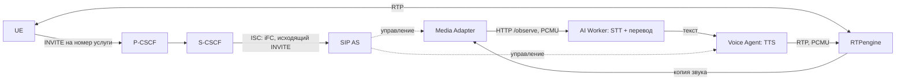

# Туториал 2. Связь IMS и AI

Этот документ объясняет, как голосовые AI-услуги (распознавание, перевод,
синтез речи, запись) подключены к IMS, как их запустить, настроить и проверить.
Предполагается, что IMS уже поднята по [первому туториалу](guide-1-ims-core.md)
и вернула `LOCAL 5G IMS BASE: READY` (или, у партнёров, прошла регистрация и
обычный вызов). SIP-серверы и клиенты подробно описаны в [третьем](guide-3-sip.md).

Документ состоит из двух частей:

- **Часть 1 — только команды.** Выполните их по порядку и получите работающие
  AI-услуги: перевод, запись и расшифровку.
- **Часть 2 — разъяснения.** Как AI встроен в IMS, режимы, настройка, контракт,
  задержка и диагностика.

Перед началом IMS должна быть поднята по [туториалу 1](guide-1-ims-core.md).
Все команды — из корня репозитория, в активированном `.venv`. Команды Bash
даны для Linux; на Windows `bash ...` запускайте в Git Bash.

# Часть 1. Команды

## А. Локальный стенд, полный режим с Qwen

**1. Запуск** (сам поднимает ядро, IMS и AI, скачивает модели и звонит)

```bash
./scripts/start.sh
```

Windows: `./scripts/start.ps1`. Первый запуск долгий: образы, Qwen около 2,5 ГБ,
Whisper. В конце все проверки звонков должны быть `PASS`.

**2. Дополнительные проверки** (по одной)

```bash
python app/tests/integration/check_bidirectional_interpreter.py
python app/tests/integration/check_parallel_calls.py
```

## Б. Локальный стенд, лёгкий режим `compact` без Qwen и GPU

**1. Подготовить модели перевода** (один раз; можно на другой машине и
перенести `local/models/opus-mt/`)

```bash
python -m pip install uv
uv venv --python 3.11 local/benchmarks/cpu-ai/.venv
uv pip install --python local/benchmarks/cpu-ai/.venv/bin/python ctranslate2==4.8.2 transformers==4.57.6 sentencepiece==0.2.2 torch==2.10.0 --torch-backend cpu
local/benchmarks/cpu-ai/.venv/bin/python scripts/prepare_translation_models.py
```

Ожидается `OPUS MODEL READY: ru-en` и `OPUS MODEL READY: en-ru`.
Windows: `bin/python` → `Scripts/python.exe`.

**2. Поднять ядро, IMS и AI**

```bash
python scripts/start_lab.py --base-only
python scripts/compose_ai.py --mode compact config --quiet
python scripts/compose_ai.py --mode compact build ai-worker voice-agent
python scripts/compose_ai.py --mode compact up -d --build
python scripts/compose_ai.py --mode compact ps
```

Ждать, пока `lab-ai-worker` и `lab-voice-agent` станут `healthy`.

**3. Проверить связь IMS и AI** (по одной)

```bash
bash app/tests/integration/verify-ims-call.sh
bash app/tests/integration/verify-voice-agent.sh
```

Обе — `PASS`.

**4. Позвонить на запись и расшифровку (1004)**

```bash
docker exec lab-sipue1 sh -lc 'printf "m\nsip:%s@%s\n" "$VOICE_TRANSCRIBER_MSISDN" "$IMS_DOMAIN" > /tmp/pjsua-control'
sleep 15
docker exec lab-sipue1 sh -lc 'printf "ha\n" > /tmp/pjsua-control'
ls local/private/recordings/
```

Появляется каталог вызова с `transcript.txt` и `turn-*.wav`. Если каталога нет —
подайте звук вручную после приветствия ([раздел 5.2](#52-ручной-вызов-услуги-с-эмулятора)).

**5. Позвонить на перевод RU → EN (1003)**

```bash
docker exec lab-sipue1 sh -lc 'printf "m\nsip:%s@%s\n" "$VOICE_TRANSLATOR_MSISDN" "$IMS_DOMAIN" > /tmp/pjsua-control'
sleep 15
docker logs --since 1m lab-ai-worker
docker exec lab-sipue1 sh -lc 'printf "ha\n" > /tmp/pjsua-control'
```

**6. Остановка** (`-v` не добавлять)

```bash
python scripts/compose_ai.py --mode compact down
```

Режим (`--mode compact`) указывается в **каждой** команде `compose_ai.py`.
Другие режимы: `balanced`, `minimal`, `baseline`.

## В. Ядро партнёров

Сначала IMS по [туториалу 1, часть 1, вариант Б](guide-1-ims-core.md#б-ядро-уже-работает-у-партнёров-ставим-только-ims--ai).

**С Qwen:**

```bash
python scripts/start_partner.py
```

**Или `compact`** (после шага Б1):

```bash
python scripts/compose_ai.py --mode compact --partner up -d --build
python scripts/compose_ai.py --mode compact --partner ps
```

**Проверка с телефона/UE партнёров:** позвоните на 1003 (перевод), 1004
(запись), пара 1005/1006 (двусторонний перевод). Логи:

```bash
docker logs --tail 50 lab-sip-as
docker logs --tail 50 lab-voice-agent
docker logs --tail 50 lab-ai-worker
ls local/private/recordings/
```

В `lab-sip-as` — `AS terminated INVITE for voice agent`, в `lab-voice-agent` —
`reason=greeting state=sent`, UE слышит приветствие и перевод.

**Остановка:**

```bash
python scripts/compose_ai.py --mode compact --partner down
```

# Часть 2. Разъяснения

## 1. Как AI встроен в IMS

AI — прикладная услуга **поверх** IMS, вне control plane ядра 5G. Он получает
звук только после того, как IMS допустила вызов и RTPengine закрепил медиа.



| Сервис | Контейнер | Роль |
| --- | --- | --- |
| SIP AS | `lab-sip-as`, `172.22.0.107:5070` | Принимает INVITE от S-CSCF по iFC, выбирает сценарий по номеру, управляет Media Adapter и Voice Agent |
| Media Adapter | `lab-media-adapter` | Работает в сетевом пространстве RTPengine, наблюдает копию звука; по Call-ID запрашивает NG-интерфейс RTPengine и связывает порт абонента с сессией; окна по 100 мс |
| AI Worker | `lab-ai-worker`, `172.22.0.109:8092` | Собирает реплики по паузам (VAD), очередь, STT (faster-whisper), перевод (Qwen через Ollama или OPUS-MT), запись транскрипции |
| Voice Agent | `lab-voice-agent`, `172.22.0.110` | Синтез речи (Piper, запасной eSpeak NG), отдельная очередь озвучки на каждый вызов, отправка PCMU через RTPengine |
| LLM | `lab-llm-worker` | Ollama с Qwen3-4B; только в режиме `baseline`, только во внутренней сети |

### Как вызов попадает в AI

1. Для каждого абонента PyHSS хранит iFC
   ([default_ifc.xml](../app/infrastructure/vendor/docker_open5gs/pyhss/default_ifc.xml)):
   исходящий (`SessionCase 0`) `INVITE` с приоритетом 30 отправляется на
   `sip:as.<IMS_DOMAIN>:<SIP_AS_PORT>`. DNS разрешает `as.<домен>` в `SIP_AS_IP`.
2. `DefaultHandling 0` — продолжить сессию при недоступности AS. Поэтому
   **обычный разговор абонентов продолжается при отказе AI**; услуги AI при этом,
   конечно, не работают.
3. SIP AS ([routing.py](../app/services/sip-as/ims_sip/routing.py)) сравнивает
   номер назначения с номерами услуг. Для обычного номера он пропускает вызов
   дальше и только включает наблюдение; для номера услуги соединяет вызов
   с Voice Agent.
4. RTPengine транскодирует кодек телефона (AMR/AMR-WB) в PCMU для AI-номеров.
   Внутренний формат AI — **PCMU/8000**; это протокольный контракт, его нельзя
   поменять одной переменной env.

### Путь речи по файлам

Пути от `app/services/`:

1. `sip-as/ims_sip/routing.py` — SIP и выбор сценария.
2. `media-adapter/ims_media/` — приём RTP и отправка аудио AI Worker.
3. `ai-worker/ims_ai/segmentation.py` — сборка кадров в реплики по паузам.
4. `ai-worker/ims_ai/queueing.py` — передача реплики свободному обработчику.
5. `ai-worker/ims_ai/utterances.py` — распознавание и замер времени STT.
6. `ai-worker/ims_ai/transcription.py` — нормализация и сохранение текста;
   `ai-worker/ims_ai/replies.py` — перевод или ответ.
7. `voice-agent/ims_voice/media.py` — озвучка и отправка PCMU через RTPengine.

Каждый сервис — **один процесс**: вызовы, очереди и история хранятся в памяти.
Разные вызовы обрабатываются параллельно; после перезапуска сервиса состояние
вызовов не восстанавливается.

## 2. Услуги и номера

Номера задаются в `app/config/lab.env`:

| Номер | Параметр | Что происходит |
| --- | --- | --- |
| 1001 / 1002 | `UE1_MSISDN`, `UE2_MSISDN` | Обычные абоненты, вызов без AI |
| 1003 | `VOICE_TRANSLATOR_MSISDN` | Говорящий по-русски получает перевод на английский голосом |
| 1004 | `VOICE_TRANSCRIBER_MSISDN` | После звукового уведомления речь записывается и расшифровывается |
| 1005 | `VOICE_INTERPRETER_RU_MSISDN` | Русский участник двустороннего перевода |
| 1006 | `VOICE_INTERPRETER_EN_MSISDN` | Английский участник двустороннего перевода |

Двусторонний перевод — это **два отдельных вызова** к сервису: русский звонит
на 1005, английский на 1006. Каждый слышит перевод на своём языке; исходный
звук напрямую между ними не передаётся.

Записывается только вызов на 1004 и только после уведомления. Результат:

```text
local/private/recordings/<session-id>/
  README.txt          уведомление о приватной записи
  transcript.txt      распознанный текст
  turn-0001.wav       звук первой реплики
  manifest.jsonl      метаданные: язык, длительность, вид транскрипции
```

## 3. Режимы AI

| Режим | STT (CPU int8) | Перевод | TTS | Назначение |
| --- | --- | --- | --- | --- |
| `baseline` | Whisper small | Qwen3-4B Instruct Q4_K_M (Ollama) | Piper | Эталон; полный набор проверок; LLM-очистка транскрипции и голосовой помощник |
| `balanced` | Whisper small | Два OPUS-MT int8 (RU→EN, EN→RU) | Piper | Меньше памяти, тот же ASR |
| `compact` | Whisper base | OPUS-MT | Piper | Основной вариант для слабого CPU |
| `minimal` | Whisper tiny | OPUS-MT | eSpeak NG | Экспериментальный; заметно хуже распознаёт русский |

- Видеокарта не нужна. Во всех CPU-режимах GPU отключён явно.
- `balanced`, `compact`, `minimal` не запускают Ollama; транскрипция в них
  сохраняется как есть (`transcript_kind=raw_asr`), без LLM-очистки.
  В `baseline` при успешной нормализации — `llm_normalized`.
- Облегчённые режимы допускают максимум **два активных голосовых вызова**
  (одна двусторонняя пара); `baseline` — технический предел 100.
- Варианты описаны в [ai-profiles.json](../app/config/ai-profiles.json).

Измерения на i5-12400F без GPU, фразы около 6,5 с (медианы):

| Режим | STT RU / EN | OPUS RU→EN / EN→RU | Пик RSS STT + MT |
| --- | --- | --- | --- |
| `balanced` | 2,75 / 2,37 с | 101 / 142 мс | 975 МиБ |
| `compact` | 0,94 / 0,94 с | 102 / 102 мс | 578 МиБ |
| `minimal` | 0,68 / 0,68 с | 199 / 143 мс | 503 МиБ |

Piper (1 поток): около 6,5 с звука за 0,52–0,54 с; пик RSS 495 МиБ, с
отключённой ONNX arena — 399 МиБ. Это замеры компонентов, а не всего звонка
и не бюджет RAM всей ВМ.

## 4. Запуск

### 4.1. `baseline` с Qwen (локальный стенд)

Windows: `./scripts/start.ps1`. Linux:

```bash
./scripts/start.sh
```

Launcher собирает образы, скачивает Qwen (GGUF около 2,5 ГБ, проверка SHA-256)
и Whisper, готовит синтетические WAV, настраивает абонентов, поднимает сеть и
выполняет последовательные проверки звонков. Флаг `-SkipVerify` (PowerShell) или
`--skip-verify` (Bash) пропускает проверки и даёт `STARTED/UNVERIFIED`.

### 4.2. `compact` без Qwen (локальный стенд)

**Шаг 1. Подготовить OPUS-MT** — один раз; можно на другой машине, затем
перенести `local/models/opus-mt/` с обоими `manifest.json`. Нужен отдельный
Python 3.11 только для конвертера, не вместо основного `.venv`:

```bash
python -m pip install uv
uv venv --python 3.11 local/benchmarks/cpu-ai/.venv
uv pip install --python local/benchmarks/cpu-ai/.venv/bin/python ctranslate2==4.8.2 transformers==4.57.6 sentencepiece==0.2.2 torch==2.10.0 --torch-backend cpu
local/benchmarks/cpu-ai/.venv/bin/python scripts/prepare_translation_models.py
```

На Windows замените `bin/python` на `Scripts/python.exe`. Ожидаются
`OPUS MODEL READY: ru-en` и `OPUS MODEL READY: en-ru`.

**Шаг 2. Поднять IMS и AI:**

```bash
python scripts/start_lab.py --base-only
python scripts/compose_ai.py --mode compact config --quiet
python scripts/compose_ai.py --mode compact build ai-worker voice-agent
python scripts/compose_ai.py --mode compact up -d --build
python scripts/compose_ai.py --mode compact ps
```

Дождитесь `healthy` у AI Worker и Voice Agent (первый старт загружает веса
Whisper). Вместо `compact` можно указать `balanced`, `minimal` или `baseline`.

Правила переключения:

- Режим указывается **в каждой** команде `compose_ai.py`, включая `logs` и `down`.
- Обычный `start.ps1` / `start.sh` возвращает конфигурацию Qwen.
- При смене режима прерываются активные вызовы. Режимы не запускаются рядом:
  сеть, имена и тома общие.
- `lab.env` при переключении не меняется: скрипт создаёт
  `local/ai-profiles/<режим>/profile.env` и overlay Compose.

### 4.3. Партнёрский вариант (внешний OAI)

После `python scripts/start_partner.py --ims-only` ([туториал 1, раздел 6](guide-1-ims-core.md#6-вариант-б-подключение-ims--ai--sip-к-уже-работающему-ядру)):

- `baseline`: `python scripts/start_partner.py`;
- CPU-режим: те же команды `compose_ai.py`, но с `--partner`:

```bash
python scripts/compose_ai.py --mode compact --partner config --quiet
python scripts/compose_ai.py --mode compact --partner build ai-worker voice-agent
python scripts/compose_ai.py --mode compact --partner up -d --build
python scripts/compose_ai.py --mode compact --partner ps
```

## 5. Проверка связи IMS и AI

### 5.1. Автоматические проверки

Запускать **по одной**, на свободном стенде (Windows — через Git Bash):

```bash
bash app/tests/integration/verify-ims-call.sh
bash app/tests/integration/verify-voice-agent.sh
```

| Проверка | Что подтверждает |
| --- | --- |
| `verify-ims-call.sh` | Вызов UE1 → UE2, S-CSCF вызывает AS по iFC, RTPengine видит оба IMS-адреса, наблюдение AI связано с Call-ID; **при остановке AI счётчики RTP продолжают расти** |
| `verify-voice-agent.sh` | Вызов голосового сервиса, приветствие, ACK, RTP и очистка по BYE |

Проверка Voice Agent завершает существующие RTP-сессии — не запускайте её во
время чужого разговора.

Для `baseline` дополнительно:

```bash
bash app/tests/integration/verify-real-ai-stream.sh
bash app/tests/integration/verify-transcription-recording.sh
python app/tests/integration/check_bidirectional_interpreter.py
python app/tests/integration/check_parallel_calls.py
```

| Проверка | Что подтверждает |
| --- | --- |
| `verify-real-ai-stream.sh` | Несколько русских реплик через IMS → Whisper → английский перевод → TTS/RTP (имя историческое, streaming не включает) |
| `verify-transcription-recording.sh` | Вызов на 1004, уведомление, запись и текст |
| `check_bidirectional_interpreter.py` | Два языковых вызова (1005/1006), перевод в обе стороны |
| `check_parallel_calls.py` | Нагрузка `1 → 2 → 1` вызов с разными Call-ID (функциональная, не нагрузочная) |

В `compact/balanced/minimal` не используйте проверки LLM-нормализации как
проверку raw-транскрипции: они обращаются к Ollama. Для CPU-режимов полностью
принятой последовательности телефонных проверок пока нет.

### 5.2. Ручной вызов услуги с эмулятора

Локальные SIP-клиенты работают без звуковой карты и подают синтетическую речь
из WAV; результат возвращается по RTP клиенту, а не в динамики компьютера.
Управление PJSUA — через FIFO `/tmp/pjsua-control` (подробно — в
[туториале 3](guide-3-sip.md#5-sip-клиент-pjsua)).

Позвонить на услугу транскрипции (Git Bash или Linux Bash):

```bash
docker exec lab-sipue1 sh -lc 'printf "m\nsip:%s@%s\n" "$VOICE_TRANSCRIBER_MSISDN" "$IMS_DOMAIN" > /tmp/pjsua-control'
docker logs --since 1m lab-voice-agent
```

Дождитесь `reason=greeting state=sent`. Подать порцию звука и сделать паузу
(номера портов — из списка команды `cl`; обычно проигрыватель 1, вызов 4):

```bash
docker exec lab-sipue1 sh -lc 'printf "cc\n1\n4\n" > /tmp/pjsua-control'
docker exec lab-sipue1 sh -lc 'printf "cd\n1\n4\n" > /tmp/pjsua-control'
docker logs --since 2m lab-ai-worker
docker exec lab-sipue1 sh -lc 'printf "ha\n" > /tmp/pjsua-control'
```

Для перевода RU → EN замените `VOICE_TRANSCRIBER_MSISDN` на
`VOICE_TRANSLATOR_MSISDN`. Результат записи — в `local/private/recordings/`.

### 5.3. Полный эксперимент с записью

```powershell
./scripts/run-interpreter-experiment.ps1
```

Результат — `local/experiments/<UTC-run-id>/`: четыре полных WAV (записывает
PJSUA на стороне абонента), журналы, метаданные образов, задержки этапов,
контрольные суммы и манифест. Незакоммиченные изменения дают `FAIL`.

### 5.4. Приёмка с внешними UE

1. Обычный вызов работает, S-CSCF вызывает AS по iFC, Media Adapter получает PCMU/8000.
2. Включён выбранный режим AI, оба сервиса `healthy`.
3. RU → EN и EN → RU на двух языковых номерах, перевод слышен у удалённого UE.
4. Вызов на 1004: уведомление, WAV и текст; отмечен вид транскрипции (raw или LLM).
5. При остановленном AI обычный вызов продолжается; после вызова нет висящих сессий.
6. CPU/RAM всей ВМ под нагрузкой, отсутствие OOM и перезапусков, время от начала
   речи до слышимого перевода на втором устройстве.

## 6. Настройка AI

Все параметры — в `app/config/lab.env`; после изменения пересоздайте сервис
(`up -d --no-deps --force-recreate <сервис>`), для моделей TTS — также `build`.

| Что менять | Переменные |
| --- | --- |
| STT | `AI_MODEL_SIZE`, `AI_MODEL_REVISION`, `AI_DEVICE`, `AI_COMPUTE_TYPE`, `AI_LANGUAGE`, `AI_STT_*` |
| Границы реплик | `AI_UTTERANCE_*`, `AI_VAD_RMS`, `AI_AUDIO_PREROLL_MS` |
| Очереди и параллельность | `AI_QUEUE_MAX`, `AI_UTTERANCE_QUEUE_MAX`, `AI_PROCESSING_WORKERS`, `VOICE_AGENT_REPLY_QUEUE_MAX`, `LLM_NUM_PARALLEL`, `SERVICE_HTTP_THREADS` |
| LLM | `LLM_MODEL`, `LLM_GGUF_URL`, `LLM_GGUF_SHA256`, `LLM_*PROMPT`, `LLM_TIMEOUT_SECONDS`, `LLM_KEEP_ALIVE`, `LLM_MAX_TOKENS` |
| Перевод OPUS | `AI_TRANSLATION_BACKEND`, `AI_TRANSLATION_THREADS`, `AI_TRANSLATION_BEAM_SIZE` |
| Синтез | `TTS_BACKEND`, `TTS_VOICE`, `TTS_TRANSLATION_VOICE`, `PIPER_*`, `PIPER_LENGTH_SCALE` |
| Запись | `RECORDING_ENABLED`, `RECORDING_RETENTION_DAYS`, `RECORDING_*` |
| Номера услуг | `VOICE_*_MSISDN` |
| Ресурсы | `*_CPU_LIMIT`, `*_MEMORY_LIMIT` |

**Смена LLM** — три значения: `LLM_MODEL`, `LLM_GGUF_URL`, `LLM_GGUF_SHA256`
(пример для Gemma 3 4B — в [local-models.md](local-models.md)). Затем пересоздать
загрузчик, LLM и AI Worker. Проверка: `docker exec lab-llm-worker ollama ps`.

**GPU (NVIDIA)** — только в локальном `local/secrets/ims.env`:

```dotenv
LLM_CONTAINER_RUNTIME=nvidia
LLM_GPU_DEVICES=all
AI_ENABLE_CUDA=1
AI_CONTAINER_RUNTIME=nvidia
AI_GPU_DEVICES=all
AI_DEVICE=cuda
AI_COMPUTE_TYPE=int8_float16
AI_WORKER_MEMORY_LIMIT=4g
```

Нужен NVIDIA Container Toolkit (Linux) или Docker Desktop/WSL2 с драйвером.
CPU-режимы `compose_ai.py` всегда принудительно отключают GPU.

**Голоса:** Piper `ru_RU-denis-medium` и `en_US-ljspeech-medium`, загружаются
при сборке образа с проверкой SHA-256. Для сравнения со старым голосом:
`TTS_BACKEND=espeak-ng` и пересоздание `voice-agent`.

## 7. Внутренний контракт IMS ↔ AI

- **Медиа:** PCMU/8000 RTP. AMR/AMR-WB транскодирует RTPengine на границе
  AI-номеров; EVS не поддержан.
- **HTTP между сервисами** (внутренний интерфейс проекта, не интерфейс 3GPP):
  - `POST /observe` — окно аудио PCMU (base64), непрозрачные `call_ids`, время,
    метаданные кодека; **без SIP-идентификаторов абонента**;
  - `GET /events` — метаданные обработки: версии моделей, длительности, число
    символов, время STT/LLM, статус доставки. Текста реплик и промптов в ответе нет;
  - `/healthz` — готовность (`204` после прогрева STT и LLM).
- **Аутентификация:** внутренний токен генерируется один раз в приватном Docker-томе.
  Voice Agent принимает звук только от адреса и пула портов RTPengine.
- **Приватность:** аудио перевода хранится только в памяти; запись — только
  на номере 1004 после уведомления. В обычных журналах остаются размеры и
  длительности, не текст. Ollama доступна только во внутренней сети.

Подключение чужого Python-модуля к этим HTTP API требует отдельного согласования
форматов, жизненного цикла Call-ID и токена: стабильного публичного API «аудио →
перевод» контракт не обещает.

## 8. Задержка и потоковый режим

Обработка пофразовая:

`задержка = длительность фразы + ожидание тишины + очередь + STT + перевод + TTS + доставка`

Поэтому 0,1 с на перевод не равно 0,1 с до слышимого ответа: при фразе 6 с цель
1–3 с от начала речи недостижима без потокового режима.

Потоковый режим (`AI_STREAMING_ENABLED=1`, только для 1005/1006) существует, но
**выключен по умолчанию и не принят**: в прогонах либо задержка выходила за 1–3 с,
либо терялась полнота текста. Не включайте его для реальных разговоров. Подробнее —
[streaming.md](streaming.md).

Метрика эксперимента `speech_end_to_first_rtp_ms` измеряет время до отправки
первого RTP перевода, а не до динамика телефона. Порог проверки —
`INTERPRETER_MAX_RESPONSE_DELAY_MS` (5000 мс).

## 9. Диагностика

Сначала убедитесь, что работает обычный вызов: если он не работает, смена модели
перевода это не исправит.

| Симптом | Что проверить |
| --- | --- |
| AI `unhealthy` | Прогрев, доступность весов Whisper, для OPUS — оба manifest, права mount, лимит RAM |
| После перехода на compact снова Qwen | Не запускался ли обычный launcher; режим в каждой команде |
| После смены env ничего не изменилось | `up -d` с пересозданием; для моделей также `build` |
| Нет приветствия на номере услуги | `docker logs lab-sip-as`, iFC абонента, разрешение `as.<домен>` в DNS |
| Вызов есть, перевода нет | `docker logs lab-media-adapter lab-ai-worker`: приходят ли окна аудио, распознана ли речь, язык |
| Нет записи после 1004 | Уведомление, поступление речи, логи AI, `RECORDING_ENABLED` |
| Контейнер AI перезапускается | `docker inspect --format '{{.State.OOMKilled}}' lab-ai-worker`, `docker stats --no-stream` |
| Большая задержка | Длительность фразы, тишина, очередь, STT, TTS — перевод лишь один этап |

Журналы: `./scripts/compose.sh logs -f sip-as voice-agent media-adapter ai-worker`
для `baseline`, `python scripts/compose_ai.py --mode compact logs --tail 100 <сервис>`
для CPU-режимов (с `--partner` у партнёров). Не запускайте полный launcher ради
просмотра логов: он меняет стенд.

## 10. Что проверено и что нет

Проверено: обычный IMS-вызов с наблюдением AI и продолжением RTP при остановке AI;
голосовой сервис; несколько реплик RU → EN с озвучкой (`baseline`); транскодирование
AMR/AMR-WB ↔ PCMU в RTPengine; компонентные замеры CPU-режимов и `healthy` в `compact`.

Не проверено: полный SIP-вызов в CPU-режимах, качество перевода на живой речи,
производительность, задержка до слышимого звука у слушателя, полный AMR-вызов
через IMS и AI, вызов с настоящего телефона.
