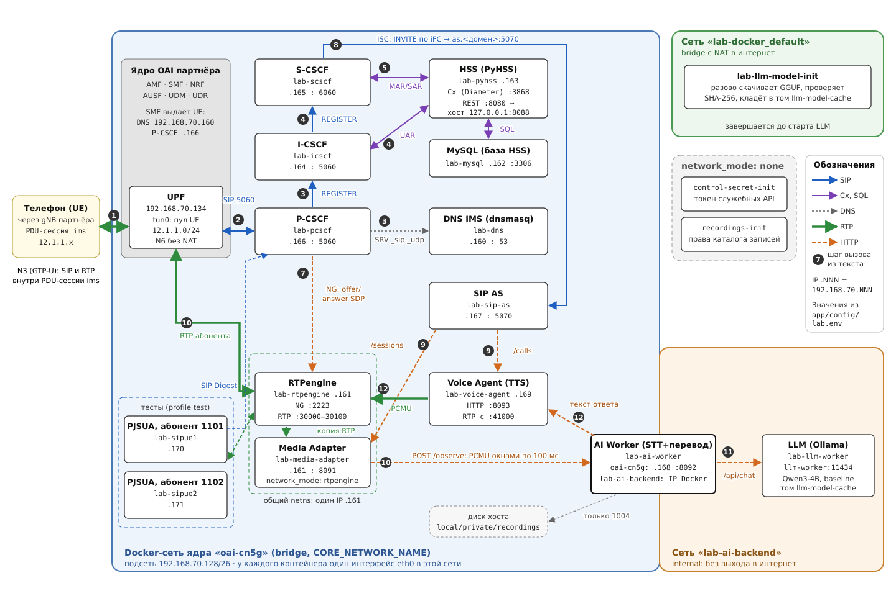

# Туториал 2. IMS и AI

Как вызов попадает в AI (распознавание, перевод, синтез речи, запись), какие есть
номера услуг и режимы AI, как их запустить и проверить. Условие: IMS подключена к
ядру по [туториалу 1](guide-1-ims-core.md). SIP-серверы и клиенты подробно — в
[туториале 3](guide-3-sip.md).

# Часть 1. Команды

**1. Полный режим `baseline` (Whisper + Qwen + Piper)**

```bash
python3 scripts/start.py
```

Результат: `STARTED: IMS + AI (baseline)`. Первый запуск долгий: образы, Qwen около
2,5 ГБ, Whisper.

**2. Проверки** (строго по одной; что проверяет каждая — [раздел 5](#5-проверки))

```bash
bash app/tests/integration/verify-ims.sh
bash app/tests/integration/verify-ims-call.sh
bash app/tests/integration/verify-voice-agent.sh
bash app/tests/integration/verify-translation.sh
bash app/tests/integration/verify-transcription.sh
python3 app/tests/integration/verify_interpreter.py
bash app/tests/integration/verify-security.sh
```

Результат: каждая `.sh` заканчивается строкой `...: PASS`, `verify_interpreter.py`
печатает JSON с `"pass": true`. Тесты сами поднимают тестовые SIP-клиенты
`lab-sipue1/2` и сами готовят синтетические WAV; отдельный запуск чего-либо ещё не нужен.

**3. Лёгкий режим `compact` без Qwen и GPU.** Сначала один раз модели перевода
OPUS-MT (можно на другой машине и перенести каталог `local/models/opus-mt/`):

```bash
python3 -m pip install --user uv
uv venv --python 3.11 local/opus-venv
uv pip install --python local/opus-venv/bin/python ctranslate2==4.8.2 transformers==4.57.6 sentencepiece==0.2.2 torch==2.10.0 --torch-backend cpu
local/opus-venv/bin/python scripts/prepare_translation_models.py
python3 scripts/start.py --mode compact
```

Результат: `OPUS MODEL READY: ru-en`, `OPUS MODEL READY: en-ru`, затем
`STARTED: IMS + AI (compact)`. Вернуться к Qwen: `python3 scripts/start.py`.

**4. Звонок с телефона.** 1003 — перевод RU → EN, 1004 — запись и расшифровка,
1005 и 1006 с двух телефонов — двусторонний перевод. Записи:

```bash
docker exec lab-ai-worker ls /recordings
```

**5. Журналы**

```bash
docker compose --env-file app/config/lab.env logs -f sip-as media-adapter ai-worker voice-agent
```

# Часть 2. Как устроено

## 1. Схема



Цифры на стрелках — шаги вызова из [туториала 1](guide-1-ims-core.md#3-один-вызов-от-начала-до-конца).
Адреса — значения по умолчанию из [lab.env](../app/config/lab.env). На схеме четыре сети:

- **`oai-cn5g`** — Docker-сеть ядра OAI. Её создаёт ядро; наш Compose подключает к ней
  все сервисы IMS, SIP AS, Voice Agent, AI Worker и тестовые клиенты со статическими
  адресами. У каждого контейнера в ней один интерфейс `eth0`. Отсюда же есть выход в
  интернет через NAT Docker (для загрузки Whisper).
- **`lab-ai-backend`** — внутренняя сеть без выхода наружу. В ней только Ollama и
  второй интерфейс AI Worker: LLM недоступна ни телефонам, ни ядру.
- **`lab-docker_default`** — обычный bridge Compose с NAT в интернет. В нём только
  разовый загрузчик модели Qwen.
- **`network_mode: none`** — разовые контейнеры без сети: генерация служебного токена
  и права на каталог записей.

Отдельной сети `ims-admin` больше нет: REST API PyHSS опубликован на хосте
(`127.0.0.1:8088`) через обычный проброс порта.

## 2. Роли сервисов

- **DNS** (`lab-dns`, `.160:53`, dnsmasq) — зона IMS-домена: `pcscf.`, `icscf.`,
  `scscf.`, `hss.`, `as.<домен>` и SRV `_sip._udp`. Его адрес SMF выдаёт телефонам.
- **P-CSCF** (`lab-pcscf`, `.166:5060`, Kamailio) — вход телефона в IMS. Пересылает SIP
  к I/S-CSCF, привязывает медиа каждого вызова к RTPengine.
- **I-CSCF** (`lab-icscf`, `.164:5060`, Kamailio) — при регистрации спрашивает HSS,
  какой S-CSCF обслуживает абонента.
- **S-CSCF** (`lab-scscf`, `.165:6060`, Kamailio с патчем регистратора) — регистратор:
  аутентификация, хранение регистрации, маршрутизация вызовов, вызов SIP AS по iFC.
- **HSS** (`lab-pyhss`, `.163`, Diameter Cx `:3868`, REST `127.0.0.1:8088`) — абоненты
  IMS, их ключи K/OPc и правила iFC. Данные — в `lab-mysql` (`.162:3306`, том `mysql-data`).
- **RTPengine** (`lab-rtpengine`, `.161`, NG `:2223`, RTP `30000–30100`) — медиа-якорь:
  через него идёт весь звук; транскодирует AMR/AMR-WB телефона в PCMU для AI.
- **SIP AS** (`lab-sip-as`, `.167:5070`, наш Python) — получает `INVITE` от S-CSCF по
  iFC, выбирает сценарий по номеру, сам отвечает на номера услуг, управляет Media
  Adapter и Voice Agent по HTTP.
- **Media Adapter** (`lab-media-adapter`, сетевое пространство RTPengine, `:8091`) —
  видит RTP вызова, по NG сопоставляет порты с Call-ID и отправляет PCMU в AI Worker
  окнами по 100 мс.
- **AI Worker** (`lab-ai-worker`, `.168:8092` и сеть `lab-ai-backend`) — делит звук на
  реплики по паузам, распознаёт Whisper, переводит (Qwen или OPUS-MT), пишет запись
  1004, отдаёт текст Voice Agent.
- **LLM** (`lab-llm-worker`, `llm-worker:11434` только в `lab-ai-backend`) — Ollama с
  Qwen3-4B; работает только в режиме `baseline`.
- **Voice Agent** (`lab-voice-agent`, `.169`, HTTP `:8093`, RTP с `:41000`) — синтез
  речи Piper (запасной eSpeak NG), отдельная очередь озвучки на каждый вызов,
  отправка PCMU в RTPengine.
- **Тестовые клиенты** (`lab-sipue1` `.170`, `lab-sipue2` `.171`, PJSUA, профиль
  `test`) — абоненты 1101 и 1102 для автоматических проверок; регистрируются прямо
  из сети ядра паролем, без 5G. Телефонам не мешают: у них свои IMSI.
- **Разовые контейнеры**: `lab-llm-model-init` скачивает GGUF и проверяет SHA-256,
  `control-secret-init` создаёт внутренний токен служебных API в томе,
  `recordings-init` отдаёт каталог записей пользователю AI Worker (uid 65532).

Каждый наш сервис — один процесс: вызовы, очереди и история хранятся в памяти.
Разные вызовы обрабатываются параллельно; после перезапуска сервиса состояние
вызовов не восстанавливается.

## 3. Услуги и номера

Номера задаются в `lab.env` (`VOICE_*_MSISDN`).

- **1001, 1002** — телефоны `UE1`, `UE2`; обычный вызов без AI. **1101, 1102** —
  тестовые клиенты.
- **1003** — перевод: русская речь звонящего возвращается ему английским голосом.
- **1004** — запись: после звукового уведомления речь записывается и расшифровывается.
- **1005 / 1006** — двусторонний перевод. Это два отдельных вызова к услуге: русский
  участник звонит на 1005, английский на 1006. Каждый слышит перевод речи другого на
  своём языке; исходный звук между ними не передаётся.

Записывается только вызов на 1004 и только после уведомления:

```text
local/private/recordings/<session-id>/
  README.txt       уведомление о приватной записи
  transcript.txt   распознанный текст
  turn-0001.wav    звук реплики
  manifest.jsonl   метаданные: язык, длительность, вид транскрипции
  completed.json   записывается при BYE
```

Каталоги принадлежат uid 65532; с хоста их читают через `sudo` или
`docker exec lab-ai-worker`.

## 4. Режимы AI

Режим выбирается при запуске: `python3 scripts/start.py --mode <режим>`. `lab.env`
не меняется: скрипт пишет параметры режима и overlay Compose в
`local/ai-profiles/<режим>/`. Режим действует до следующего запуска `start.py`.

- **`baseline`** — Whisper small, перевод Qwen3-4B (Ollama), Piper. Эталон: все
  проверки рассчитаны на него, расшифровка 1004 очищается LLM.
- **`balanced`** — Whisper small, два OPUS-MT int8 (RU→EN, EN→RU), Piper. Меньше памяти,
  тот же ASR.
- **`compact`** — Whisper base, OPUS-MT, Piper. Основной вариант для слабого CPU.
- **`minimal`** — Whisper tiny, OPUS-MT, eSpeak NG. Экспериментальный, заметно хуже
  распознаёт русский.

В CPU-режимах GPU и потоковый перевод принудительно выключены, Ollama не запускается,
расшифровка 1004 сохраняется как есть (`raw_asr`), а одновременно обслуживается не
больше двух голосовых вызовов. Параметры режимов — [ai-profiles.json](../app/config/ai-profiles.json).
Замеры на i5-12400F без GPU (фраза около 6,5 с, медианы): STT RU 2,75 с в `balanced`,
0,94 с в `compact`, 0,68 с в `minimal`; перевод OPUS-MT 0,1–0,2 с; Piper синтезирует
6,5 с речи за 0,5 с. Это замеры компонентов, а не всего звонка.

## 5. Проверки

Все проверки используют один стенд: запускайте их строго по одной, на свободном
стенде, не во время чужих звонков через AI. Каждая сама пересоздаёт тестовых
клиентов `lab-sipue1/2`. Проверки 4–6 рассчитаны на режим `baseline`.

1. **`verify-ims.sh`** — DNS-зона IMS, абоненты и Cx в PyHSS, маршрут к пулу UE через
   UPF, регистрация двух тестовых клиентов с UAR/MAR/SAR. Вызовов не делает.
2. **`verify-ims-call.sh`** — вызов 1101 → 1102: INVITE через P/S-CSCF, вызов SIP AS по
   iFC, медиа обеих сторон в RTPengine, звук в AI Worker. Затем останавливает AI
   Worker и проверяет, что RTP продолжает идти (fail-open).
3. **`verify-voice-agent.sh`** — вызов номера услуги без проверки моделей: AS отвечает
   сам, ACK доходит до AS, Voice Agent синтезирует приветствие и обменивается RTP,
   BYE освобождает сессии.
4. **`verify-translation.sh`** — 1003: две русские реплики проходят Whisper и Qwen,
   английский перевод возвращается абоненту по RTP. Печатает только метаданные.
5. **`verify-transcription.sh`** — 1004: нормализация LLM на контрольной фразе,
   уведомление о записи, запись WAV 8 кГц и `transcript.txt` с русским текстом.
6. **`verify_interpreter.py`** — 1005/1006: два вызова, по два перевода в каждую
   сторону, задержка от конца фразы до первого RTP перевода не больше
   `INTERPRETER_MAX_RESPONSE_DELAY_MS`. При первом запуске синтезирует диалог Piper в
   `local/private/interpreter/`. Отчёт — JSON.
7. **`verify-security.sh`** — read-only rootfs, no-new-privileges, сброс capabilities,
   ограниченные журналы, токен на служебных API, Ollama только во внутренней сети,
   отсутствие IMSI и текста реплик в журналах. Звонков не делает.

`python3 scripts/check.py` перед коммитом проверяет код без стенда: Git, размер и
синтаксис файлов, ссылки в документации, отсутствие адресов вне `lab.env`, ruff и
unit-тесты из `app/tests/unit/`. Что проверяет каждый unit-тест, написано в первой
строке файла; список — в [карте проекта](project-layout.md#тесты).

## 6. Как вызов попадает в AI

PyHSS при provisioning записывает каждому абоненту iFC из
[default_ifc.xml](../app/infrastructure/vendor/docker_open5gs/pyhss/default_ifc.xml):
исходящий `INVITE` с приоритетом 30 отправляется на `sip:as.<IMS_DOMAIN>:<SIP_AS_PORT>`,
а `DefaultHandling 0` продолжает вызов при недоступном AS. Поэтому обычный разговор не
зависит от AI, а услуги AI при отказе просто не работают.

SIP AS ([routing.py](../app/services/sip-as/ims_sip/routing.py)) сравнивает номер
назначения с номерами услуг. Обычный вызов он возвращает в S-CSCF и только включает
наблюдение. Вызов на номер услуги он завершает сам и соединяет с Voice Agent.
Внутренний формат звука AI — PCMU/8000: это протокольный контракт, одной переменной
его не поменять. Путь речи по коду (от `app/services/`):

1. `sip-as/ims_sip/routing.py` — SIP и выбор сценария.
2. `media-adapter/ims_media/` — приём RTP и отправка в AI Worker.
3. `ai-worker/ims_ai/segmentation.py` — сборка окон в реплики по паузам.
4. `ai-worker/ims_ai/queueing.py` — передача реплики свободному обработчику.
5. `ai-worker/ims_ai/utterances.py` — распознавание и замер времени STT.
6. `ai-worker/ims_ai/transcription.py` — нормализация и сохранение текста (1004).
7. `ai-worker/ims_ai/replies.py` — перевод или ответ и доставка в нужный канал.
8. `voice-agent/ims_voice/media.py` — озвучка и отправка PCMU.

Между сервисами — внутренний HTTP с токеном из тома `service-control-secret`, а не
интерфейс 3GPP. `POST /observe` несёт окно PCMU (base64) и непрозрачные Call-ID без
SIP-идентификаторов абонента. `GET /events` отдаёт только метаданные: версии моделей,
длительности, число символов, время STT/LLM. Voice Agent принимает задания отправлять
звук только на адрес и порты RTPengine.

## 7. Настройка AI

Параметры — в `app/config/lab.env`. После изменения повторите `python3 scripts/start.py`
(с тем же `--mode`): он пересоздаст изменённые сервисы. Модели Piper задаются при сборке
образа, поэтому их смена требует `docker compose --env-file app/config/lab.env build voice-agent`.

- **STT**: `AI_MODEL_SIZE`, `AI_MODEL_REVISION`, `AI_DEVICE`, `AI_COMPUTE_TYPE`, `AI_LANGUAGE`, `AI_STT_*`.
- **Границы реплик**: `AI_UTTERANCE_*`, `AI_VAD_RMS`, `AI_AUDIO_PREROLL_MS`.
- **Очереди**: `AI_QUEUE_MAX`, `AI_UTTERANCE_QUEUE_MAX`, `AI_PROCESSING_WORKERS`,
  `VOICE_AGENT_REPLY_QUEUE_MAX`, `LLM_NUM_PARALLEL`.
- **LLM**: `LLM_MODEL`, `LLM_GGUF_URL`, `LLM_GGUF_SHA256` (смена модели — эти три значения),
  `LLM_*PROMPT`, `LLM_TIMEOUT_SECONDS`.
- **Синтез**: `TTS_BACKEND`, `TTS_VOICE`, `TTS_TRANSLATION_VOICE`, `PIPER_*`.
- **Запись**: `RECORDING_ENABLED`, `RECORDING_RETENTION_DAYS`.
- **Ресурсы**: `*_CPU_LIMIT`, `*_MEMORY_LIMIT`.

GPU NVIDIA (нужен NVIDIA Container Toolkit) включается в `lab.env`:
`LLM_CONTAINER_RUNTIME=nvidia`, `LLM_GPU_DEVICES=all`, `AI_ENABLE_CUDA=1`,
`AI_CONTAINER_RUNTIME=nvidia`, `AI_GPU_DEVICES=all`, `AI_DEVICE=cuda`,
`AI_COMPUTE_TYPE=int8_float16`, `AI_WORKER_MEMORY_LIMIT=4g`. CPU-режимы GPU всегда выключают.

## 8. Диагностика AI

Сначала убедитесь, что работает обычный вызов: если нет, смена модели не поможет
([туториал 1, раздел 7](guide-1-ims-core.md#7-диагностика)).

AI Worker долго остаётся `unhealthy`, если он ещё качает Whisper или ждёт прогрева
LLM; в CPU-режимах частая причина — нет одного из двух `manifest.json` OPUS-MT. Смотрите
`docker logs lab-ai-worker`. Если на номере услуги нет приветствия, посмотрите
`docker logs lab-sip-as`: есть ли `AS terminated INVITE for voice agent`. Если строки
нет, S-CSCF не вызвал AS — проверьте, что `as.<домен>` разрешается в DNS и абонент
заведён с iFC. Если приветствие есть, а перевода нет, проверьте по порядку: приходят
ли окна звука в `docker logs lab-media-adapter`, распознана ли реплика и на каком языке
в `docker logs lab-ai-worker`, отправлен ли ответ в `docker logs lab-voice-agent`.
Нет записи после 1004 — проверьте, прозвучало ли уведомление, была ли речь после него
и включён ли `RECORDING_ENABLED`. Если контейнер AI перезапускается, проверьте
`docker inspect --format '{{.State.OOMKilled}}' lab-ai-worker` и лимиты памяти.

## 9. Задержка

Обработка пофразовая, поэтому задержка складывается так: длительность фразы +
ожидание тишины + очередь + STT + перевод + TTS + доставка. При фразе 6 с ответ через
1–3 с от начала речи недостижим; эта цель не подтверждена. Потоковый режим
(`AI_STREAMING_ENABLED=1`) экспериментальный и выключен: в прогонах либо задержка
выходила за 1–3 с, либо терялась полнота текста. Метрика `verify_interpreter.py` —
время от конца фразы до отправки первого слышимого RTP перевода, без jitter buffer
телефона.
