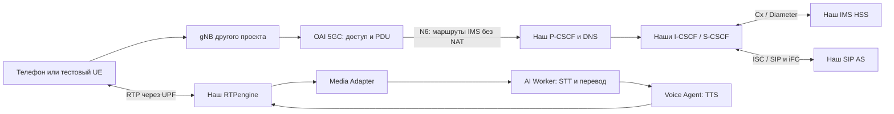

# Как связать IMS + AI с другим проектом

Здесь описаны технические интерфейсы и порядок подключения. Конкретные адреса,
версия внешнего ядра и модель телефона задаются для целевого стенда.
Документ не означает, что внешний стенд уже принят. Команды развёртывания:
[partner-integration.md](partner-integration.md); все параметры: [lab-env-reference.md](lab-env-reference.md).

## Архитектура и границы

Есть роли 3GPP IMS: P/I/S-CSCF, HSS/Cx, SIP AS/ISC с iFC. Наша обработка речи —
прикладная услуга поверх IMS. HTTP между Python-сервисами и управление RTPengine
NG являются внутренними интерфейсами проекта, а не дополнительными интерфейсами 3GPP.
OAI UDM/AUSF/UDR обслуживают доступ 5GS и не заменяют IMS HSS.

Это ограниченный лабораторный профиль: полная матрица IMS AKA/Gm security,
IPsec, QoS/policy Rx/N5, VoNR и отказоустойчивость не приняты. Подробнее:
[профиль](3gpp-profile.md), [критерии 3GPP](3gpp-acceptance.md),
[ограничения телефона](native-phone.md). Работа Digest-клиента не доказывает
работу встроенной звонилки телефона.
В текущем SIP AS обязательные `100rel`/`precondition` отклоняются; если телефон
их требует, потребуются реализация и проверка PRACK/UPDATE и согласования QoS.

## Три варианта соединения

| Сценарий | Что запускать | Условие |
| --- | --- | --- |
| Одна ВМ, всё наше | `docker-compose.yml` через локальный launcher | OAI + UERANSIM + IMS + выбранный AI; [полный гайд](quickstart.md) |
| OAI другого проекта и наш IMS на одной Linux ВМ | `compose.partner.yml` для нашей части | Их UPF N6 должен достигать LAN macvlan; общий хост сам по себе маршруты не создаёт |
| OAI и IMS на разных ВМ/хостах | Тот же partner Compose | Согласованная LAN/VLAN, маршруты в обе стороны, дополнительные MAC разрешены на vSwitch |

Нельзя одновременно запустить локальный и partner Compose на одном Docker daemon:
имена проекта, контейнеров и томов общие. Для внешней интеграции сначала выбирают
сетевую схему, затем применяют её к Compose. Проброс одного SIP-порта или создание
общей Docker-сети без настройки N6/обратного маршрута недостаточны.

## Входы и выходы нашей части

| Граница | Откуда → куда | Данные и параметры | Критерий |
| --- | --- | --- | --- |
| Доступ | UE → RAN → OAI | IMS DNN, PLMN, S-NSSAI, IP из IMS UE pool | Активная IMS PDU-сессия |
| Обнаружение | OAI/UE → наш DNS/P-CSCF | DNS и P-CSCF в согласованном механизме PCO/EPCO; IMS domain | UE использует нужный P-CSCF |
| DNS | IMS UE → `DNS_IP` | UDP/TCP 53, IMS-зона | Разрешение имени с адреса UE |
| SIP | IMS UE ↔ `PCSCF_IP` | `PCSCF_SIP_PORT` (5060), UDP/TCP текущего профиля; IMPI/IMPU, realm, Contact | REGISTER 200, затем INVITE/200/ACK/BYE |
| Звук | IMS UE ↔ `RTPENGINE_IP` | UDP `RTPENGINE_PORT_MIN`–`MAX` (30000–30100); достижимые SDP-адреса | Звук обоих источников у противоположного участника |
| Абоненты | Настройка клиента ↔ наш HSS | IMS identity, номер, K/OPc/AMF по защищённому каналу | Ожидаемый способ аутентификации; SQN сохраняется |
| Услуги | UE → сервисные номера | 1003 перевод, 1004 запись, 1005/1006 языковые входы по умолчанию | Перевод обоих направлений и сохранённая расшифровка |

Внешнему ядру не требуется доступ к нашим SQL, Cx, RTPengine NG или AI HTTP.
Открывайте абонентские потоки; внутренние порты ограничивайте внутри доверенной
сети. Текущий macvlan Compose сам по себе не изолирует все control-plane порты.

Внутри поставки: S-CSCF вызывает SIP AS, AS управляет Media Adapter и Voice Agent,
Media Adapter отправляет аудио AI Worker, AI Worker передаёт текст на озвучку.
Python-сервисы уже разделены по контейнерам; OPUS и Whisper живут в AI Worker,
Piper — в Voice Agent; Ollama нужен только baseline. Карта реализации:
[app/services](../app/services/README.md), [Compose AI](../app/infrastructure/compose/ai.yml).
Прямое подключение чужого Python-модуля к этим HTTP API требует отдельного
согласования форматов, жизненного цикла Call-ID и токена; публичного стабильного
API «произвольное аудио → перевод» этот контракт не обещает.

AI получает PCMU/8000. Для телефонных AMR/AMR-WB предусмотрено транскодирование
на границе AI-услуг; компонентный тест кодеков не заменяет полный вызов. EVS
не поддержан. Кодек и упаковку RTP согласовывают до интеграционного звонка.

## Параметры подключения

| Поле | Требуемое решение |
| --- | --- |
| Версия и размещение | Commit/образы обоих проектов; одна ВМ или несколько; Linux/CPU/архитектура/RAM |
| PLMN и область | MCC, MNC, TAC; IMS home domain; способ формирования IMPI/IMPU |
| PDU | IMS DNN, SST и при необходимости SD, IPv4-пул UE и подписка в OAI |
| LAN | VLAN, CIDR, интерфейс Linux, шлюз к UE; свободный динамический диапазон и статические IP |
| Обнаружение | DNS_IP и PCSCF_IP; где задаются в SMF и как проверяются у UE |
| Маршруты | N6 → IMS LAN и IMS LAN → UE pool; отсутствие NAT/SIP ALG на IMS-тракте |
| Абоненты | Два тестовых IMSI/номера, SIM/ISIM, поддерживаемая аутентификация; ключи вне документа |
| Телефон | Модель, прошивка, операторский профиль, VoNR/IMS-настройки, RAN/диапазон |
| AI | baseline/balanced/compact/minimal, допустимое качество, предел вызовов, запись/retention |
| Приёмка | Журнал результатов и общий способ измерения времени |

Не добавляйте SD, TLS/IPsec или альтернативный bearer как произвольные новые env:
их поддержка должна быть проверена в конкретных шаблонах и клиентах. При
несовпадении профиля фиксируется необходимая доработка.

## Общая приёмка по этапам

1. **Воспроизводимость:** чистый клон, зафиксированные образы/модели, offline PASS,
   корректный Compose. Это ещё не успешная интеграция.
2. **Транспорт:** IMS PDU, IP/PCO, DNS и оба маршрута. На этом этапе AI не нужен.
3. **Телефония:** два REGISTER с ожидаемой аутентификацией, вызов в обе стороны,
   корректные SIP/SDP и звук. Зафиксировать согласованный кодек.
4. **Услуги:** RU → EN и EN → RU, две языковые ноги, слышимый результат; номер
   транскрипции с уведомлением, WAV и текст. Различать raw и LLM-normalized.
5. **Перезапуск и отказ:** повторная регистрация, повторный вызов, отказ AI при
   обычном звонке, отсутствие оставшихся сессий; сохранённые ключи/SQN.
6. **Ресурсы и время:** CPU/RAM всей ВМ под нагрузкой, OOM/restarts, очереди,
   время от начала речи до слышимого перевода на втором устройстве. Пофразовый
   режим не гарантирует 1–3 секунды; streaming пока экспериментальный.

На каждый этап сохраняйте дату, версии, топологию, команды, фактический результат,
ограничения и путь к приватным артефактам. Ошибка остаётся FAIL даже после
успешного повтора. Локальные тесты с `lab-ue*` не проверяют автоматически телефон
партнёра. Отдельно фиксируйте серверный RTP и действительно воспроизведённый звук.
