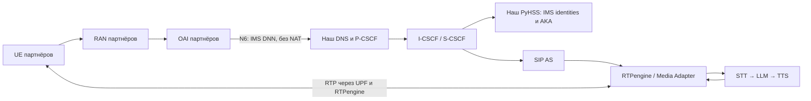

# Подключение IMS + AI к OAI партнёров

Передаваемая часть — DNS, PyHSS/MySQL, P/I/S-CSCF, RTPengine, SIP AS,
Media Adapter, AI Worker, локальные STT/LLM/TTS. Партнёры сохраняют свой OAI,
RAN и UE. Наш OAI + UERANSIM нужен для локальной проверки интеграции.

Два независимых входа:

- `python scripts/start_lab.py --base-only` — локальный OAI + UERANSIM + IMS.
- `python scripts/start_partner.py` — только IMS + AI, без ядра и эмуляторов.

[compose.partner.yml](../compose.partner.yml) включает те же определения IMS/AI,
что локальный стенд. Для переноса не нужно менять исходники сервисов.
Текущее состояние проверок — [oai-migration.md](oai-migration.md).

## Граница интеграции



OAI UDM/UDR и IMS HSS — разные базы. Для обычного SIP/RTP соединения нашему
IMS не нужен доступ к SQL-базе OAI, NRF или N2/N3/N4. OAI выдаёт IMS PDU,
DNS и P-CSCF; UE регистрируется в нашем IMS, а HSS обслуживает Cx внутри
нашей части. N5/Rx policy integration, dedicated QoS flows и гарантии
физического VoNR в этот проверочный профиль не входят.

## Что согласовать и заполнить

Все публичные значения задаются в [lab.env](../app/config/lab.env),
ключи — только в `local/secrets/ims.env`. Таблица является контрактом
подключения; конкретные адреса партнёров пока не получены.

| Параметры | Ответственная сторона и проверка |
| --- | --- |
| `MCC`, `MNC`, `IMS_DOMAIN` | Согласовать PLMN и IMS home domain; IMS domain не выводить автоматически из случайного тестового PLMN |
| `IMS_DNN`, `IMS_UE_CIDR`, S-NSSAI | Партнёры: разрешить DNN абонентам, выдать IPv4 PDU, указать SST/SD; пул не пересекается с LAN контейнеров |
| `LAB_NETWORK_CIDR`, `LAB_DYNAMIC_IP_RANGE` | Выделенная LAN/VLAN для нашей части; диапазон Docker исключить из DHCP, статические service IP зарезервировать |
| `IMS_PARENT_INTERFACE` | Интерфейс Linux ВМ/хоста в этой LAN/VLAN, например имя из `ip link`; адрес не зашит в Compose |
| `IMS_ROUTE_GATEWAY` | Достижимый в той же LAN next hop к пулу IMS UE; это может быть UPF или маршрутизатор, не обязательно адрес удалённого UPF |
| `DNS_IP`, `PCSCF_IP` | Партнёры указывают эти адреса в конфигурации SMF DNS/P-CSCF; проверяют реально выданные PCO/EPCO и настройки UE |
| `INTERNET_UE_CIDR` | Партнёры указывают реальный internet UE pool: совместимые init-скрипты CSCF/media также устанавливают обратный маршрут к нему |
| `RTPENGINE_IP`, RTP диапазон | Маршрут между IMS UE pool и media anchor в обе стороны, без NAT/SIP ALG |
| `UE1_IMSI`, `UE2_IMSI`, `UE*_MSISDN` | Текущий bootstrap создаёт два согласованных тестовых IMS-абонента; IMPI/IMPU и home domain должны совпадать с клиентом |
| `UE*_IMS_K/OPC/AMF` | В защищённом канале согласовать с IMS-клиентом/ISIM; не менять ключи существующих SIM и не обнулять SQN |

У партнёров 5GS K/OPc остаются в их UDR и SIM. `--ims-only` при подготовке
нашей части не требует их 5GS-секретов. Независимые IMS и 5GS ключи удобны
для программного тестового клиента; для телефона нужно проверить его
USIM/ISIM и реальный механизм IMS AKA.

## Сеть и порты

Партнёрский вариант рассчитан на Linux и macvlan: контейнеры имеют собственные
адреса в согласованной LAN. ВМ должна пропускать дополнительные MAC-адреса;
это проверяется настройкой vSwitch/port group. Запуск macvlan на Docker
Desktop Windows этим сценарием не покрыт. Нельзя запускать локальный стенд
и партнёрский вариант одновременно на одном Docker daemon: имена контейнеров
и томов намеренно общие.

`IMS_ROUTE_GATEWAY` задаёт обратные маршруты у DNS, CSCF и RTPengine.
Партнёры обеспечивают маршрут N6 к LAN сервисов. SIP/SDP должны рекламировать
достижимые адреса; одного проброса SIP-порта на хост недостаточно.
PyHSS имеет дополнительный management bridge с приоритетным default gateway для локального REST управления:
не надо открывать HSS API на внешнюю сеть ради provisioning.

| Поток через границу | Порты из lab.env |
| --- | --- |
| UE → DNS | UDP/TCP 53 |
| UE ↔ P-CSCF | `PCSCF_SIP_PORT`, текущий профиль UDP/TCP SIP |
| UE ↔ RTPengine | UDP `RTPENGINE_PORT_MIN`–`RTPENGINE_PORT_MAX` |

Cx, SQL, RTPengine control и AI HTTP — внутренние связи нашей части.
При использовании общей LAN партнёры должны ограничить доступ к внутренним
адресам/портам средствами сети. Текущий Compose не является полной сетевой
изоляцией всех IMS control-plane интерфейсов.

## Запуск на стороне партнёров

1. Получить исходники нашей части и Docker Engine 28+ с Compose 2.33.1+, Linux,
   Python 3.12+. Настроить LAN/VLAN и выделить адреса.
2. Заполнить `app/config/lab.env` по таблице. Подготовить согласованные IMS
   ключи в `local/secrets/ims.env`. Для новых программных клиентов можно
   вызвать `python scripts/initialize_local.py --ims-only` и затем передать
   сгенерированные IMS-ключи клиентам защищённым способом.
3. `python scripts/start_partner.py --check` — проверка конфигурации.
4. `python scripts/start_partner.py --ims-only` — поднять IMS, создать
   subscriber/iFC, дождаться Cx. Команда не изменяет ядро партнёров.
5. Проверить IMS REGISTER и обычный вызов. Затем `python scripts/start_partner.py`
   загружает модели и запускает AI. Первый запуск требует доступа к registry
   и хранилищам моделей; веса остаются в постоянных томах.
6. Для обслуживания использовать
   `docker compose --env-file app/config/lab.env --env-file local/secrets/ims.env -f compose.partner.yml ps`.

Надпись `STARTED` означает готовность процессов. До проверки внешних UE,
SIP/RTP и AI-вызова интеграция остаётся `UNVERIFIED`.

## Приёмка: в этом порядке

1. У UE есть IMS PDU, корректные DNS/P-CSCF и разрешённый DNN/S-NSSAI.
2. DNS и P-CSCF доступны с адреса IMS PDU; подтверждён обратный маршрут.
3. Два IMS REGISTER завершаются 200 OK с ожидаемой аутентификацией.
   Digest лабораторного PJSUA не заменяет IMS AKA и Gm security телефона.
4. Вызов UE1 → UE2: INVITE/200/ACK/BYE и двусторонний RTP через anchor.
5. S-CSCF вызывает SIP AS по iFC; Media Adapter получает PCMU/8000.
6. Включить режим AI, проверить STT → перевод/ответ → TTS и звук у удалённого UE.
7. Повторить после перезапуска IMS и повторной регистрации; SQN не сбрасывать.

Локальные gate-скрипты используют контейнеры `lab-ue*`/`lab-sipue*` и не являются
автоматической проверкой внешних телефонов. Для партнёрской приёмки нужны их
UE/клиенты, трассы на согласованных границах и отдельный протокол результатов.
Документация по AI: [local-models.md](local-models.md), по статусу 3GPP:
[3gpp-acceptance.md](3gpp-acceptance.md).

Текущий контракт AI — PCMU/8000. Для AMR/AMR-WB добавлены кодировщики и
транскодирование на границе AI-номеров; EVS не поддержан. Состав проверок и
оставшиеся ограничения описаны в [native-phone.md](native-phone.md). Прямую совместимость
с реальным телефоном и задержку 1–3 секунды эта инструкция не утверждает.

## Локальное воспроизведение SIPp / AI

Для нашего OAI-стенда после `start_lab.py --base-only`:

```bash
python app/tests/integration/verify_aka_registration.py
docker stop lab-sip-as lab-ai-worker lab-media-adapter lab-voice-agent
python app/tests/integration/verify_aka_call.py --caller 1
bash scripts/compose.sh up -d --no-deps --force-recreate sip-as ai-worker media-adapter voice-agent
```

Это последовательные тестовые сценарии SIPp/AKA на общем стенде. Они временно
останавливают PJSUA, создают тестовые регистрации/вызовы и восстанавливают
клиенты; одновременно с другими gate-скриптами их не запускать.
Plain AKA call требует остановленных AS/AI. Если запускали только базовый
стенд и этих контейнеров ещё нет, строки остановки/восстановления не нужны; после ошибки
теста также восстановите ранее работавшие сервисы.
Сборка и происхождение SIPp — [sipp-aka-provenance.md](sipp-aka-provenance.md).

После полного локального запуска:

```bash
bash app/tests/integration/verify-ims-call.sh
bash app/tests/integration/verify-real-ai-stream.sh
```

Первый проверяет SIP AS, RTP и fail-open при недоступности AI. Второй —
русский звук через IMS, STT, перевод на английский и TTS/RTP.
Номера сервисов задаются `VOICE_TRANSLATOR_MSISDN`, `VOICE_INTERPRETER_RU_MSISDN`,
`VOICE_INTERPRETER_EN_MSISDN`, `VOICE_TRANSCRIBER_MSISDN` в lab.env;
актуальные имена параметров и сценарии описаны в [running.md](running.md).

Правило выбора default gateway по `gw_priority`:
[Docker Compose reference](https://docs.docker.com/reference/compose-file/services/#gw_priority).
