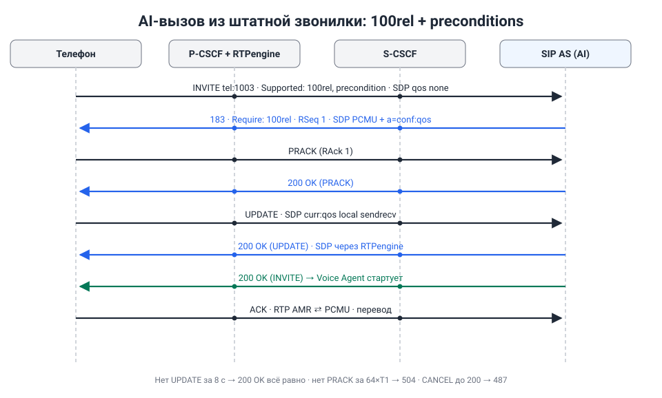

# Проверка на стенде с телефонами

[Назад к документации](README.md). Подготовка SIM: [research-sims.md](research-sims.md).
Требования к телефону: [native-phone.md](native-phone.md).

Одна команда показывает, готов ли сервер, ещё до того, как берёте телефон в руки:

```bash
python scripts/stand_check.py
```

| Команда | Что делает |
| --- | --- |
| `stand_check.py` | Preflight: конфигурация, контейнеры, версии SIP AS/P-CSCF, SIM в базах, кодеки, самотест AI-вызова |
| `stand_check.py phones` | Какие SIM зарегистрированы в IMS и с какого IMS-адреса |
| `stand_check.py watch` | Живой журнал P-CSCF, S-CSCF и SIP AS во время звонка; строки с ключами скрыты |
| `stand_check.py collect` | Сохранить журналы за 3 часа в `local/evidence/stand-…` для разбора |

Самотест — один синтетический вызов внутри `lab-sip-as` по той же схеме, что у
штатной звонилки: `INVITE tel:1003;phone-context=…` с `100rel`/`precondition` →
надёжный 183 → PRACK → UPDATE → 200 OK → BYE. Не запускайте его одновременно
с интеграционными проверками: стенд общий.



## 1. До выезда на стенд

1. Получить ветку с изменениями и таблицу SIM (она у оператора, не в Git).
2. `python scripts/research_sims.py import /путь/sim_imsi.xlsx` и `… plan` — 10 карт без ошибок.
3. По возможности прочитать одну карту через `pySim-read`: MNC из 2 цифр, ISIM, SUCI, PIN
   ([подробно](research-sims.md#что-проверить-до-первого-звонка)).
4. Ядро у партнёров: `python scripts/research_sims.py oai-sql --output local/private/research-sims-udr.sql`
   и передать файл по защищённому каналу.

## 2. Согласовать с партнёрами

| Что | Значение |
| --- | --- |
| PLMN на gNB и AMF | MCC 901, MNC 70 (2 цифры), TAC согласовать |
| Абоненты в UDR | 10 SIM из `oai-sql`, 5G AKA, DNN `internet` и `ims`, S-NSSAI SST `UE_PDU_SST` |
| DNN `ims` | IPv4-пул `IMS_UE_CIDR`, P-CSCF `PCSCF_IP` и DNS `DNS_IP` в PCO |
| Маршрут | IMS-пул ⇄ наши `PCSCF_IP`, `RTPENGINE_IP` без NAT, порты из [partner-integration.md](partner-integration.md#сеть-и-порты) |

## 3. На стенде, без телефона

```bash
python scripts/research_sims.py retire --imsi 001010000000001 --imsi 001010000000002 --apply  # только для старого стенда
python scripts/start_lab.py --base-only        # или: python3 scripts/start_partner.py --ims-only
scripts/compose.sh up -d --build --force-recreate sip-as pcscf   # если стенд уже был запущен
python scripts/stand_check.py
```

В партнёрском варианте пересоздание идёт через partner-файл:
`docker compose --env-file app/config/lab.env --env-file local/secrets/ims.env -f compose.partner.yml up -d --build --force-recreate sip-as pcscf`.

Ожидаемый итог: `СТЕНД ГОТОВ К ТЕЛЕФОНУ`. Каждая строка `FAIL` содержит подсказку.

## 4. С телефоном

Во втором терминале держите `python scripts/stand_check.py watch`.

| Шаг | Действие | На телефоне | В `watch` / командах |
| --- | --- | --- | --- |
| 1 | Вставить SIM, ввести PIN1 при запросе, создать APN `internet` (default) и `ims` (ims), IPv4 | — | — |
| 2 | Выключить авиарежим | Сеть «90170», значок 5G | Журнал AMF у владельца ядра: Registration Accept |
| 3 | Ждать IMS | Значок VoNR/VoLTE (если есть) | `REGISTER` → 401 → `REGISTER` → 200; `stand_check.py phones` показывает SIM и IMS-адрес |
| 4 | Позвонить с SIM 2600 на 2601 | Звонок, звук в обе стороны | `INVITE … 2601`, 180/183, 200, `BYE` |
| 5 | Позвонить на 1003 (перевод RU→EN) | Приветствие, затем перевод | `AS sent reliable 183`, `PRACK`, `UPDATE`, `AS terminated INVITE` |
| 6 | 1004 (запись), 1005 и 1006 (переводчик) | Предупреждение о записи / голоса каналов | `AS terminated INVITE … service=transcribe/interpret_*` |
| 7 | Авиарежим вкл/выкл, повторить шаги 3 и 5 | То же | Новая регистрация; SQN не сбрасывать |

После испытаний: `python scripts/stand_check.py collect` и пришлите каталог из `local/evidence/`.

## 5. Если не работает

| Симптом | Где смотреть и что делать |
| --- | --- |
| Телефон не видит сеть | PLMN gNB ≠ 901/70; диапазон NR не поддержан телефоном |
| Сеть есть, «Нет SIM» / отказ регистрации | SIM не в UDR, MNC из 3 цифр на карте, включён SUCI: журнал AMF/AUSF у владельца ядра |
| Нет `REGISTER` в `watch` | Нет IMS PDU или P-CSCF/DNS в PCO; маршрут IMS-пула к `PCSCF_IP`; APN `ims` |
| `REGISTER` без 200, повторяется 401 | Ключи AuC ≠ карте (`research_sims.py status`), однократный AUTS — норма; `docker logs lab-scscf` |
| Регистрация есть, вызов на 2601 не идёт | Номер набран не как 2601; `docker logs lab-scscf`, второй телефон не зарегистрирован |
| На 1003: 488 | P-CSCF не пересоздан (нет PCMU для AI), preflight раздел 3 |
| На 1003: 504 `No PRACK Received` | PRACK не дошёл до SIP AS: `docker logs lab-pcscf`, `lab-scscf` |
| На 1003: долгое ожидание ответа | Нет QoS-потока, AI ждёт `SIP_AS_PRECONDITION_TIMEOUT_SECONDS` (8 с) — ожидаемо |
| Тишина после ответа | RTP: `docker logs lab-rtpengine`, маршрут IMS-пул ⇄ `RTPENGINE_IP`, кодек AMR |
