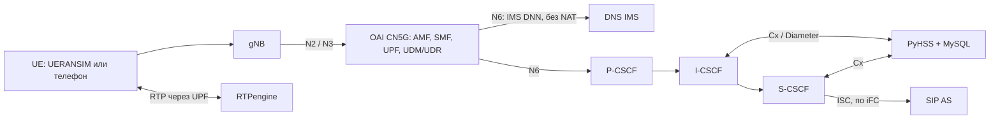

# Туториал 1. Настройка IMS и её связь с ядром 5G

Два варианта: **А** — локальный стенд, наше ядро OAI CN5G + IMS на одной машине;
**Б** — у партнёров уже работает OAI, рядом ставим только нашу IMS + AI.
AI поверх IMS — [туториал 2](guide-2-ims-ai.md), SIP-серверы и клиенты — [туториал 3](guide-3-sip.md).

Команды выполняются из корня репозитория. Bash — для Linux; на Windows Python и
`.ps1` запускайте из PowerShell, `bash ...` — из Git Bash.

# Часть 1. Быстрый запуск

## А. Локальный стенд: наше ядро OAI + IMS

Нужны Git, Python 3.12+, Docker 28+ с Compose 2.33.1+ (Linux или Windows с Docker Desktop/WSL2).

**А1. Исходники и окружение**

```bash
git clone --branch master https://github.com/meonisk/5g-lab.git
cd 5g-lab
docker info --format '{{.OSType}}'
docker compose version
python3 -m venv .venv
source .venv/bin/activate
python -m pip install -r requirements-dev.txt
python scripts/quality/check.py
```

Windows: `python -m venv .venv`, затем `.\.venv\Scripts\Activate.ps1`.
Результат: `linux`, затем `TEAM OFFLINE CHECKS: PASS`.

**А2. Ключи и конфигурация**

```bash
python scripts/initialize_local.py
./scripts/compose.sh config --quiet
```

Windows: `./scripts/compose.ps1 config --quiet`.
Результат: вторая команда ничего не печатает.

**А3. Ядро и IMS без AI**

```bash
python scripts/start_lab.py --base-only
```

Результат: `LOCAL 5G IMS BASE: READY`.

**А4. Проверки** (по одной)

```bash
bash app/tests/integration/verify.sh
bash app/tests/integration/verify-ims.sh
bash app/tests/integration/verify-ims-registration.sh
```

Результат: каждая заканчивается `PASS`; две эмулированные UE подключены к ядру и
зарегистрированы в IMS. Дальше — AI ([туториал 2](guide-2-ims-ai.md)).

**А5. Остановка** (базы сохраняются; `-v` не добавлять)

```bash
./scripts/compose.sh down
```

Результат: контейнеры удалены, тома с базами OAI и IMS остались.

## Б. Ядро уже работает у партнёров: ставим только IMS + AI

Рядом с OAI партнёров работают наши DNS, PyHSS, P/I/S-CSCF, RTPengine, SIP AS и AI.
Наше ядро, gNB и UE не запускаются.

Нужны:

- Linux x86-64 (машина или ВМ), rootful Docker 28+, Compose 2.33.1+, `git`, `bash`,
  `curl`, `python3` 3.12+ (venv не нужен);
- проводной интерфейс в сети, которую видит N6 UPF партнёров (macvlan: Wi-Fi и облачные
  ВМ с port security не подходят; на vSwitch разрешить чужие MAC — promiscuous / forged transmits);
- интернет при первом запуске (образы и модели);
- на этом Docker не работает локальный стенд: если запускался — `./scripts/compose.sh down`,
  затем `docker network rm lab5g`.

**Б1. Партнёры меняют свой OAI** (подробно — [раздел 6.4](#64-что-сделать-на-стороне-ядра-партнёров))

```yaml
dnns:
  - dnn: "ims"
    pdu_session_type: "IPV4"
    ipv4_subnet: "10.46.0.0/16"   # IMS-пул; добавить в smf_info и upf_info
smf:
  ue_dns:
    primary_ipv4: "172.22.0.100"  # наш DNS_IP
  ims:
    pcscf_ipv4: "172.22.0.106"    # наш PCSCF_IP
upf:
  support_features:
    enable_snat: no               # NAT только для internet, см. ниже
```

- В UDR у абонентов разрешён DNN `ims`.
- NAT для internet-пула на UPF: `iptables -t nat -A POSTROUTING -s 10.45.0.0/16 -j MASQUERADE`
  (без него после `enable_snat: no` пропадёт интернет).
- `ue_dns` в OAI общий для всех DNN: internet-абоненты тоже пойдут в наш DNS
  (он пересылает внешние запросы на `DNS_UPSTREAM_*`).
- UPF знает маршрут к `172.22.0.0/24` через N6. Если наш шлюз — маршрутизатор, а не UPF,
  на нём: `ip route add 10.46.0.0/16 via <N6 UPF>`.
- Без SIP ALG и фильтров между UE и нами: UDP/TCP 53, UDP/TCP 5060, UDP 30000–30100;
  для телефонов с IPsec ещё ESP и UDP/TCP 5100, 6100.

Результат: UE получает PDU-сессию `ims` с адресом из `10.46.0.0/16`, DNS `172.22.0.100`, P-CSCF `172.22.0.106`.

**Б2. Исходники**

```bash
git clone --branch master https://github.com/meonisk/5g-lab.git
cd 5g-lab
```

Результат: папка `5g-lab` с `compose.partner.yml`.

**Б3. Сеть — только в `app/config/lab.env`** (`local/secrets/ims.env` для этих параметров проверка не читает)

```bash
ip -br link     # имя интерфейса
ip -br addr     # сеть этого интерфейса
```

```dotenv
MCC=001
MNC=01
IMS_DOMAIN=ims.mnc001.mcc001.3gppnetwork.org   # строго ims.mnc<MNC из 3 цифр>.mcc<MCC>...
IMS_UE_CIDR=10.46.0.0/16          # = ipv4_subnet DNN ims
INTERNET_UE_CIDR=10.45.0.0/16     # = ipv4_subnet DNN internet
LAB_NETWORK_CIDR=172.22.0.0/24    # сеть интерфейса
LAB_DYNAMIC_IP_RANGE=172.22.0.128/25  # свободный диапазон, исключить из DHCP
IMS_PARENT_INTERFACE=ens192
IMS_ROUTE_GATEWAY=172.22.0.1      # UPF или маршрутизатор к IMS-пулу
UE1_IMSI=001010000000001          # два тестовых абонента партнёров
UE2_IMSI=001010000000002
UE1_MSISDN=1001
UE2_MSISDN=1002
```

`DNS_IP`, `PCSCF_IP`, `RTPENGINE_IP` и остальные `*_IP` (`.100`–`.110`) свободны в этой
сети; DNS и P-CSCF — те же, что в SMF. Номера услуг 1003–1006 не совпадают с номерами абонентов.
Результат: файл сохранён (проверка — в шаге Б4).

**Б4. Проверка конфигурации и ключи**

```bash
python3 scripts/start_partner.py --check
```

Первый запуск создаёт `local/secrets/ims.env` со случайными IMS-ключами. **До шага Б5**
приведите их к клиентам (передавать только защищённым каналом):

- телефон с обычной USIM: `UE<n>_IMS_K`, `UE<n>_IMS_OPC`, `UE<n>_IMS_AMF` = K, OPc, AMF
  его SIM (те же, что в UDR партнёров);
- софтфон с Digest: логин `<IMSI>@<IMS_DOMAIN>`, пароль = `UE<n>_IMS_K`.

После Б5 ключи записаны в PyHSS, правка файла их уже не меняет.
Результат: `PARTNER CONFIG: VALID`.

**Б5. IMS без AI**

```bash
python3 scripts/start_partner.py --ims-only
```

Зарегистрируйте телефон в 5G; в `docker logs --tail 200 lab-scscf` — `REGISTER`, `401`,
затем `200`. Вызов 1001 → 1002 — звук в обе стороны. Не прошло — [проверка по шагам](#67-проверка-по-шагам-вызова).
Результат: `PARTNER SERVICES: STARTED`.

**Б6. AI**

С Qwen (около 2,5 ГБ модели; CSCF перезапускаются, телефоны перерегистрируются):

```bash
python3 scripts/start_partner.py
```

Или без Qwen, режим `compact` — после однократной подготовки OPUS-MT
([туториал 2, шаг Б1](guide-2-ims-ai.md#б-локальный-стенд-лёгкий-режим-compact-без-qwen-и-gpu)):

```bash
python3 scripts/compose_ai.py --mode compact --partner up -d --build
python3 scripts/compose_ai.py --mode compact --partner ps
```

Вызовы: 1003 — перевод RU → EN, 1004 — запись, пара 1005/1006 — двусторонний перевод.
Записи: `sudo ls local/private/recordings/` (владелец — uid 65532).
Результат: `healthy` у `lab-ai-worker` и `lab-voice-agent`; в `docker logs --tail 50 lab-sip-as` —
`AS terminated INVITE for voice agent`.

**Б7. Безопасность.** MySQL, REST PyHSS, управление RTPengine и HTTP AI Worker видны в этой
сети. На шлюзе или firewall пропускайте к нам только порты шага Б1.

**Б8. Остановка** (тома сохраняются; `-v` не добавлять)

```bash
docker compose --env-file app/config/lab.env --env-file local/secrets/ims.env -f compose.partner.yml down
```

Только AI, не трогая IMS:

```bash
docker compose --env-file app/config/lab.env --env-file local/secrets/ims.env -f compose.partner.yml stop sip-as media-adapter ai-worker voice-agent
```

Результат: контейнеры остановлены; базы PyHSS и кэши моделей сохранены.

# Часть 2. Как устроено

## 1. Архитектура



| Компонент | Что делает | Адрес по умолчанию (`lab.env`) |
| --- | --- | --- |
| OAI CN5G v2.2.1 | NRF, AMF, SMF, UPF, AUSF, UDM, UDR и своя MySQL `oai-db`; PDU-сессии `internet` и `ims` | UPF `172.22.0.3` |
| UERANSIM | Эмулятор gNB и двух UE (только вариант А) | — |
| DNS (dnsmasq) | Зона IMS-домена: `pcscf.`, `icscf.`, `scscf.`, `hss.`, `as.`, SRV `_sip._udp` | `DNS_IP=172.22.0.100` |
| P-CSCF | Вход UE в IMS, привязка медиа к RTPengine | `PCSCF_IP=172.22.0.106`, 5060 |
| I-CSCF | Выбор S-CSCF при регистрации, запросы к HSS | `ICSCF_IP=172.22.0.104`, 5060 |
| S-CSCF | Регистратор, аутентификация, маршрутизация, вызов AS по iFC | `SCSCF_IP=172.22.0.105`, 6060 |
| PyHSS + MySQL | IMS HSS: идентификаторы, ключи IMS AKA, iFC; Cx | `PYHSS_IP=172.22.0.103` |
| RTPengine | Медиа-якорь, RTP, транскодирование AMR/AMR-WB ↔ PCMU | `RTPENGINE_IP=172.22.0.101`, RTP 30000–30100 |

**OAI UDM/UDR и IMS HSS — разные базы.** Ядро: доступ в 5GS (5GS-ключи, PDU-сессии).
IMS HSS: телефонная регистрация (IMS-ключи, IMPI/IMPU, iFC). IMS не нужен доступ к SQL
OAI, NRF, N2/N3/N4. Связь ядра и IMS — четыре вещи:

| Связь | Суть |
| --- | --- |
| IMS DNN | Отдельная PDU-сессия `ims` с адресом из `IMS_UE_CIDR` (`10.46.0.0/16`) |
| Обнаружение | SMF сообщает UE адреса DNS и P-CSCF (PCO/EPCO) |
| Маршрутизация N6 | IMS-пул ↔ сервисы IMS **без NAT и SIP ALG**: SIP и SDP содержат реальный адрес UE |
| Медиа | RTP через UPF к RTPengine и обратно |

Не входят в профиль: N5/Rx (политики PCF), выделенные QoS-потоки, полная защита Gm (IPsec),
гарантии VoNR на физической радиосети.

## 2. Требования к машине

| Пункт | Требование |
| --- | --- |
| Docker | Engine 28+, Compose 2.33.1+, Linux-контейнеры (используются `include`, `!override`, `gw_priority`) |
| Windows | Python, Git for Windows с Git Bash, Docker Desktop с WSL2. Если PowerShell блокирует `Activate.ps1` — не менять политику системы, вызывать `.\.venv\Scripts\python.exe` напрямую |
| Linux | Git, Python с модулем venv, Docker Engine с Compose plugin, ядро с SCTP; `docker info` без `sudo` из того же терминала |
| macOS | Launcher не поддерживает |
| Железо | Проверено на x86-64, i5-12400F; ARM не проверен; минимум RAM не измерен |

## 3. Конфигурация и секреты

| Файл | Содержимое | В Git |
| --- | --- | --- |
| `app/config/lab.env` | Публичные параметры: сети, адреса, IMS-домен, порты, номера, образы, модели | Да |
| `local/secrets/ims.env` | Ключи 5GS и IMS, пароли БД, машинные overrides | Нет |
| `local/oai/*.yaml` | Конфигурации OAI, генерируются из двух файлов выше | Нет |
| `app/config/ims.env.example` | Шаблон секретов (значения `replace-*` не использовать) | Да |

| Параметр | По умолчанию | Смысл |
| --- | --- | --- |
| `MCC`, `MNC` | `001`, `01` | PLMN |
| `IMS_DOMAIN` | `ims.mnc001.mcc001.3gppnetwork.org` | Домашний IMS-домен, realm |
| `INTERNET_DNN`, `IMS_DNN` | `internet`, `ims` | Имена DNN |
| `UE_PDU_SST` | `1` | S-NSSAI SST |
| `INTERNET_UE_CIDR` | `10.45.0.0/16` | Пул internet; NAT только для него |
| `IMS_UE_CIDR`, `IMS_UE_GATEWAY` | `10.46.0.0/16`, `10.46.0.1` | Пул IMS без NAT |
| `LAB_NETWORK_CIDR` | `172.22.0.0/24` | LAN сервисов; статические адреса `.100`–`.110` |
| `LAB_DYNAMIC_IP_RANGE` | `172.22.0.128/25` | Динамический диапазон Docker |
| `IMS_PARENT_INTERFACE`, `IMS_ROUTE_GATEWAY` | пусто | Только вариант Б |
| `UE1_IMSI`, `UE2_IMSI`, `UE1_MSISDN`, `UE2_MSISDN` | `…0001`, `…0002`, `1001`, `1002` | Тестовые абоненты |

Подсети Docker, IMS и internet не пересекаются с LAN/VPN машины; при смене LAN меняются
**все** статические адреса согласованно. Все 246 параметров — [lab-env-reference.md](../lab-env-reference.md).

`initialize_local.py` (шаг А2) создаёт недостающие ключи и конфигурации OAI, существующие
ключи сохраняет. Полный вывод `compose config` не публикуйте: в нём секреты.

Как применяются настройки:

| Ситуация | Что нужно |
| --- | --- |
| Порядок чтения | `lab.env`, затем `local/secrets/ims.env`; переменные shell приоритетнее. Оба файла подключают только обёртки `scripts/compose.sh` / `compose.ps1`, «голый» `docker compose` — нет |
| Изменён env | `up -d` с пересозданием сервиса (`restart` оставляет старое окружение) |
| Изменены build args | `build`, затем `up -d` |
| Изменены публичные параметры ядра | Повторить `python scripts/initialize_local.py`, перезапустить затронутые NF |

## 4. Вариант А: локальное ядро OAI + IMS

`start_lab.py --base-only` (шаг А3) по порядку:

1. Готовит SCTP (в Docker Desktop — `scripts/prepare-host.ps1`).
2. Собирает образы, поднимает OAI CN5G, UERANSIM gNB и две UE.
3. Создаёт абонентов в OAI UDR (`scripts/oai_subscribers.py`): новые добавляет, ключи и SQN существующих не трогает.
4. Создаёт абонентов, APN и iFC в PyHSS (`scripts/provision-ims-subscribers.sh`).
5. Поднимает DNS, PyHSS, P/I/S-CSCF, RTPengine, ждёт Cx.
6. Запускает три проверки шага А4.

`LOCAL 5G IMS BASE: READY` означает: у обеих UE сессии internet и ims, DNS и маршруты к IMS
работают, оба SIP-клиента зарегистрированы.

Как связаны ядро и IMS локально:

| Узел | Устройство |
| --- | --- |
| UPF | simple-switch, один `tun0` для обоих DNN. Общий SNAT OAI выключен; wrapper ([oai-upf-network.sh](../../scripts/oai-upf-network.sh)) при каждом старте и `docker restart` добавляет `MASQUERADE` только для `INTERNET_UE_CIDR` и маршрут к IMS-шлюзу. Healthcheck проверяет TUN и UDP-слушатели N3/N4, но не прохождение RTP |
| SMF | Выдаёт DNS и P-CSCF из `DNS_IP`, `PCSCF_IP`. Шаблон — [oai_config.py](../../scripts/oai_config.py); SBI по HTTP/1.1 (обход ошибки обработчика HTTP/2 в OAI 2.2.1), таймаут `OAI_HTTP_TIMEOUT_MS`. Отсутствующий SD хранится в подписке как `FFFFFF` |
| UE | UERANSIM создаёт `uesimtun*` на каждую PDU-сессию. SIP-клиент находит IMS-TUN по адресу из `IMS_UE_CIDR` и ставит маршруты /32 к P-CSCF и RTPengine через него — SIP и RTP идут через PDU-сессию, а не через Docker bridge |
| CSCF, DNS, RTPengine | Обратные маршруты к пулам UE |

Уровень логов OAI — warning: info/debug могут содержать ключи и векторы аутентификации.
Такие логи не передавать.

## 5. Абоненты и ключи

| Ключи | Куда | Назначение |
| --- | --- | --- |
| `UE*_5GS_K`, `UE*_5GS_OPC`, `UE*_5GS_AMF` | secrets → OAI UDR | Доступ в 5GS; только наш локальный OAI |
| `UE*_IMS_K`, `UE*_IMS_OPC`, `UE*_IMS_AMF` | secrets → PyHSS AuC | IMS AKA; `UE<n>_IMS_K` — также пароль Digest |
| `IMS_DIGEST_PASSWORD` | secrets | Запасное значение, если `UE<n>_IMS_K` не задан |
| `OAI_DB_PASSWORD`, `OAI_DB_ROOT_PASSWORD` | secrets | Создаются автоматически |

K и OPc — 32 hex-символа, AMF — 4 hex-символа (поле Milenage, не функция AMF). Новые
профили получают независимые 5GS- и IMS-ключи.

Идентификаторы, которые создаёт provisioning:

- IMPI: `<IMSI>@ims.mnc<MNC>.mcc<MCC>.3gppnetwork.org`;
- IMPU: `sip:<MSISDN>@<домен>`, `tel:<MSISDN>`, `sip:<IMSI>@<домен>`.

Правила:

- provisioning не перезаписывает существующие базы; несовпадение ключей — только явная миграция с backup;
- **SQN не сбрасывать** для обхода ошибки аутентификации;
- `scripts/migrate_subscriber_keys.py` — только для прежнего Open5GS, к OAI UDR не применять;
- ключи настоящих SIM — по защищённому каналу, не через документацию.

## 6. Вариант Б: подключение IMS + AI + SIP к уже работающему ядру

У партнёров есть OAI, радиосеть и абоненты; мы ставим DNS, PyHSS/MySQL, P/I/S-CSCF,
RTPengine, SIP AS и AI. Состав — [compose.partner.yml](../../compose.partner.yml).

### 6.1. Три слоя

Специального интерфейса «IMS ↔ ядро» нет. Связь — слоями:

| Слой | Что передаёт | Кто отвечает | Что видит соседний слой |
| --- | --- | --- | --- |
| 1. Ядро 5G (IP) | IP-пакеты UE: адрес из IMS-пула, адреса DNS/P-CSCF, пересылка через UPF (N6) в нашу LAN | Партнёры | Ядро не разбирает SIP и не знает про AI |
| 2. IMS (SIP) | REGISTER, INVITE, BYE между UE и CSCF; аутентификация через наш HSS; вызов SIP AS по iFC | Мы (Kamailio, PyHSS) | Для ядра SIP — UDP/TCP на 5060 P-CSCF |
| 3. Медиа и AI | Звук UE ↔ RTPengine, копия в AI, синтезированный ответ обратно | Мы (RTPengine, SIP AS, Media Adapter, AI Worker, Voice Agent) | Для ядра RTP — UDP на 30000–30100 RTPengine |

Со стороны ядра нужны только IP-сессия, адреса DNS/P-CSCF и маршруты в обе стороны без NAT.
IMS не нужен доступ к SQL ядра, NRF, N2/N3/N4; ядру — к нашим Cx, SQL, RTPengine NG и AI HTTP.
5GS-ключи остаются у партнёров (UDR и SIM), IMS-ключи — у нас (PyHSS) и в IMS-клиенте/ISIM.

### 6.2. Один вызов от начала до конца

Вызов на номер перевода 1003. Каждая строка проверяется в [разделе 6.7](#67-проверка-по-шагам-вызова).

| Шаг | Что происходит | Слой | Где задано |
| --- | --- | --- | --- |
| 1 | UE регистрируется в 5G, открывает PDU-сессию DNN `ims`, получает, например, `10.46.0.5` | 1 | OAI партнёров: DNN и пул в SMF, подписка в UDR |
| 2 | SMF сообщает DNS `172.22.0.100` и P-CSCF `172.22.0.106` | 1 | SMF: `ue_dns`, `ims.pcscf_ipv4` |
| 3 | REGISTER на P-CSCF: gNB → UPF → N6 → наша LAN | 1 → 2 | Маршрут N6 → `LAB_NETWORK_CIDR` у партнёров |
| 4 | P-CSCF → I-CSCF (по DNS) → HSS (Cx) → S-CSCF | 2 | Наш DNS, PyHSS |
| 5 | S-CSCF: `401` с challenge, повторный REGISTER, `200 OK` | 2 | Ключи в PyHSS и в клиенте/ISIM |
| 6 | Ответы к `10.46.0.5`: контейнеры → `IMS_ROUTE_GATEWAY` → UPF | 2 → 1 | Наш маршрут `IMS_UE_CIDR via IMS_ROUTE_GATEWAY` и маршрут к пулу у шлюза |
| 7 | INVITE на 1003 → P-CSCF; через RTPengine адрес медиа в SDP заменяется на `172.22.0.101:<порт>` | 2 → 3 | P-CSCF `rtpengine_manage()` |
| 8 | S-CSCF по iFC шлёт INVITE на `as.<домен>:5070` | 2 | `default_ifc.xml` в PyHSS |
| 9 | SIP AS видит номер услуги, отвечает от имени Voice Agent, передаёт Call-ID в Media Adapter и Voice Agent | 2 → 3 | `VOICE_*_MSISDN` в `lab.env` |
| 10 | Звук UE → UPF → RTPengine; Media Adapter шлёт копию в AI Worker окнами по 100 мс | 3 | `RTPENGINE_PORT_MIN`–`MAX` |
| 11 | AI Worker: реплика по паузе → STT → перевод; Voice Agent синтезирует голос | 3 | Режим AI ([туториал 2](guide-2-ims-ai.md)) |
| 12 | Voice Agent → PCMU на RTPengine → `10.46.0.5` через шлюз и UPF | 3 → 1 | Обратный маршрут шага 6 |

Обычный вызов 1001 → 1002: на шагах 8–9 SIP AS только наблюдает и возвращает INVITE в
S-CSCF, звук UE ↔ RTPengine ↔ UE. При недоступных AS или AI обычный вызов продолжается
(`DefaultHandling 0` в iFC).

SIP AS **отклоняет вызов на номер услуги**, если медиа в SDP — не RTPengine (шаг 7).
Поэтому UE попадает в IMS только через наш P-CSCF; обход P-CSCF не работает.

### 6.3. Сетевая схема

Наши контейнеры подключаются к LAN партнёров через **macvlan**: у каждого свой адрес, как у
отдельной машины.

| Схема | Статус |
| --- | --- |
| OAI партнёров и наш IMS на разных Linux-машинах/ВМ | Поддерживается: общая LAN/VLAN, на vSwitch разрешены дополнительные MAC, маршруты в обе стороны |
| OAI партнёров и наш IMS на одной Linux ВМ | **Не поддерживается** и не проверено: UPF в Docker-bridge хоста не видит macvlan-контейнеры этого же хоста |

Ограничения: только Linux и rootful Docker (Docker Desktop под Windows не подходит);
локальный стенд и партнёрский состав нельзя запускать на одном Docker daemon — имена
контейнеров и томов общие.

### 6.4. Что сделать на стороне ядра партнёров

Изменения в **их** OAI; наши скрипты ядро партнёров не меняют. После изменений партнёры
перезапускают SMF/UPF по своей процедуре.

| № | Изменение | Зачем / деталь |
| --- | --- | --- |
| 1 | DNN `ims` с отдельным пулом (конфиг ниже); DNN `ims` также в `smf_info` и `upf_info` для нужного S-NSSAI | Отдельный адрес для IMS |
| 2 | `smf.ue_dns` и `smf.ims.pcscf_ipv4` — наши `DNS_IP` и `PCSCF_IP` | `ue_dns` общий для всех DNN: наш DNS должен быть доступен и из internet-пула; внешние запросы он пересылает на `DNS_UPSTREAM_*` |
| 3 | В UDR у абонента разрешены DNN `ims` и S-NSSAI | Иначе UE получит только internet |
| 4 | `upf.support_features.enable_snat: no` и `iptables -t nat -A POSTROUTING -s <internet-пул> -j MASQUERADE` | При SNAT IMS-трафик придёт с адреса UPF, а SIP/SDP содержат адрес UE — звонок ломается. NAT — только для internet-пула (так же устроен наш локальный UPF, раздел 4); без правила internet-абоненты теряют интернет |
| 5 | Маршрут на UPF (или маршрутизаторе за N6): `LAB_NETWORK_CIDR` через интерфейс N6 | Пакеты UE доходят до нас |
| 6 | Шлюз `IMS_ROUTE_GATEWAY` пересылает `IMS_UE_CIDR` в UPF. Если шлюз — сам UPF в нашей LAN, хватает пункта 5; если маршрутизатор — на нём `ip route add 10.46.0.0/16 via <адрес N6 UPF>` | Ответы доходят до UE |
| 7 | Без SIP ALG и фильтров на пути UE ↔ наша LAN (порты ниже) | ALG переписывает SIP/SDP |

```yaml
dnns:
  - dnn: "internet"
    pdu_session_type: "IPV4"
    ipv4_subnet: "10.45.0.0/16"
  - dnn: "ims"
    pdu_session_type: "IPV4"
    ipv4_subnet: "10.46.0.0/16"
smf:
  ue_dns:
    primary_ipv4: "172.22.0.100"
    secondary_ipv4: "172.22.0.100"
  ims:
    pcscf_ipv4: "172.22.0.106"
upf:
  support_features:
    enable_snat: no
```

Порты на границе. MySQL, REST PyHSS, управление RTPengine и HTTP AI Worker в macvlan тоже
видны в этой сети — на шлюзе или firewall пропускайте к нам только эти потоки:

| Поток | Порты |
| --- | --- |
| UE → DNS | UDP/TCP 53 |
| UE ↔ P-CSCF | `PCSCF_SIP_PORT` (5060), UDP/TCP |
| UE ↔ RTPengine | UDP `RTPENGINE_PORT_MIN`–`RTPENGINE_PORT_MAX` (30000–30100) |
| UE ↔ P-CSCF, IPsec (sec-agree) | ESP (IP-протокол 50), UDP/TCP 5100 и 6100 |

### 6.5. Что заполнить у нас

Топология — только в `app/config/lab.env` (шаг Б3); ключи — в `local/secrets/ims.env` (шаг Б4).

| Параметр | Что вписать | Должно совпасть с |
| --- | --- | --- |
| `MCC`, `MNC` | PLMN партнёров | Их AMF/SMF и SIM |
| `IMS_DOMAIN` | Строго `ims.mnc<MNC из 3 цифр>.mcc<MCC>.3gppnetwork.org`: CSCF и PyHSS выводят его из MCC/MNC, `--check` проверяет | IMS-клиент/ISIM |
| `IMS_DNN` | `ims` (или их имя) | DNN в SMF |
| `IMS_UE_CIDR` | Их IMS-пул | `ipv4_subnet` DNN `ims` |
| `INTERNET_UE_CIDR` | Их internet-пул | `ipv4_subnet` DNN `internet` |
| `LAB_NETWORK_CIDR` | LAN/VLAN для наших контейнеров | Маршрут N6 у партнёров; не пересекается с пулами UE |
| `LAB_DYNAMIC_IP_RANGE` | Свободный диапазон LAN, исключённый из DHCP | — |
| `DNS_IP`, `PCSCF_IP`, `RTPENGINE_IP`, `*_IP` | Свободные статические адреса LAN | `ue_dns` и `pcscf_ipv4` в SMF |
| `IMS_PARENT_INTERFACE` | Интерфейс Linux в этой LAN (`ip -br link`) | — |
| `IMS_ROUTE_GATEWAY` | Адрес в LAN, через который достижим IMS-пул (UPF или маршрутизатор); пример `172.22.0.1` | Пункт 6 раздела 6.4 |
| `UE1_IMSI`, `UE2_IMSI`, `UE1_MSISDN`, `UE2_MSISDN` | Два тестовых абонента | SIM/клиенты партнёров |
| `UE*_IMS_K`, `UE*_IMS_OPC`, `UE*_IMS_AMF` (secrets) | IMS-ключи | IMS-клиент/ISIM; передаются защищённо |

Адреса из шага Б3 — пример плана, а не адреса конкретного проекта; при другой LAN меняются
**все** статические адреса сервисов.

Что эти значения делают автоматически:

| Значение | Эффект |
| --- | --- |
| `IMS_ROUTE_GATEWAY` | Шлюз macvlan-сети; init-скрипты DNS, P-CSCF, S-CSCF, RTPengine ставят `ip route replace <IMS_UE_CIDR> via <IMS_ROUTE_GATEWAY>`, P-CSCF и RTPengine — ещё маршрут к `INTERNET_UE_CIDR`. **Сам шлюз не настраивается** — пункт 6 раздела 6.4 за партнёрами |
| `start_partner.py --check` | Адреса уникальны, отличаются от шлюза и лежат в `LAB_NETWORK_CIDR`; шлюз в той же сети; пул UE с ней не пересекается; Compose-конфигурация валидна |
| Provisioning | Абоненты в PyHSS с iFC на SIP AS |

### 6.6. Что делает `start_partner.py`

| Режим | Действия |
| --- | --- |
| `--check` | Проверка `lab.env`, создание недостающих IMS-ключей (`initialize_local.py --ims-only`), `compose config`; контейнеры не запускаются |
| `--ims-only` | Только Linux. `up -d --build` для DNS, MySQL, PyHSS, I/S/P-CSCF, RTPengine; provisioning абонентов и iFC; ожидание Cx; перезапуск цепочки CSCF |
| без флага | То же для всего состава с AI, затем ожидание `healthy` у `lab-ai-worker` (до `LLM_WARMUP_TIMEOUT_SECONDS` + 60 с) |

`PARTNER SERVICES: STARTED` означает только запуск процессов: регистрация внешних UE, SIP/RTP
и AI не проверены. Обслуживание — только с явным `-f compose.partner.yml` (как в шаге Б8);
`compose.sh` / `compose.ps1` относятся к локальному составу с OAI.

### 6.7. Проверка по шагам вызова

По порядку, не переходя дальше, пока шаг не прошёл. Номера — из таблицы 6.2;
`docker exec` — на нашей машине.

| Шаг | Что проверить | Как |
| --- | --- | --- |
| 1–2 | IMS PDU-адрес из `IMS_UE_CIDR`, DNS и P-CSCF — наши | Журналы SMF партнёров; на UE — сведения о сессии `ims` |
| 3 | Пакеты UE доходят до нас | `docker exec lab-pcscf ip route` (маршрут к пулу через шлюз); `docker exec lab-pcscf tcpdump -ni any port 5060` (если tcpdump есть в образе) или захват на `IMS_PARENT_INTERFACE` хоста |
| 3 | DNS отвечает UE | С UE: запрос `pcscf.<IMS_DOMAIN>` к `DNS_IP` |
| 4–5 | REGISTER → `200 OK` | `docker logs --tail 200 lab-pcscf`, затем `lab-icscf`, `lab-scscf`, `lab-pyhss`: REGISTER, `401`, `200` |
| 6 | Ответы доходят до UE | Повторы REGISTER без ответа на UE — пункт 6 раздела 6.4 |
| 7 | Вызов UE1 → UE2: INVITE/200/ACK/BYE, звук в обе стороны | `docker logs lab-rtpengine` — сессия с адресами обоих UE |
| 8 | S-CSCF вызвал AS | `docker logs lab-sip-as`: `AS observed INVITE call_id=...` |
| 9 | Вызов на 1003 попал в услугу | `docker logs lab-sip-as`: `AS terminated INVITE for voice agent ...`; `AS rejected unanchored media` — медиа не через RTPengine (шаг 7) |
| 10 | Звук дошёл до AI | `docker logs --since 2m lab-media-adapter lab-ai-worker` |
| 11–12 | Ответ синтезирован и отправлен | `docker logs --since 2m lab-voice-agent`: `reason=greeting state=sent`, затем ответы; UE слышит приветствие и перевод |

Дальше: 1004 (запись в `local/private/recordings/`), пара 1005/1006, остановка AI во время
обычного вызова (звук не пропадает), повтор после перезапуска IMS и перерегистрации. SQN не сбрасывать.

Где искать причину — в слое шага (таблица 6.1): нет IP-сессии или маршрута — ядро и сеть;
пакеты есть, `200 OK` нет — IMS и ключи; вызов есть, звука или перевода нет — медиа и AI.
Смена модели AI не исправит проблему ядра или SIP.

## 7. Проверка связи IMS с ядром

### Локальный стенд

Скрипты шага А4 — по одному, на свободном стенде (Windows — Git Bash):

| Скрипт | Что проверяет |
| --- | --- |
| `verify.sh` | Базовая сеть и подключение UE |
| `verify-ims.sh` | IMS-маршруты, DNS, необходимые компоненты |
| `verify-ims-registration.sh` | Регистрация двух SIP-абонентов через IMS |

Восстановление IMS PDU-сессии (свободный стенд, AS/AI остановлены):

```bash
python app/tests/integration/verify_pdu_recovery.py --ue 1
```

Освобождает IMS PDU-сессию UE, ждёт восстановления с новым адресом и новым TUN, проверяет
маршруты SIP/RTP и новый `REGISTER 200`. Internet-сессия и второе UE не должны пострадать.

### Внешнее ядро

Проверка — [раздел 6.7](#67-проверка-по-шагам-вызова). Локальные скрипты работают с
`lab-ue*`/`lab-sipue*` и телефоны партнёров не проверяют. Партнёрская приёмка: их UE, трассы
на границах, протокол (дата, версии, топология, команды, результат). `FAIL` остаётся `FAIL`
даже после успешного повтора.

## 8. Диагностика

Порядок: Docker → ядро/PDU → DNS/маршруты → REGISTER → звонок.

| Симптом | Что проверить |
| --- | --- |
| Compose не понимает `include`, `!override`, `gw_priority` | Версии Docker/Compose |
| UE не подключается, нет SCTP | Журналы AMF/gNB/UE, поддержка SCTP ядром Linux/WSL2 |
| У UE нет IMS PDU | IMS DNN/S-NSSAI в подписке, SMF и UE; не путать internet и ims |
| REGISTER без ответа | Адреса DNS/P-CSCF, обратный маршрут к IMS-пулу, порт SIP, firewall |
| REGISTER отклоняется | IMPI/IMPU, realm, способ аутентификации, ключи, журналы Cx |
| `signal lost`, тайм-ауты `Service Request`, `UE context already exists` | Журналы UE/gNB, `verify-ims.sh`; перезапустить `gnb ue1 ue2`, затем пересоздать `sipue1 sipue2` |
| `port is already allocated` при запуске | Порт хоста занят другим приложением: сменить его в `lab.env` (например `PYHSS_API_PORT`) |
| Windows: REGISTER зависает на P-CSCF, `w_rx_aar_register(): Failed to send AAR` | Конфиги склонированы с CRLF (старый клон). Клонировать заново: `git clone -c core.autocrlf=false ...`, перенести `lab.env` и `local/`, перезапустить |
| Контейнер перезапускается | `docker stats --no-stream`, `docker inspect --format '{{.State.OOMKilled}}' <контейнер>`, лимит ВМ/WSL2 |

Работающий контейнер не гарантирует живую сессию: после перезапуска радиочасти SIP-клиенты
пересоздаются, чтобы сокеты привязались к новым IMS-адресам.

## 9. Остановка, обновление, откат

Остановка — шаги А5 и Б8 (на Windows — `./scripts/compose.ps1 down`). **`down -v` не
использовать:** удаляет тома с базами OAI и IMS.

Обновление:

1. Зафиксировать commit, версии образов, конфигурацию, результаты проверок; завершить вызовы.
2. Приватно сохранить `local/secrets/ims.env`.
3. Согласованно сохранить тома IMS MySQL и OAI DB. Копия файлов работающей MySQL — не
   резервная копия: сначала остановить потребителей и БД.
4. Обновить исходники, пересобрать образы, запустить.
5. Повторить проверки раздела 7. При откате учитывать схемы БД, а не только образы.

Прежнее ядро Open5GS — `app/infrastructure/compose/core-open5gs.yml` (для отката).
Переключать только образ UPF нельзя: маршруты и хранилище абонентов отличаются.

## 10. Что проверено и что нет

| Проверено (локальный OAI) | Не проверено |
| --- | --- |
| Две UE с сессиями internet/ims, DNS и маршруты, Cx, Digest- и AKA-регистрация, двусторонний PCMU-вызов, восстановление после `docker restart lab-upf`, повторный provisioning без изменения ключей и SQN; партнёрский Compose — только проверка конфигурации | Внешний OAI партнёров, macvlan на Linux, настоящие телефоны, Gm IPsec, QoS/N5/Rx, полная матрица отказов |

`PASS` относится к конкретной проверке и не означает соответствия 3GPP.
