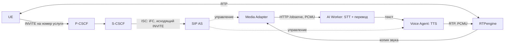

# Туториал 2. Связь IMS и AI

Как вызов попадает в AI (распознавание, перевод, синтез речи, запись), номера
услуг, режимы AI, запуск и проверка. Условие: IMS поднята по
[туториалу 1](guide-1-ims-core.md). SIP-серверы и клиенты — в [туториале 3](guide-3-sip.md).

Команды — из корня репозитория, в активированном `.venv`. Bash-команды на
Windows запускайте в Git Bash.

# Часть 1. Быстрый запуск

| Номер | Услуга |
| --- | --- |
| 1001 / 1002 | Обычные абоненты, вызов без AI |
| 1003 | Перевод RU → EN |
| 1004 | Запись и расшифровка |
| 1005 / 1006 | Двусторонний перевод: русский / английский участник |

## А. Локальный стенд, полный режим с Qwen

**1. Запуск ядра, IMS и AI с проверками звонков**

```bash
./scripts/start.sh
```

Windows: `./scripts/start.ps1`. Первый запуск долгий (образы, Qwen около 2,5 ГБ, Whisper).
Результат: `LOCAL 5G IMS LAB: READY`.

**2. Двусторонний перевод и параллельные вызовы** (по одной)

```bash
python app/tests/integration/check_bidirectional_interpreter.py
python app/tests/integration/check_parallel_calls.py
```

Результат: JSON-отчёт с `"pass": true`, код выхода 0.

## Б. Локальный стенд, лёгкий режим `compact` без Qwen и GPU

**1. Модели перевода OPUS-MT** (один раз; можно на другой машине и перенести `local/models/opus-mt/`)

```bash
python -m pip install uv
uv venv --python 3.11 local/benchmarks/cpu-ai/.venv
uv pip install --python local/benchmarks/cpu-ai/.venv/bin/python ctranslate2==4.8.2 transformers==4.57.6 sentencepiece==0.2.2 torch==2.10.0 --torch-backend cpu
local/benchmarks/cpu-ai/.venv/bin/python scripts/prepare_translation_models.py
```

Windows: `bin/python` → `Scripts/python.exe`.
Результат: `OPUS MODEL READY: ru-en` и `OPUS MODEL READY: en-ru`.

**2. Ядро и IMS без AI**

```bash
python scripts/start_lab.py --base-only
```

Результат: `LOCAL 5G IMS BASE: READY`.

**3. AI в режиме `compact`**

```bash
python scripts/compose_ai.py --mode compact config --quiet
python scripts/compose_ai.py --mode compact build ai-worker voice-agent
python scripts/compose_ai.py --mode compact up -d --build
python scripts/compose_ai.py --mode compact ps
```

Результат: `lab-ai-worker` и `lab-voice-agent` — `healthy`.

**4. Связь IMS и AI** (по одной)

```bash
bash app/tests/integration/verify-ims-call.sh
bash app/tests/integration/verify-voice-agent.sh
```

Результат: `PHASE 4C/4D (DOCKER): PASS` и `PHASE 4E VOICE AGENT (DOCKER): PASS`.

**5. Вызов на запись (1004)**

```bash
docker exec lab-sipue1 sh -lc 'printf "m\nsip:%s@%s\n" "$VOICE_TRANSCRIBER_MSISDN" "$IMS_DOMAIN" > /tmp/pjsua-control'
sleep 15
docker exec lab-sipue1 sh -lc 'printf "ha\n" > /tmp/pjsua-control'
ls local/private/recordings/
```

Результат: каталог вызова с `transcript.txt` и `turn-*.wav`. Нет каталога —
подайте звук вручную ([раздел 5.2](#52-ручной-вызов-услуги-с-эмулятора)).

**6. Вызов на перевод RU → EN (1003)**

```bash
docker exec lab-sipue1 sh -lc 'printf "m\nsip:%s@%s\n" "$VOICE_TRANSLATOR_MSISDN" "$IMS_DOMAIN" > /tmp/pjsua-control'
sleep 15
docker logs --since 1m lab-ai-worker
docker exec lab-sipue1 sh -lc 'printf "ha\n" > /tmp/pjsua-control'
```

Результат: в логе AI Worker — распознанная реплика и перевод.

**7. Остановка** (`-v` не добавлять: удалит тома)

```bash
python scripts/compose_ai.py --mode compact down
```

Результат: контейнеры стенда остановлены, тома сохранены.

Режим (`--mode compact`) указывается в **каждой** команде `compose_ai.py`.
Другие режимы: `balanced`, `minimal`, `baseline` ([раздел 3](#3-режимы-ai)).

## В. Ядро партнёров

Запуск — в [туториале 1, вариант Б](guide-1-ims-core.md#б-ядро-уже-работает-у-партнёров-ставим-только-ims--ai),
шаги 5–6 (IMS, затем AI) и 8 (остановка). Здесь — проверка услуг с телефона партнёров.

**1. Звонки с телефона:** 1003 (перевод RU → EN), 1004 (запись), пара 1005/1006
(двусторонний перевод, два телефона).

**2. Логи и записи**

```bash
docker logs --tail 50 lab-sip-as
docker logs --tail 50 lab-voice-agent
docker logs --tail 50 lab-ai-worker
sudo ls local/private/recordings/
```

Результат: в `lab-sip-as` — `AS terminated INVITE for voice agent`, в
`lab-voice-agent` — `reason=greeting state=sent`; UE слышит приветствие и
перевод; после 1004 — каталог записи (владелец uid 65532, поэтому `sudo`).

`AS rejected unanchored media` — медиа идёт мимо RTPengine, то есть UE обходит
наш P-CSCF; AS отвечает `488` и не соединяет вызов с AI.

# Часть 2. Как устроено

## 1. Как AI встроен в IMS

AI — прикладная услуга **поверх** IMS, вне control plane ядра 5G. Звук он
получает только после того, как IMS допустила вызов и RTPengine закрепил медиа.



| Сервис | Контейнер | Роль |
| --- | --- | --- |
| SIP AS | `lab-sip-as`, `172.22.0.107:5070` | Принимает INVITE от S-CSCF по iFC, выбирает сценарий по номеру, управляет Media Adapter и Voice Agent |
| Media Adapter | `lab-media-adapter` | В сетевом пространстве RTPengine наблюдает копию звука; по Call-ID запрашивает NG-интерфейс RTPengine и связывает порт абонента с сессией; окна по 100 мс |
| AI Worker | `lab-ai-worker`, `172.22.0.109:8092` | Реплики по паузам (VAD), очередь, STT (faster-whisper), перевод (Qwen через Ollama или OPUS-MT), запись транскрипции |
| Voice Agent | `lab-voice-agent`, `172.22.0.110` | Синтез (Piper, запасной eSpeak NG), своя очередь озвучки на каждый вызов, отправка PCMU через RTPengine |
| LLM | `lab-llm-worker` | Ollama с Qwen3-4B; только в `baseline`, только во внутренней сети |

### Как вызов попадает в AI

1. PyHSS хранит для каждого абонента iFC
   ([default_ifc.xml](../../app/infrastructure/vendor/docker_open5gs/pyhss/default_ifc.xml)):
   исходящий (`SessionCase 0`) `INVITE`, приоритет 30, отправляется на
   `sip:as.<IMS_DOMAIN>:<SIP_AS_PORT>`; DNS разрешает `as.<домен>` в `SIP_AS_IP`.
2. `DefaultHandling 0` — продолжить сессию при недоступности AS: **обычный
   разговор продолжается при отказе AI**, услуги AI при этом не работают.
3. SIP AS ([routing.py](../../app/services/sip-as/ims_sip/routing.py)) сравнивает
   номер назначения с номерами услуг: обычный вызов пропускает дальше и только
   включает наблюдение, вызов на номер услуги соединяет с Voice Agent. Offer,
   не заякоренный в RTPengine, отклоняется (`488 Media Must Be Anchored`).
4. RTPengine транскодирует кодек телефона (AMR/AMR-WB) в PCMU для AI-номеров.
   Внутренний формат AI — **PCMU/8000**; это протокольный контракт, одной
   переменной env он не меняется.

### Путь речи по файлам

Пути от `app/services/`:

| Этап | Файл |
| --- | --- |
| SIP и выбор сценария | `sip-as/ims_sip/routing.py` |
| Приём RTP, отправка аудио в AI Worker | `media-adapter/ims_media/` |
| Сборка кадров в реплики по паузам | `ai-worker/ims_ai/segmentation.py` |
| Передача реплики свободному обработчику | `ai-worker/ims_ai/queueing.py` |
| Распознавание и замер времени STT | `ai-worker/ims_ai/utterances.py` |
| Нормализация и сохранение текста | `ai-worker/ims_ai/transcription.py` |
| Перевод или ответ | `ai-worker/ims_ai/replies.py` |
| Озвучка и отправка PCMU | `voice-agent/ims_voice/media.py` |

Каждый сервис — **один процесс**: вызовы, очереди и история в памяти. Разные
вызовы обрабатываются параллельно; после перезапуска сервиса состояние вызовов
не восстанавливается.

## 2. Услуги и номера

Номера задаются в `app/config/lab.env`:

| Номер | Параметр | Что происходит |
| --- | --- | --- |
| 1001 / 1002 | `UE1_MSISDN`, `UE2_MSISDN` | Обычные абоненты, вызов без AI |
| 1003 | `VOICE_TRANSLATOR_MSISDN` | Русская речь звонящего возвращается ему английским голосом |
| 1004 | `VOICE_TRANSCRIBER_MSISDN` | После звукового уведомления речь записывается и расшифровывается |
| 1005 | `VOICE_INTERPRETER_RU_MSISDN` | Русский участник двустороннего перевода |
| 1006 | `VOICE_INTERPRETER_EN_MSISDN` | Английский участник двустороннего перевода |

- Двусторонний перевод — **два отдельных вызова** к сервису (1005 и 1006).
  Каждый участник слышит перевод на своём языке; исходный звук между ними не передаётся.
- Записывается только вызов на 1004 и только после уведомления:

```text
local/private/recordings/<session-id>/
  README.txt          уведомление о приватной записи
  transcript.txt      распознанный текст
  turn-0001.wav       звук реплики
  manifest.jsonl      метаданные: язык, длительность, вид транскрипции
```

## 3. Режимы AI

| Режим | STT (CPU int8) | Перевод | TTS | Назначение |
| --- | --- | --- | --- | --- |
| `baseline` | Whisper small | Qwen3-4B Instruct Q4_K_M (Ollama) | Piper | Эталон; полный набор проверок; LLM-очистка транскрипции, голосовой помощник |
| `balanced` | Whisper small | Два OPUS-MT int8 (RU→EN, EN→RU) | Piper | Меньше памяти, тот же ASR |
| `compact` | Whisper base | OPUS-MT | Piper | Основной вариант для слабого CPU |
| `minimal` | Whisper tiny | OPUS-MT | eSpeak NG | Экспериментальный; заметно хуже распознаёт русский |

| Свойство | `baseline` | `balanced` / `compact` / `minimal` |
| --- | --- | --- |
| GPU | Не нужен (можно включить, [раздел 6](#6-настройка-ai)) | Принудительно отключён `compose_ai.py` |
| Ollama | Запущен | Не запускается (старый останавливается при `up`) |
| Вид транскрипции | `llm_normalized` при успешной нормализации | `raw_asr`, без LLM-очистки |
| Активные голосовые вызовы | Технический предел 100 | Максимум **два** (одна двусторонняя пара) |

Параметры режимов — в [ai-profiles.json](../../app/config/ai-profiles.json).

Замеры компонентов на i5-12400F без GPU, фразы около 6,5 с, медианы:

| Режим | STT RU / EN | OPUS RU→EN / EN→RU | Пик RSS STT + MT |
| --- | --- | --- | --- |
| `balanced` | 2,75 / 2,37 с | 101 / 142 мс | 975 МиБ |
| `compact` | 0,94 / 0,94 с | 102 / 102 мс | 578 МиБ |
| `minimal` | 0,68 / 0,68 с | 199 / 143 мс | 503 МиБ |

Piper (1 поток): 6,5 с звука за 0,52–0,54 с; пик RSS 495 МиБ, с отключённой
ONNX arena — 399 МиБ. Это замеры компонентов, не всего звонка и не бюджет RAM ВМ.

## 4. Запуск

### 4.1. `baseline` с Qwen (локальный стенд)

Команда — [шаг А1](#а-локальный-стенд-полный-режим-с-qwen). Launcher собирает
образы, скачивает Qwen (GGUF около 2,5 ГБ, проверка SHA-256) и Whisper, готовит
синтетические WAV, настраивает абонентов, поднимает сеть и последовательно
выполняет проверки: базовые (`verify.sh`, `verify-ims.sh`,
`verify-ims-registration.sh`) и AI (`verify-ims-call.sh`, `verify-voice-agent.sh`,
`verify-real-ai-stream.sh`, `verify-transcription-recording.sh`,
`verify-bilingual-dialogue.sh`, `verify-security.sh`).
`--skip-verify` (Bash) / `-SkipVerify` (PowerShell) пропускает проверки AI
(базовые выполняются всегда) и даёт `LOCAL 5G IMS LAB: STARTED/UNVERIFIED`.

### 4.2. `compact` без Qwen (локальный стенд)

Команды — [шаги Б1–Б3](#б-локальный-стенд-лёгкий-режим-compact-без-qwen-и-gpu).

- **OPUS-MT (Б1):** Python 3.11 в `local/benchmarks/cpu-ai/.venv` нужен только
  для конвертера моделей, не вместо основного `.venv`. При переносе с другой
  машины нужны оба `manifest.json` (`ru-en`, `en-ru`): без них `compose_ai.py up`
  завершается ошибкой.
- **Первый старт** AI Worker загружает веса Whisper, `healthy` наступает не сразу.
- **Другой режим:** вместо `compact` — `balanced`, `minimal` или `baseline`.
- **Режим в каждой команде** `compose_ai.py`, включая `logs` и `down`.
- Обычный `start.ps1` / `start.sh` возвращает конфигурацию Qwen.
- Смена режима прерывает активные вызовы. Режимы не запускаются рядом: сеть,
  имена контейнеров и тома общие.
- `lab.env` не меняется: скрипт создаёт `local/ai-profiles/<режим>/profile.env`
  и overlay Compose `local/ai-profiles/<режим>/compose.yml`.

### 4.3. Партнёрский вариант (внешнее ядро)

Сначала IMS: `python3 scripts/start_partner.py --ims-only`
([туториал 1, раздел 6](guide-1-ims-core.md#6-вариант-б-подключение-ims--ai--sip-к-уже-работающему-ядру)).
Затем AI одним из способов:

- `baseline`: `python3 scripts/start_partner.py`. Полный запуск перезапускает
  CSCF — телефоны перерегистрируются.
- CPU-режим: подготовить OPUS ([шаг Б1](#б-локальный-стенд-лёгкий-режим-compact-без-qwen-и-gpu)),
  затем команды шага Б3 через `python3` и с `--partner` **в каждой** команде:

```bash
python3 scripts/compose_ai.py --mode compact --partner config --quiet
python3 scripts/compose_ai.py --mode compact --partner build ai-worker voice-agent
python3 scripts/compose_ai.py --mode compact --partner up -d --build
python3 scripts/compose_ai.py --mode compact --partner ps
```

Остановка у партнёров: `compose_ai.py --partner down` останавливает **и IMS**
(весь `compose.partner.yml`). Только AI:

```bash
python3 scripts/compose_ai.py --mode compact --partner stop sip-as media-adapter ai-worker voice-agent
```

## 5. Проверка связи IMS и AI

### 5.1. Автоматические проверки

Запускать **по одной**, на свободном стенде. `verify-voice-agent.sh` завершает
существующие RTP-сессии — не запускайте во время чужого разговора.

| Проверка | Режимы | Что подтверждает |
| --- | --- | --- |
| `verify-ims-call.sh` | все | Вызов UE1 → UE2, S-CSCF вызывает AS по iFC, RTPengine видит оба IMS-адреса, наблюдение AI связано с Call-ID; **при остановке AI счётчики RTP продолжают расти** |
| `verify-voice-agent.sh` | все | Вызов голосового сервиса, приветствие, ACK, RTP, очистка по BYE |
| `verify-real-ai-stream.sh` | `baseline` | Несколько русских реплик через IMS → Whisper → английский перевод → TTS/RTP (имя историческое, streaming не включает) |
| `verify-transcription-recording.sh` | `baseline` | Вызов на 1004, уведомление, запись, LLM-нормализованный текст |
| `check_bidirectional_interpreter.py` | `baseline` | Два языковых вызова (1005/1006), перевод в обе стороны, задержка до RTP |
| `check_parallel_calls.py` | `baseline` | `1 → 2 → 1` одновременных вызовов с разными Call-ID (функциональная, не нагрузочная) |

Все `.sh` лежат в `app/tests/integration/`, запуск — `bash <путь>` (Windows —
Git Bash), `.py` — `python <путь>`.

В `compact` / `balanced` / `minimal` проверки LLM-нормализации не годятся для
raw-транскрипции: они обращаются к Ollama. Принятой последовательности
телефонных проверок для CPU-режимов пока нет.

### 5.2. Ручной вызов услуги с эмулятора

Локальные SIP-клиенты работают без звуковой карты: подают синтетическую речь
из WAV, ответ приходит по RTP клиенту, а не в динамики. Управление PJSUA — через
FIFO `/tmp/pjsua-control` ([туториал 3](guide-3-sip.md#5-sip-клиент-pjsua)).

Позвонить на 1004 — первая команда [шага Б5](#б-локальный-стенд-лёгкий-режим-compact-без-qwen-и-gpu);
в `docker logs --since 1m lab-voice-agent` дождаться `reason=greeting state=sent`.
Затем подать порцию звука и сделать паузу (номера портов — из команды `cl`;
обычно проигрыватель 1, вызов 4):

```bash
docker exec lab-sipue1 sh -lc 'printf "cc\n1\n4\n" > /tmp/pjsua-control'
docker exec lab-sipue1 sh -lc 'printf "cd\n1\n4\n" > /tmp/pjsua-control'
docker logs --since 2m lab-ai-worker
docker exec lab-sipue1 sh -lc 'printf "ha\n" > /tmp/pjsua-control'
```

Для перевода RU → EN — `VOICE_TRANSLATOR_MSISDN` вместо `VOICE_TRANSCRIBER_MSISDN`.

### 5.3. Полный эксперимент с записью

```powershell
./scripts/run-interpreter-experiment.ps1
```

Результат — `local/experiments/<UTC-run-id>/`: четыре полных WAV (пишет PJSUA
на стороне абонента), журналы, метаданные образов, задержки этапов, контрольные
суммы, манифест. Незакоммиченные изменения дают `FAIL`.

### 5.4. Приёмка с внешними UE

1. Обычный вызов работает, S-CSCF вызывает AS по iFC, Media Adapter получает PCMU/8000.
2. Включён выбранный режим AI, оба сервиса `healthy`.
3. RU → EN и EN → RU на двух языковых номерах, перевод слышен у удалённого UE.
4. Вызов на 1004: уведомление, WAV и текст; отмечен вид транскрипции (raw или LLM).
5. При остановленном AI обычный вызов продолжается; после вызова нет висящих сессий.
6. CPU/RAM всей ВМ под нагрузкой, нет OOM и перезапусков; измерено время от
   начала речи до слышимого перевода на втором устройстве.

## 6. Настройка AI

Параметры — в `app/config/lab.env`. После изменения пересоздайте сервис
(`up -d --no-deps --force-recreate <сервис>`), для моделей TTS — также `build`.

| Что менять | Переменные |
| --- | --- |
| STT | `AI_MODEL_SIZE`, `AI_MODEL_REVISION`, `AI_DEVICE`, `AI_COMPUTE_TYPE`, `AI_LANGUAGE`, `AI_STT_*` |
| Границы реплик | `AI_UTTERANCE_*`, `AI_VAD_RMS`, `AI_AUDIO_PREROLL_MS` |
| Очереди и параллельность | `AI_QUEUE_MAX`, `AI_UTTERANCE_QUEUE_MAX`, `AI_PROCESSING_WORKERS`, `VOICE_AGENT_REPLY_QUEUE_MAX`, `LLM_NUM_PARALLEL`, `SERVICE_HTTP_THREADS` |
| LLM | `LLM_MODEL`, `LLM_GGUF_URL`, `LLM_GGUF_SHA256`, `LLM_*PROMPT`, `LLM_TIMEOUT_SECONDS`, `LLM_KEEP_ALIVE`, `LLM_MAX_TOKENS` |
| Перевод OPUS | `AI_TRANSLATION_BACKEND`, `AI_TRANSLATION_THREADS`, `AI_TRANSLATION_BEAM_SIZE` |
| Синтез | `TTS_BACKEND`, `TTS_VOICE`, `TTS_TRANSLATION_VOICE`, `PIPER_*`, `PIPER_LENGTH_SCALE` |
| Запись | `RECORDING_ENABLED`, `RECORDING_RETENTION_DAYS`, `RECORDING_*` |
| Номера услуг | `VOICE_*_MSISDN` |
| Ресурсы | `*_CPU_LIMIT`, `*_MEMORY_LIMIT` |

**Смена LLM** — три значения: `LLM_MODEL`, `LLM_GGUF_URL`, `LLM_GGUF_SHA256`
(пример для Gemma 3 4B — в [local-models.md](../local-models.md)); затем
пересоздать загрузчик, LLM и AI Worker. Проверка: `docker exec lab-llm-worker ollama ps`.

**GPU (NVIDIA)** — только в локальном `local/secrets/ims.env`; нужен NVIDIA
Container Toolkit (Linux) или Docker Desktop/WSL2 с драйвером. CPU-режимы
`compose_ai.py` GPU всегда отключают.

```dotenv
LLM_CONTAINER_RUNTIME=nvidia
LLM_GPU_DEVICES=all
AI_ENABLE_CUDA=1
AI_CONTAINER_RUNTIME=nvidia
AI_GPU_DEVICES=all
AI_DEVICE=cuda
AI_COMPUTE_TYPE=int8_float16
AI_WORKER_MEMORY_LIMIT=4g
```

**Голоса:** Piper `ru_RU-denis-medium` и `en_US-ljspeech-medium`, загружаются при
сборке образа с проверкой SHA-256. Старый голос для сравнения:
`TTS_BACKEND=espeak-ng` и пересоздание `voice-agent`.

## 7. Внутренний контракт IMS ↔ AI

| Часть | Правило |
| --- | --- |
| Медиа | PCMU/8000 RTP. AMR/AMR-WB транскодирует RTPengine на границе AI-номеров; EVS не поддержан |
| `POST /observe` | Окно аудио PCMU (base64), непрозрачные `call_ids`, время, метаданные кодека; **без SIP-идентификаторов абонента** |
| `GET /events` | Метаданные обработки: версии моделей, длительности, число символов, время STT/LLM, статус доставки; без текста реплик и промптов |
| `/healthz` | `204` после прогрева STT и LLM |
| Аутентификация | Внутренний токен, генерируется один раз в приватном Docker-томе; Voice Agent принимает звук только от адреса и пула портов RTPengine |
| Приватность | Аудио перевода — только в памяти; запись — только на 1004 после уведомления; в журналах размеры и длительности, не текст; Ollama — только во внутренней сети |

HTTP — внутренний интерфейс проекта, не интерфейс 3GPP. Стабильного публичного
API «аудио → перевод» нет: подключение чужого Python-модуля требует согласовать
форматы, жизненный цикл Call-ID и токен.

## 8. Задержка и потоковый режим

Обработка пофразовая:

`задержка = длительность фразы + ожидание тишины + очередь + STT + перевод + TTS + доставка`

Поэтому 0,1 с на перевод не равно 0,1 с до ответа: при фразе 6 с цель 1–3 с от
начала речи без потокового режима недостижима; **задержка 1–3 с не подтверждена**.

Потоковый режим (`AI_STREAMING_ENABLED=1`, только 1005/1006) **выключен по
умолчанию и не принят**: в прогонах либо задержка выходила за 1–3 с, либо
терялась полнота текста. Для реальных разговоров не включать;
`compose_ai.py` его всегда отключает. Подробнее — [streaming.md](../streaming.md).

Метрика `speech_end_to_first_rtp_ms` — время до отправки первого RTP перевода, а
не до динамика телефона (без jitter buffer UE). Порог —
`INTERPRETER_MAX_RESPONSE_DELAY_MS` (5000 мс).

## 9. Диагностика

Сначала проверьте обычный вызов: если он не работает, смена модели перевода не поможет.

| Симптом | Что проверить |
| --- | --- |
| AI `unhealthy` | Прогрев, доступность весов Whisper, для OPUS — оба manifest, права mount, лимит RAM |
| После перехода на `compact` снова Qwen | Не запускался ли обычный launcher; режим в каждой команде |
| После смены env ничего не изменилось | `up -d` с пересозданием; для моделей также `build` |
| Нет приветствия на номере услуги | `docker logs lab-sip-as`, iFC абонента, разрешение `as.<домен>` в DNS |
| `AS rejected unanchored media` | UE обходит наш P-CSCF, медиа не через RTPengine |
| Вызов есть, перевода нет | `docker logs lab-media-adapter`, `docker logs lab-ai-worker`: приходят ли окна аудио, распознана ли речь, язык |
| Нет записи после 1004 | Уведомление, поступление речи, логи AI, `RECORDING_ENABLED` |
| Контейнер AI перезапускается | `docker inspect --format '{{.State.OOMKilled}}' lab-ai-worker`, `docker stats --no-stream` |
| Большая задержка | Длительность фразы, тишина, очередь, STT, TTS — перевод лишь один этап |

Журналы: `./scripts/compose.sh logs -f sip-as voice-agent media-adapter ai-worker`
для `baseline`; `python scripts/compose_ai.py --mode compact logs --tail 100 <сервис>`
для CPU-режимов (у партнёров — `python3` и `--partner`). Полный launcher ради
логов не запускать: он меняет стенд.

## 10. Что проверено и что нет

| Проверено | Не проверено |
| --- | --- |
| Обычный IMS-вызов с наблюдением AI; RTP продолжается при остановке AI | Полный SIP-вызов в CPU-режимах |
| Голосовой сервис | Качество перевода на живой речи |
| Несколько реплик RU → EN с озвучкой (`baseline`) | Производительность; задержка до слышимого звука у слушателя |
| Транскодирование AMR/AMR-WB ↔ PCMU в RTPengine | Полный AMR-вызов через IMS и AI |
| Компонентные замеры CPU-режимов, `healthy` в `compact` | Вызов с настоящего телефона |
